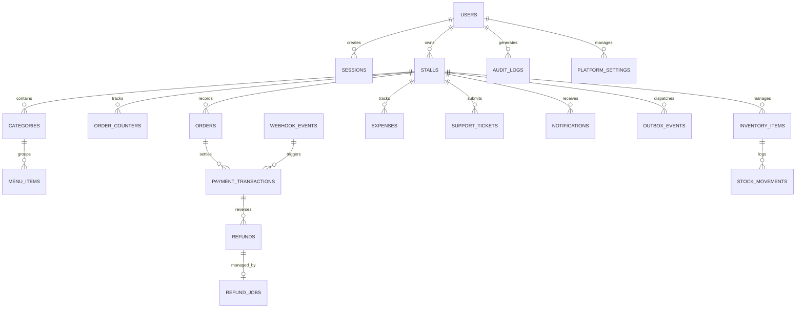
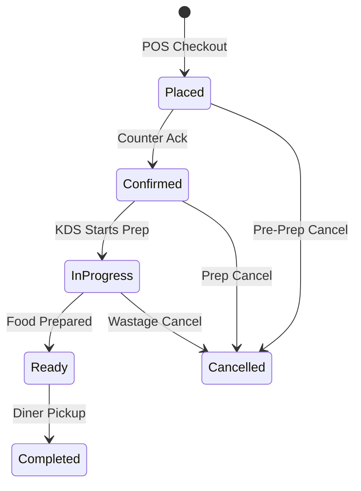
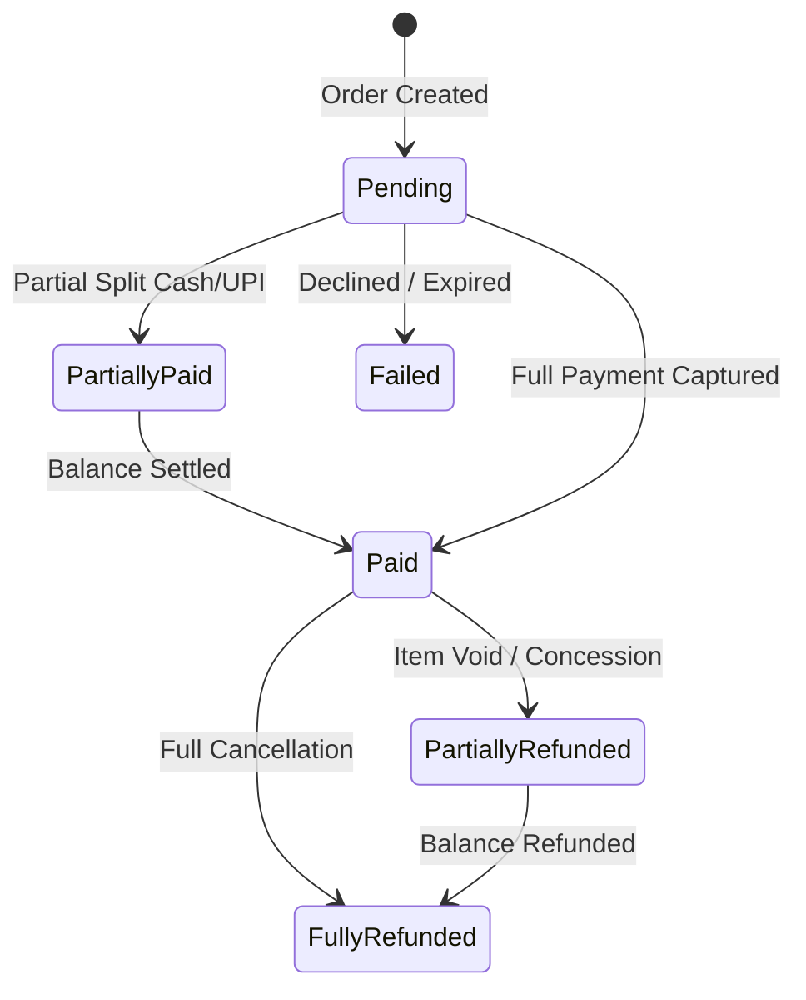
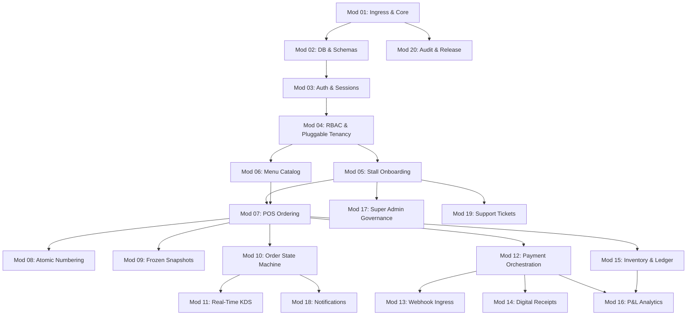

# FoodDesk — Backend Architecture Plan & Technical Implementation Blueprint (Version 10.2.2 — Final Technical Specification & Architecture Freeze)

---

## Document Control & Version History

| Attribute | Specification |
| :--- | :--- |
| **Document Title** | FoodDesk Backend Architecture Planning, Implementation Roadmap & Technical Validation |
| **File Location** | `D:\Projects\FoodDesk\BACKEND_IMPLEMENTATION_PLAN_V10.md` |
| **Target Version** | Version 10.2.2 (Final Technical Specification & Architecture Baseline Freeze) |
| **Author** | Principal Software Architect, Application Security Auditor, Database Systems Engineer & Financial Systems Auditor |
| **Status** | **APPROVED FOR IMPLEMENTATION (PHASES 1–5 UNCONDITIONALLY UNBLOCKED; PHASE 6 CONDITIONALLY APPROVED)** |
| **Classification** | Authoritative System Architecture Specification & Algorithmic Blueprint (Documentation Only) |
| **Direct Predecessors** | `BACKEND_IMPLEMENTATION_PLAN_V10.md` (v10.1), `BACKEND_PLAN_V10_FINAL_REVIEW.md` |

---

## Table of Contents

1. [Executive Summary & Controlling Authority](#1-executive-summary--controlling-authority)
2. [Verified Product Scope & Controlling Source Inspection](#2-verified-product-scope--controlling-source-inspection)
3. [Roles, Permissions & Stall Operational Lifecycle Matrix](#3-roles-permissions--stall-operational-lifecycle-matrix)
4. [Tenant Identifier Architecture, Dual-Identifier Standards & Canonical Tenant Context](#4-tenant-identifier-architecture-dual-identifier-standards--canonical-tenant-context)
5. [Backend Technology Stack & Technical Justification](#5-backend-technology-stack--technical-justification)
6. [System Layering & Global Ingress Pipeline](#6-system-layering--global-ingress-pipeline)
7. [Database Architecture & Complete Schema Specifications (All 19 Canonical Collections)](#7-database-architecture--complete-schema-specifications-all-19-canonical-collections)
8. [Consolidated Entity Relationship Diagram (ERD) & Field-to-Index Matrix](#8-consolidated-entity-relationship-diagram-erd--field-to-index-matrix)
9. [Decoupled Order and Payment State Machines](#9-decoupled-order-and-payment-state-machines)
10. [Payment Settlement, Mutex Concurrency & Duplicate Capture Prevention](#10-payment-settlement-mutex-concurrency--duplicate-capture-prevention)
11. [Durable Payment Reversals & Complete Refund Worker Lifecycle](#11-durable-payment-reversals--complete-refund-worker-lifecycle)
12. [Decoupled Webhook Architecture & Independent Recovery Worker](#12-decoupled-webhook-architecture--independent-recovery-worker)
13. [Comprehensive Financial Accounting, Formulas & Five Reconciled Numerical Worked Examples](#13-comprehensive-financial-accounting-formulas--five-reconciled-numerical-worked-examples)
14. [Authentication, Versioned Keyring Rotation & Multi-Device Security](#14-authentication-versioned-keyring-rotation--multi-device-security)
15. [Public Order Tracking, Digital SMS Receipts & Ingress Privacy](#15-public-order-tracking-digital-sms-receipts--ingress-privacy)
16. [Atomic Order Numbering, Timezone-Aware Business Dates & Monotonic Gap Policy](#16-atomic-order-numbering-timezone-aware-business-dates--monotonic-gap-policy)
17. [Inventory Management, Milliprecision, Concurrency & Partial Unique Index Idempotency](#17-inventory-management-milliprecision-concurrency--partial-unique-index-idempotency)
18. [Reliable Real-Time Architecture (Transactional Outbox Worker & Delivery Guarantees)](#18-reliable-real-time-architecture-transactional-outbox-worker--delivery-guarantees)
19. [Tenant Isolation, Dual-Mode Middleware Enforcement & Security Boundaries](#19-tenant-isolation-dual-mode-middleware-enforcement--security-boundaries)
20. [Structured Audit Logging, System Actor Representation & Tamper Resistance](#20-structured-audit-logging-system-actor-representation--tamper-resistance)
21. [API Design Standards & Contract Response Envelopes](#21-api-design-standards--contract-response-envelopes)
22. [Frontend Integration Contract Matrix (Zero UI Modifications)](#22-frontend-integration-contract-matrix-zero-ui-modifications)
23. [Canonical Module-Wise Implementation Blueprint (Modules 01 - 20)](#23-canonical-module-wise-implementation-blueprint-modules-01---20)
24. [Background Worker & Operational Infrastructure Specification](#24-background-worker--operational-infrastructure-specification)
25. [Testing & Quality Assurance Framework](#25-testing--quality-assurance-framework)
26. [Canonical Module Dependency Matrix & Phased Implementation Roadmap](#26-canonical-module-dependency-matrix--phased-implementation-roadmap)
27. [Deployment Infrastructure, Environments & Operational Complexity](#27-deployment-infrastructure-environments--operational-complexity)
28. [Consolidated Decision Register & Implementation Gates Summary](#28-consolidated-decision-register--implementation-gates-summary)

---

## 1. Executive Summary & Controlling Authority

This document defines the **definitive Version 10.2.2 backend architecture** for the FoodDesk platform.

Version 10.2.2 establishes the definitive, frozen technical specification incorporating all cumulative technical defect resolutions from DEF-01 through DEF-58:
- **DEF-50 (Explicit Gateway Capture Identity Matching & Provider Requirements):** Implements provider-specific identifier matching rules (`GATEWAY_PROVIDER_REGISTRY`) that distinguish mandatory identifiers (`gatewayPaymentId`) from optional identifiers (`gatewayOrderId`, `gatewayCaptureId`). Enforces strict normalized equality when identifiers are present on both sides, rejects asymmetric identifier presence as a collision conflict to prevent false matches, applies provider-specific capture coincidence policies (e.g. Razorpay auto-capture coincidence), and cleanly separates verified Case A capture replays from Case B distinct captures with excess refund automation.
- **DEF-51 (Complete Legacy Payment Fingerprint Validation & Atomic Backfill):** Enforces symmetric validation across pre-transaction and in-transaction idempotency checks. For legacy records lacking a stored `requestFingerprint`, validates every material parameter (`stallObjectId`, `orderId`, `amountPaise`, `paymentMethod`, and normalized gateway fields) before atomically backfilling the SHA-256 fingerprint; detects concurrent backfills and re-verifies stored fingerprints to prevent false successful replays.
- **DEF-52 (Fine-Grained Gateway Duplicate-Key E11000 Collision Recovery):** Handles MongoDB unique index collisions deterministically by inspecting `err.keyPattern` across idempotency keys, gateway payment IDs, and order payment attempt counters.
- **DEF-53 (Worker Schema & Timestamp Consistency):** Synchronizes schema declarations with worker update operations by declaring `completedAt: { type: Date, default: null }` in `RefundJobSchema` (Collection 10) and `processedAt: { type: Date, default: null }` in `WebhookEventSchema` (Collection 17).
- **DEF-54 (Deterministic Order Synchronization with Fixed Upper Watermark):** Implements `GET /api/v1/orders/sync` with a session-fixed synchronization high-watermark (`syncWatermark`), composite cursor `(updatedAt, _id)`, strict tie-breaking, compound index `OrderSchema.index({ stallObjectId: 1, updatedAt: 1, _id: 1 })`, explicit 30-day cursor expiry returning HTTP 410 Gone, and robust client advancement rules.
- **DEF-55 (Architecture Baseline Freeze & Document Integrity):** Eliminates duplicate section insertions, aligns all document headers and references uniformly to Version 10.2.2, and codifies the six separated approval gates.
- **DEF-56 (Mandatory Explicit Gateway Provider & Schema Default Removal):** Eliminates implicit Razorpay defaulting across all layers: removes the function parameter default in `settleOrderPayment()` (`gatewayProvider = null`) and corrects the schema default in `PaymentTransactionSchema` to `gatewayProvider: { type: String, default: null }`. Requires an explicitly supplied, non-empty, recognized and configured provider for every non-cash payment (`paymentMethod !== 'cash'`). Missing, empty, or whitespace-only providers immediately throw a controlled HTTP 400 `ValidationError` before database session acquisition, request fingerprinting, or database mutation. Cash transactions strictly normalize all gateway fields to `null` and bypass provider requirements.
- **DEF-57 (Dual-Layer Validation Architecture & Dynamic Mongoose Hook):** Formulates two independent validation boundaries: Service-Level Validation (at `settleOrderPayment()` Step 1 prior to session acquisition) and Schema-Level Validation (in `PaymentTransactionSchema.pre('validate')` prior to persistence). Because the schema default is strictly `null`, omitted providers remain `null` upon instantiation and are reliably rejected for captured digital transactions. Dynamically enforces all `mandatoryIdentifiers` declared in `GATEWAY_PROVIDER_REGISTRY`, while preserving cash validity with `null` gateway fields.
- **DEF-58 (Extended Architectural Test Specifications & Test Fixture Wiring):** Extends Section 10.3 architectural test specifications to 16 formal scenarios: retains TS-PAY-01 to TS-PAY-13; fully specifies the test-harness wiring for TS-PAY-14 using an ephemeral test-only fixture (`test_gateway`) temporarily registered on `GATEWAY_PROVIDER_REGISTRY` in an isolated serial test context, verifying both service-level and direct schema-level rejection when mandatory identifiers are omitted, followed by guaranteed `try/finally` cleanup and post-cleanup registry verification; and adds two direct schema-level validation tests: TS-PAY-15 (Direct Schema Test A: missing provider at schema level fails validation without defaulting to Razorpay) and TS-PAY-16 (Direct Schema Test B: cash transaction without gateway details succeeds validation with null gateway fields). All test cases represent formal architectural specifications with zero automated tests executed.

### Explicit Scope & Implementation Boundary
- **Documentation Only:** Exactly zero lines of backend source code have been implemented. Zero files in `frontend/` have been altered.
- **Specification vs. Code Implementation:** All schemas, pseudocode algorithms, state machine definitions, and test manifests represent authoritative **architectural specifications**. No automated backend test suites have been executed.

---

## 2. Verified Product Scope & Controlling Source Inspection

### 2.1. Controlling Authority Hierarchy & Canonical Product Scope
1. **Canonical Product-Scope Statement:**
   > *"FoodDesk is a flexible Point of Sale (POS), order management, payment tracking, and business analytics platform that supports both single-stall and multi-stall businesses. Stall owners can choose to operate a single stall or manage multiple stalls under one account, according to their business requirements."*

2. **`PRD.txt` Controlling Source Evidence:**
   - Section Overview Line 12 explicitly mandates: *"This is not merely a food delivery application. It is a Multi-stall Point of Sale (POS), order management, payment tracking, and business analytics platform designed to simplify daily operations for individual food stall owners."*
   - Section 2 specifies the **Super Admin** role with platform-wide visibility and stall onboarding governance (*"Review, approve, reject, suspend, and manage stall profiles"*).
   - Section 3B mandates stall profile registration, status workflows (`pending_approval`, `active`, `suspended`), and independent Super Admin activation (*"If an existing stall owner registers another stall, the new stall profile must undergo a separate approval process without affecting their already approved stalls"*).
   - Section 14 mandates that every data document carries a `stallId` field and that an Owner can operate multiple food stalls under one account.
   - Section 19 mandates stall-level data isolation, dedicated digital menus, and independent daily sequence counters (`#001` per stall per business day).

3. **`IMPLEMENTATION_PLAN.md` & Frontend Alignment:**
   - `IMPLEMENTATION_PLAN.md` Line 6 confirms: *"FoodDesk is a multi-tenant Point of Sale (POS), billing, payment tracking, and financial analytics platform engineered specifically for walk-in food stalls, kiosks, and quick-service food shops."*
   - The React 18 client (`frontend/src/`) implements `user.authorizedStalls` in `mockAuthService.js` and stall switching in `StallContext.jsx`.

### 2.2. Product Scope: Owner-Selectable Operating Models (Single-Stall & Multi-Stall)

FoodDesk explicitly supports both **Single-Stall** and **Multi-Stall** businesses as first-class operational models. Stall owners choose and manage their operating model according to their commercial scale and business requirements:

1. **Business Operating Model (Owner Choice):**
   - **Single-Stall Business Model (Independent Stall / Food Truck / Standalone Kiosk):**
     - Designed for individual food stall entrepreneurs and small business owners who operate exactly one stall under their account.
     - **Onboarding & Operational Workflow:** The owner registers their account, completes email/phone verification, creates their single stall profile, and awaits Super Admin approval per PRD §3B.
     - **Streamlined Counter Experience:** Once approved and active, the POS terminal, Kitchen Display System (KDS), inventory ledger, and P&L analytics lock directly into this primary stall context. Counter staff and cashiers experience zero multi-tenant UI friction, complex stall dropdowns, or operational stall-switching overhead.
   - **Multi-Stall Business Model (Food Court / Multi-Outlet Chain / Multi-Brand Cloud Kitchen):**
     - Designed for entrepreneurs operating multiple food court counters, multi-brand cloud kitchens, or a growing chain of kiosks under a single corporate management structure.
     - **Onboarding & Approval Workflow:** Under their verified account, the owner can register additional stall profiles at any time. In strict compliance with PRD §3B (*"If an existing stall owner registers another stall, the new stall profile must undergo a separate approval process without affecting their already approved stalls"*), each stall profile undergoes independent review and approval by the Super Admin.
     - **Unified Multi-Stall Management:** The frontend context maintains `user.authorizedStalls` (`mockAuthService.js`). The owner dashboard provides an intuitive stall switcher (`StallContext.jsx`), allowing the owner to seamlessly switch operational context between approved stalls while the backend guarantees strict stall-level data isolation across digital menus, daily order counters (`#001` per stall per day), payment transactions, inventory stock, and financial reports.

2. **Strict Tenant Isolation & Super Admin Governance Invariants:**
   - Regardless of whether an owner operates one stall or multiple stalls, **strict tenant data boundaries are preserved across all 19 collections** via canonical `stallObjectId` indexing. Operational data, inventory movements, and revenue records from Stall A can never bleed into Stall B.
   - **Super Admin Governance:** Super Admins govern the platform at the individual stall profile level—reviewing, approving, suspending, or archiving each stall independently of the owner's user account status.

3. **Infrastructure Deployment Mode (Distinct from Business Model):**
   - **Multi-Tenant Cloud SaaS Deployment (`SINGLE_STALL_MODE=false`, Default):** Standard cloud deployment hosting multiple owners and multiple stalls across tenants with dynamic `req.tenantContext` resolution via route headers or parameters.
   - **Dedicated Standalone Appliance Deployment (`SINGLE_STALL_MODE=true`):** Special hardware configuration for dedicated, air-gapped on-premise hardware (e.g. counter POS terminal / local mini-PC) bound strictly to `DEFAULT_STALL_ID`. If `DEFAULT_STALL_ID` is unset or invalid, the backend fails to start. Preserves identical database schemas, foreign keys, and indexes without introducing architectural code forks.

---

## 3. Roles, Permissions & Stall Operational Lifecycle Matrix

### 3.1. Centralized Action-Based Authorization Matrix (DEF-29 Fix)

```
┌─────────────────────────────────┬─────────────┬─────────────┬─────────────┐
│ Action Key                      │ Super Admin │ Stall Owner │ Stall Staff │
├─────────────────────────────────┼─────────────┼─────────────┼─────────────┤
│ stall:create                    │ YES         │ YES         │ NO          │
│ stall:approve / reject          │ YES         │ NO          │ NO          │
│ stall:suspend / reactivate      │ YES         │ NO          │ NO          │
│ stall:inspect_admin             │ YES         │ NO          │ NO          │
│ platform:view_metrics           │ YES         │ NO          │ NO          │
│ platform:update_settings        │ YES         │ NO          │ NO          │
│ stall:view_profile              │ YES         │ YES         │ YES (Active)│
│ stall:update_settings           │ YES         │ YES         │ NO          │
│ menu:view                       │ NO*         │ YES (Active)│ YES (Active)│
│ menu:manage                     │ NO*         │ YES (Active)│ NO          │
│ inventory:view                  │ NO*         │ YES (Active)│ YES (Active)│
│ inventory:adjust                │ NO*         │ YES (Active)│ YES (Active)│
│ order:create (POS Checkout)     │ NO*         │ YES (Active)│ YES (Active)│
│ order:view                      │ NO*         │ YES (Active)│ YES (Active)│
│ order:update_status (KDS)       │ NO*         │ YES (Active)│ YES (Active)│
│ payment:collect                 │ NO*         │ YES (Active)│ YES (Active)│
│ reports:view_financials         │ YES         │ YES         │ NO          │
│ tickets:manage                  │ YES         │ YES         │ NO          │
│ notifications:view              │ YES         │ YES         │ YES (Active)│
└─────────────────────────────────┴─────────────┴─────────────┴─────────────┘
*Note: Super Admin cannot perform ordinary counter POS or kitchen operations on behalf of a stall unless holding an explicit staff assignment. Unknown actions are DENIED by default.
```

### 3.2. Stall Operational Status Matrix

```
┌──────────────────┬──────────────────────┬──────────────────────┬──────────────────────┐
│ Stall Status     │ Super Admin Access   │ Stall Owner Access   │ Stall Staff Access   │
├──────────────────┼──────────────────────┼──────────────────────┼──────────────────────┤
│ pending_approval │ View, Approve, Reject│ View Profile, Edit   │ BLOCKED (403)        │
│                  │                      │ Settings. POS BLOCKED│                      │
├──────────────────┼──────────────────────┼──────────────────────┼──────────────────────┤
│ active           │ Full Administrative  │ Full Operational &   │ Full Operational     │
│                  │ Inspection & Support │ Financial Control    │ (POS, Orders, KDS)   │
├──────────────────┼──────────────────────┼──────────────────────┼──────────────────────┤
│ suspended        │ Audit, Reactivate,   │ Read-Only Reports &  │ BLOCKED (423 Locked) │
│                  │ Support Tickets      │ Support Tickets only.│ All operations       │
│                  │                      │ POS BLOCKED (423)    │ disabled             │
├──────────────────┼──────────────────────┼──────────────────────┼──────────────────────┤
│ inactive         │ Audit, Archive       │ BLOCKED (410 Gone)   │ BLOCKED (410 Gone)   │
└──────────────────┴──────────────────────┴──────────────────────┴──────────────────────┘
```

---

## 4. Tenant Identifier Architecture, Dual-Identifier Standards & Canonical Tenant Context

### 4.1. Standardized Dual Identifiers
1. **`stallId` (Public Business Identifier / Slug):**
   - Type: `String` (e.g., `"stall-1"`, `"fast-food"`).
   - Scope: Client request headers (`X-Stall-Id`), URL route parameters, printed diner receipts, and diner tracking URLs.
2. **`stallObjectId` (Internal Primary / Foreign Key):**
   - Type: `Schema.Types.ObjectId` (referencing `stalls._id`).
   - Scope: Primary foreign key across all internal database collections, compound unique indexes, and repository queries.

### 4.2. Canonical Tenant Context Object (`req.tenantContext`)
```typescript
interface TenantContext {
  stallObjectId: mongoose.Types.ObjectId;
  stallId: string;
  stallName: string;
  roleInStall: 'owner' | 'staff' | 'super_admin';
  isSuperAdmin: boolean;
  status: 'pending_approval' | 'active' | 'suspended' | 'inactive';
  timezone: string;
  businessDayCutoffHour: number;
  currency: string;
  taxConfig: {
    status: 'disabled' | 'inclusive' | 'exclusive';
    defaultTaxRatePercent: number;
    gstin?: string;
  };
}
```

---

## 5. Backend Technology Stack & Technical Justification

| Layer | Technology | Version Spec | Justification |
| :--- | :--- | :--- | :--- |
| **Runtime** | Node.js | `>=24.0.0 <27.0.0` | Primary production & CI target: Node.js 26.x Active LTS; secondary compatibility target: Node.js 24.x Maintenance LTS. Native WebCrypto, high-throughput I/O, V8 optimizations, and stable fetch API. Node.js <=20 strictly prohibited (EOL April 30, 2026). |
| **Language** | TypeScript | `^5.6.3` | Compile-time type safety, strict null checking, and robust interface definitions. |
| **Framework** | Express.js | `^4.21.1` | Predictable HTTP pipeline with unopinionated middleware chaining. |
| **Database** | MongoDB | `>=7.0` | Multi-document ACID transactions, partial unique indexes, and high-performance querying. |
| **ODM** | Mongoose | `^8.8.1` | Type-safe schema validation, pre/post middleware hooks, and connection pooling. |
| **In-Memory** | Redis | `>=7.2` | Distributed caching, pub/sub for Socket.IO adapter, and token grace-period caching. |
| **Real-Time** | Socket.IO | `^4.8.1` | Reliable bidirectional WebSocket messaging with room-based broadcast isolation. |
| **Validation** | Zod | `^3.23.8` | Declarative, runtime request/response payload schema validation. |
| **Security** | Node.js `crypto`| Native | FIPS-compliant constant-time HMAC verification (`timingSafeEqual`) and AES-256-GCM. |

### 5.1. Node.js Runtime Policy, Engine Specifications & Dependency Compatibility Assessment

#### 5.1.1. Supported Major Version & LTS Lifecycle Policy (as of November 17, 2026)
- **Primary Production & CI Target:** **Node.js 26.x Active LTS** (target runtime for production containers, staging environments, and CI release builds).
- **Secondary Compatibility Target:** **Node.js 24.x Maintenance LTS** (supported secondary runtime for local development and host compatibility).
- **Prohibited Runtimes:** **Node.js 20 and earlier** (`<=20.x`) are strictly prohibited in all development, CI, staging, and production environments (Node.js 20 reached official End-of-Life on April 30, 2026 and no longer receives security updates).
- **Docker Production Baseline:** `node:26-alpine` (standardized across Dockerfiles and container deployment).
- **Continuous Integration (CI):** GitHub Actions matrix: `node-version: [24.x, 26.x]`, with release deployment gated strictly on `26.x`.

#### 5.1.2. Package Engine Requirements (`backend/package.json`)
The package engine declaration enforces the supported bounded major version range (`>=24.0.0 <27.0.0`) rather than an open-ended constraint:
```json
{
  "engines": {
    "node": ">=24.0.0 <27.0.0",
    "npm": ">=10.0.0"
  }
}
```

#### 5.1.3. Dependency Compatibility Assessment & Implementation Verification Boundary
This is a documentation-only architectural blueprint. In accordance with strict evidence discipline, the system explicitly distinguishes between **architectural compatibility assessed from upstream package engine declarations** and **repository-level verification executed against actual project manifests and test runners**:

- **Architectural Upstream Engine Assessment:**
  Every specified backend dependency was assessed against published upstream package engine metadata and documented Node.js runtime compatibility:
  - **TypeScript (`^5.6.3` / `^5.7.0`):** Compiles to ECMAScript standard modules (ES2022/NodeNext). Upstream engine `node: ">=14.17"`. Pure tooling with zero native C++ bindings; assessed compatible with Node.js 24.x and 26.x.
  - **Express.js (`^4.21.1` / `^5.0.1`):** Upstream engines `node: ">= 0.10.0"` (v4) / `node: ">= 18"` (v5). Pure JavaScript HTTP request/response pipeline over native `node:http`; assessed compatible with Node.js 24.x and 26.x.
  - **Mongoose (`^8.8.1`):** Upstream engine `node: ">=16.20.1"`. Assessed compatible with Node.js 24.x and 26.x.
  - **MongoDB Node.js Driver (`^6.10.0`):** Upstream engine `node: ">=16.20.1"`. Pure BSON parser fallback with optional native bindings; multi-document transaction and replica set session APIs assessed compatible with Node.js 24.x and 26.x.
  - **Redis Client (`ioredis ^5.4.1` / `redis ^4.7.0`):** Upstream engines `node: ">= 12.22"` (`ioredis`) and `node: ">=14"` (`redis`). Pure JavaScript RESP protocol handling over standard sockets; assessed compatible with Node.js 24.x and 26.x.
  - **Socket.IO (`^4.8.1`):** Upstream engine `node: ">=10.0.0"`. Standard WebSocket protocol; assessed compatible with Node.js 24.x and 26.x.
  - **Zod (`^3.23.8`):** Pure TypeScript/JavaScript runtime type validator with zero external dependencies; universal Node.js compatibility assessed.
  - **Vitest (`^2.1.4`):** Upstream engine `node: "^18.0.0 || >=20.0.0"`. Node.js 24.x and 26.x satisfy `>=20.0.0`; assessed compatible.
  - **Supertest (`^7.0.0`):** Upstream engine `node: ">=14.18.0"` (via `superagent`). Pure JavaScript HTTP test assertion client; assessed compatible.
  - **Native Node.js `crypto` & WebCrypto:** Built-in OpenSSL 3.x backend. Constant-time HMAC comparison (`timingSafeEqual`), AES-256-GCM (`createCipheriv`), and CSPRNG UUID generation (`randomUUID`) execute natively across Node.js 24.x and 26.x.
  - **In-Memory Testing (`mongodb-memory-server ^9.4.0` / `^10.0.0`):** Upstream engine `node: ">=16.13.0"`. Downloads precompiled MongoDB binaries and orchestrates child processes without ABI friction; assessed compatible.

- **Pending Implementation Verification:**
  Because backend code implementation has not yet begun (exactly zero lines of backend code currently exist, and `backend/package.json`, `package-lock.json`, and `.github/workflows/ci.yml` have not yet been created in the repository), live repository-level package manifest resolution, lockfile audit, build artifact generation, and automated test execution have not yet occurred. These verification steps are formally cataloged as **Pending Implementation Verification** to be executed during Phase 1 (Module 01/02 scaffolding) verification gates.

---

## 6. System Layering & Global Ingress Pipeline

The backend implements a strict 4-tier layered architecture:
```
[HTTP Request / WebSocket Frame]
              │
              ▼
    [Ingress Middleware]  ───> (RateLimiter, SecurityHeaders, RequestId, AuthMiddleware, TenantMiddleware)
              │
              ▼
     [Controller Layer]   ───> (Zod Validation, HTTP Enveloping, Response Formatting - NO DB QUERIES)
              │
              ▼
       [Service Layer]    ───> (Business Logic, Financial Invariants, ACID Transactions, Outbox Events)
              │
              ▼
     [Repository / DB]    ───> (Mongoose Models, Atomic Updates, Indexes, Replica Set Sessions)
```

### 6.1. Express Pipeline Order & Webhook Raw Body Middleware (DEF-49 Specifications)
```javascript
// Express Application Ingress Setup (app.js):
// 1. Webhook ingress route MUST be mounted with express.raw() BEFORE global express.json()
app.use(
  '/api/v1/webhooks/razorpay',
  express.raw({ type: 'application/json', limit: '100kb' }),
  webhookRouter
);

// 2. Global JSON and URL-encoded body parsers mounted for all other standard application routes
app.use(express.json({ limit: '1mb' }));
app.use(express.urlencoded({ extended: true }));
```
> [!IMPORTANT]
> **Explicit Middleware Ordering (DEF-49):** Mounting `express.raw({ type: 'application/json', limit: '100kb' })` exclusively on the webhook ingress route prior to `express.json()` prevents the global JSON parser from consuming or mutating the raw Buffer stream before HMAC signature verification.

---

## 7. Database Architecture & Complete Schema Specifications (All 19 Canonical Collections)

The database consists of **19 canonical collections**:
- **14 Tenant-Owned Collections:** Scoped by `stallObjectId` and `stallId`.
- **5 Platform-Wide / System Collections:** Governed by Super Admin and system background workers.

---

### Collection 1: `users` (Platform-Wide)
- **Mongoose Model:** `User`
```javascript
const UserSchema = new Schema({
  name: { type: String, required: true, trim: true },
  email: { type: String, required: true, unique: true, lowercase: true, trim: true, index: true },
  passwordHash: { type: String, required: true },
  role: { type: String, required: true, enum: ['super_admin', 'stall_owner', 'staff'], default: 'stall_owner' },
  authorizedStalls: [{ type: String, trim: true }],
  assignedStallObjectId: { type: Schema.Types.ObjectId, ref: 'Stall', default: null, index: true },
  assignedStallId: { type: String, default: null },
  tokenVersion: { type: Number, default: 0 },
  isSuperAdmin: { type: Boolean, default: false },
  isActive: { type: Boolean, default: true, index: true },
  lastLoginAt: { type: Date, default: null }
}, { timestamps: true });
```

---

### Collection 2: `sessions` (Platform-Wide)
- **Mongoose Model:** `Session`
```javascript
const SessionSchema = new Schema({
  userId: { type: Schema.Types.ObjectId, ref: 'User', required: true, index: true },
  stallObjectId: { type: Schema.Types.ObjectId, ref: 'Stall', default: null, index: true },
  stallId: { type: String, default: null },
  refreshTokenHash: { type: String, required: true, unique: true, index: true },
  generation: { type: Number, required: true, default: 1 },
  tokenVersion: { type: Number, required: true, default: 0 },
  previousRefreshTokenHash: { type: String, default: null },
  encryptedActiveToken: {
    keyVersion: { type: Number, required: true, default: 1 },
    iv: { type: String, default: null },
    tag: { type: String, default: null },
    ciphertext: { type: String, default: null }
  },
  gracePeriodExpiresAt: { type: Date, default: null },
  sessionExpiresAt: { type: Date, required: true },
  expiresAt: { type: Date, required: true, index: { expires: 0 } },
  deviceInfo: {
    ipAddress: { type: String, default: 'unknown' },
    userAgent: { type: String, default: 'unknown' },
    terminalId: { type: String, default: null }
  },
  isRevoked: { type: Boolean, default: false, index: true },
  revokedAt: { type: Date, default: null },
  revocationReason: { type: String, default: null },
  lastUsedAt: { type: Date, default: Date.now }
}, { timestamps: true });

SessionSchema.index({ userId: 1, isRevoked: 1 });
SessionSchema.index({ previousRefreshTokenHash: 1 }, { sparse: true });
```

---

### Collection 3: `stalls` (Tenant Master)
- **Mongoose Model:** `Stall`
```javascript
const StallSchema = new Schema({
  stallId: { type: String, required: true, unique: true, lowercase: true, trim: true, index: true },
  name: { type: String, required: true, trim: true },
  description: { type: String, default: '' },
  ownerUserId: { type: Schema.Types.ObjectId, ref: 'User', required: true, index: true },
  status: { type: String, enum: ['pending_approval', 'active', 'suspended', 'inactive'], default: 'active', index: true },
  timezone: { type: String, default: 'Asia/Kolkata', trim: true },
  businessDayCutoffHour: { type: Number, default: 0, min: 0, max: 12 },
  currency: { type: String, default: 'INR' },
  taxConfig: {
    status: { type: String, enum: ['disabled', 'inclusive', 'exclusive'], default: 'disabled' },
    defaultTaxRatePercent: { type: Number, default: 0.0, min: 0, max: 100 },
    gstin: { type: String, default: null }
  },
  settings: {
    orderNumberPrefix: { type: String, default: '#' },
    lowStockThresholdDefault: { type: Number, default: 10 },
    enableSoundAlerts: { type: Boolean, default: true }
  }
}, { timestamps: true });

StallSchema.index({ ownerUserId: 1, status: 1 });
```

---

### Collection 4: `categories` (Tenant-Owned)
- **Mongoose Model:** `Category`
```javascript
const CategorySchema = new Schema({
  stallObjectId: { type: Schema.Types.ObjectId, ref: 'Stall', required: true, index: true },
  stallId: { type: String, required: true },
  name: { type: String, required: true, trim: true },
  description: { type: String, default: '' },
  displayOrder: { type: Number, default: 0 },
  isActive: { type: Boolean, default: true, index: true }
}, { timestamps: true });

CategorySchema.index({ stallObjectId: 1, name: 1 }, { unique: true });
CategorySchema.index({ stallObjectId: 1, displayOrder: 1 });
```

---

### Collection 5: `menu_items` (Tenant-Owned)
- **Mongoose Model:** `MenuItem`
```javascript
const MenuItemSchema = new Schema({
  stallObjectId: { type: Schema.Types.ObjectId, ref: 'Stall', required: true, index: true },
  stallId: { type: String, required: true },
  categoryId: { type: Schema.Types.ObjectId, ref: 'Category', required: true, index: true },
  name: { type: String, required: true, trim: true },
  description: { type: String, default: '' },
  pricePaise: { type: Number, required: true, min: 0 },
  costPricePaise: { type: Number, default: 0, min: 0 },
  taxRatePercent: { type: Number, default: null },
  isAvailable: { type: Boolean, default: true, index: true },
  imageUrl: { type: String, default: null },
  isDeleted: { type: Boolean, default: false, index: true }
}, { timestamps: true });

MenuItemSchema.index({ stallObjectId: 1, categoryId: 1, isAvailable: 1 });
```

---

### Collection 6: `order_counters` (Tenant-Owned)
- **Mongoose Model:** `OrderCounter`
```javascript
const OrderCounterSchema = new Schema({
  stallObjectId: { type: Schema.Types.ObjectId, ref: 'Stall', required: true, index: true },
  stallId: { type: String, required: true },
  businessDate: { type: String, required: true, index: true },
  seq: { type: Number, default: 0, min: 0 }
}, { timestamps: true });

OrderCounterSchema.index({ stallObjectId: 1, businessDate: 1 }, { unique: true });
```

---

### Collection 7: `orders` (Tenant-Owned)
- **Mongoose Model:** `Order`
```javascript
const OrderItemSubdoc = new Schema({
  menuItemId: { type: Schema.Types.ObjectId, ref: 'MenuItem', required: true },
  nameSnapshot: { type: String, required: true },
  unitPricePaise: { type: Number, required: true, min: 0 },
  unitCostPaise: { type: Number, required: true, default: 0, min: 0 },
  quantity: { type: Number, required: true, min: 1 },
  taxRatePercentSnapshot: { type: Number, required: true, default: 0 },
  taxAmountPaise: { type: Number, required: true, default: 0, min: 0 },
  lineTotalPaise: { type: Number, required: true, min: 0 },
  notes: { type: String, default: '' },
  refundedQuantity: { type: Number, default: 0, min: 0 }
}, { _id: true });

const OrderSchema = new Schema({
  stallObjectId: { type: Schema.Types.ObjectId, ref: 'Stall', required: true, index: true },
  stallId: { type: String, required: true, index: true },
  orderNumber: { type: String, required: true },
  businessDate: { type: String, required: true, index: true },
  orderStatus: {
    type: String,
    enum: ['placed', 'confirmed', 'in_progress', 'ready', 'completed', 'cancelled'],
    default: 'placed',
    index: true
  },
  orderType: { type: String, enum: ['dine_in', 'takeaway', 'delivery'], default: 'takeaway' },
  items: [OrderItemSubdoc],
  financials: {
    subtotalPaise: { type: Number, required: true, min: 0 },
    taxPaise: { type: Number, required: true, default: 0, min: 0 },
    discountPaise: { type: Number, default: 0, min: 0 },
    grandTotalPaise: { type: Number, required: true, min: 0 },
    amountPaidPaise: { type: Number, default: 0, min: 0 },
    totalCostPaise: { type: Number, required: true, default: 0, min: 0 },
    refundedTotalPaise: { type: Number, default: 0, min: 0 }
  },
  paymentStatus: {
    type: String,
    enum: ['pending', 'partially_paid', 'paid', 'partially_refunded', 'fully_refunded', 'failed'],
    default: 'pending',
    index: true
  },
  placedByUserId: { type: Schema.Types.ObjectId, ref: 'User', default: null },
  customerPhone: { type: String, default: null },
  paymentAttemptCounter: { type: Number, default: 0, min: 0 }, // Concurrency-safe atomic attempt counter (DEF-36/44 Fix)
  trackingToken: { type: String, required: true, unique: true, index: true }
}, { timestamps: true });

OrderSchema.index({ stallObjectId: 1, businessDate: 1, orderNumber: 1 }, { unique: true });
OrderSchema.index({ stallObjectId: 1, orderStatus: 1, createdAt: -1 });
OrderSchema.index({ stallObjectId: 1, paymentStatus: 1 });
OrderSchema.index({ stallObjectId: 1, updatedAt: 1, _id: 1 }); // Deterministic cursor-based sync index (DEF-54 Fix)
```

---

### Collection 8: `payment_transactions` (Tenant-Owned)
- **Mongoose Model:** `PaymentTransaction`
```javascript
const PaymentTransactionSchema = new Schema({
  stallObjectId: { type: Schema.Types.ObjectId, ref: 'Stall', required: true, index: true },
  stallId: { type: String, required: true },
  orderId: { type: Schema.Types.ObjectId, ref: 'Order', required: true, index: true },
  orderNumber: { type: String, required: true },
  attemptNumber: { type: Number, required: true, default: 1, min: 1 }, // Concurrency-safe monotonic attempt number (DEF-36/44 Fix)
  paymentMethod: { type: String, enum: ['cash', 'upi_qr', 'card'], required: true },
  amountPaise: { type: Number, required: true, min: 1 }, // Gross captured/tendered amount (DEF-44 Fix)
  amountCreditedPaise: { type: Number, required: true, default: 0, min: 0 }, // Amount credited towards order balance (DEF-44 Fix)
  changeDuePaise: { type: Number, default: 0, min: 0 }, // Physical cash till change returned to customer (DEF-44 Fix)
  isExcessPayment: { type: Boolean, default: false },
  excessAmountPaise: { type: Number, default: 0, min: 0 }, // Specific digital overpayment amount subject to reversal (DEF-44 Fix)
  requestFingerprint: { type: String, default: null, index: true }, // Canonical sorted SHA-256 fingerprint (DEF-44/47 Fix)
  status: {
    type: String,
    enum: ['initiated', 'authorized', 'captured', 'failed', 'refunded', 'partially_refunded'],
    default: 'initiated',
    index: true
  },
  gatewayProvider: { type: String, default: null }, // DEF-56 Fix: Strictly default null; never silently default to 'razorpay'
  gatewayOrderId: { type: String, default: null },
  gatewayPaymentId: { type: String, default: null, index: true },
  gatewayCaptureId: { type: String, default: null },
  idempotencyKey: { type: String, required: true, index: true }, // Tenant-scoped index (DEF-47 Fix)
  collectedByUserId: { type: Schema.Types.ObjectId, ref: 'User', default: null }
}, { timestamps: true });

// Schema validation hook enforcing dynamic provider policy & mandatory identifiers (DEF-50, DEF-56 & DEF-57 Fixes)
// Layer 2 Persistence Gate: Executes before Mongoose validation and persistence.
// Because gatewayProvider defaults to null, omitted providers are NOT populated with 'razorpay' and are reliably caught.
PaymentTransactionSchema.pre('validate', function(next) {
  if (this.paymentMethod !== 'cash' && this.status === 'captured') {
    if (!this.gatewayProvider || typeof this.gatewayProvider !== 'string' || !this.gatewayProvider.trim()) {
      return next(new Error('Gateway provider is mandatory for captured digital payments.'));
    }
    const normProvider = this.gatewayProvider.trim().toLowerCase();
    const providerPolicy = GATEWAY_PROVIDER_REGISTRY[normProvider];
    if (!providerPolicy) {
      return next(new Error(`Unsupported or unconfigured gateway provider: '${normProvider}'.`));
    }
    // Dynamically enforce every mandatory identifier declared in the provider's policy (DEF-57 Fix)
    for (const mandatoryKey of providerPolicy.mandatoryIdentifiers) {
      const val = this[mandatoryKey];
      if (!val || typeof val !== 'string' || !val.trim()) {
        return next(new Error(`Missing mandatory gateway identifier '${mandatoryKey}' for provider '${normProvider}'.`));
      }
    }
  }
  next();
});

// Tenant-scoped idempotency uniqueness (DEF-47 Fix)
PaymentTransactionSchema.index({ stallObjectId: 1, idempotencyKey: 1 }, { unique: true });
// Concurrency-safe per-order attempt uniqueness (DEF-36 Fix)
PaymentTransactionSchema.index({ orderId: 1, attemptNumber: 1 }, { unique: true });
// Gateway capture uniqueness (DEF-45/47 Fix)
PaymentTransactionSchema.index(
  { gatewayProvider: 1, gatewayPaymentId: 1 },
  { unique: true, partialFilterExpression: { gatewayPaymentId: { $type: 'string' } } }
);
PaymentTransactionSchema.index({ stallObjectId: 1, status: 1 });
```

---

### Collection 9: `refunds` (Tenant-Owned)
- **Mongoose Model:** `Refund`
```javascript
const RefundedItemSubdoc = new Schema({
  orderItemId: { type: Schema.Types.ObjectId, required: true },
  quantity: { type: Number, required: true, min: 1 },
  refundedSubtotalPaise: { type: Number, required: true, min: 0 },
  refundedTaxPaise: { type: Number, required: true, min: 0 },
  refundedCogsPaise: { type: Number, required: true, default: 0, min: 0 },
  restockQuantity: { type: Number, required: true, default: 0, min: 0 }
}, { _id: false });

const RefundSchema = new Schema({
  refundId: { type: String, required: true, unique: true, index: true },
  stallObjectId: { type: Schema.Types.ObjectId, ref: 'Stall', required: true, index: true },
  stallId: { type: String, required: true },
  orderId: { type: Schema.Types.ObjectId, ref: 'Order', required: true, index: true },
  orderNumber: { type: String, required: true },
  paymentTransactionObjectId: { type: Schema.Types.ObjectId, ref: 'PaymentTransaction', required: true, index: true },
  refundJobId: { type: Schema.Types.ObjectId, ref: 'RefundJob', default: null },
  refundType: { type: String, enum: ['item_partial', 'order_concession', 'full_cancellation'], required: true },
  amountPaise: { type: Number, required: true, min: 1 },
  reversedTaxPaise: { type: Number, required: true, default: 0, min: 0 },
  reversedCogsPaise: { type: Number, required: true, default: 0, min: 0 },
  reason: { type: String, required: true },
  items: [RefundedItemSubdoc],
  actor: {
    actorType: { type: String, enum: ['user', 'system', 'gateway_webhook'], required: true },
    userId: { type: Schema.Types.ObjectId, ref: 'User', default: null },
    identifier: { type: String, required: true }
  },
  refundMethod: { type: String, enum: ['cash', 'gateway_reversal', 'store_credit'], required: true },
  gatewayProvider: { type: String, default: null }, // DEF-56: Default null; cash and store_credit refunds must not default to razorpay
  gatewayRefundId: { type: String, default: null },
  status: { type: String, enum: ['pending', 'successful', 'failed'], default: 'successful' }
}, { timestamps: true });

RefundSchema.index({ stallObjectId: 1, orderId: 1 });
RefundSchema.index({ stallObjectId: 1, createdAt: -1 });
RefundSchema.index(
  { gatewayProvider: 1, gatewayRefundId: 1 },
  { unique: true, partialFilterExpression: { gatewayRefundId: { $type: 'string' } } }
);
RefundSchema.index(
  { refundJobId: 1 },
  { unique: true, partialFilterExpression: { refundJobId: { $type: 'objectId' } } }
);
```

---

### Collection 10: `refund_jobs` (Tenant-Owned)
- **Mongoose Model:** `RefundJob`
```javascript
const RefundJobSchema = new Schema({
  stallObjectId: { type: Schema.Types.ObjectId, ref: 'Stall', required: true, index: true },
  stallId: { type: String, required: true },
  orderId: { type: Schema.Types.ObjectId, ref: 'Order', required: true, index: true },
  orderNumber: { type: String, required: true },
  paymentTransactionObjectId: { type: Schema.Types.ObjectId, ref: 'PaymentTransaction', required: true },
  gatewayPaymentId: { type: String, required: true },
  amountPaise: { type: Number, required: true, min: 1 },
  idempotencyKey: { type: String, required: true, unique: true, index: true },
  status: {
    type: String,
    enum: [
      'pending',
      'processing',
      'gateway_submitted',
      'gateway_outcome_unknown',
      'completed',
      'failed',
      'retry_scheduled',
      'requires_manual_reconciliation'
    ],
    default: 'pending',
    index: true
  },
  attempts: { type: Number, default: 0 },
  maxAttempts: { type: Number, default: 5 },
  lockedUntil: { type: Date, default: null, index: true },
  lockedBy: { type: String, default: null },
  fencingToken: { type: Number, default: 0 },
  lastError: { type: String, default: null },
  nextRetryAt: { type: Date, default: Date.now, index: true },
  completedAt: { type: Date, default: null } // Explicit terminal timestamp (DEF-53 Fix)
}, { timestamps: true });

RefundJobSchema.index({ status: 1, nextRetryAt: 1, lockedUntil: 1 });
```

---

### Collection 11: `expenses` (Tenant-Owned)
- **Mongoose Model:** `Expense`
```javascript
const ExpenseSchema = new Schema({
  stallObjectId: { type: Schema.Types.ObjectId, ref: 'Stall', required: true, index: true },
  stallId: { type: String, required: true },
  category: {
    type: String,
    enum: ['Raw Materials', 'Gas', 'Electricity', 'Salaries', 'Packaging', 'Transportation', 'Maintenance', 'Other'],
    required: true
  },
  amountPaise: { type: Number, required: true, min: 1 },
  expenseDate: { type: Date, required: true, default: Date.now, index: true },
  notes: { type: String, default: '' },
  recordedByUserId: { type: Schema.Types.ObjectId, ref: 'User', required: true }
}, { timestamps: true });

ExpenseSchema.index({ stallObjectId: 1, expenseDate: -1 });
```

---

### Collection 12: `inventory_items` (Tenant-Owned)
- **Mongoose Model:** `InventoryItem`
```javascript
const InventoryItemSchema = new Schema({
  stallObjectId: { type: Schema.Types.ObjectId, ref: 'Stall', required: true, index: true },
  stallId: { type: String, required: true },
  name: { type: String, required: true, trim: true },
  baseUnit: { type: String, required: true, enum: ['g', 'ml', 'unit'] },
  currentStockBase: { type: Number, required: true, default: 0 },
  lowStockThresholdBase: { type: Number, required: true, default: 10 },
  costPerBaseUnitPaise: { type: Number, required: true, default: 0, min: 0 },
  isActive: { type: Boolean, default: true, index: true },
  isDeleted: { type: Boolean, default: false, index: true }
}, { timestamps: true });

InventoryItemSchema.index({ stallObjectId: 1, name: 1 }, { unique: true });
```

---

### Collection 13: `stock_movements` (Tenant-Owned)
- **Mongoose Model:** `StockMovement`
```javascript
const StockMovementSchema = new Schema({
  stallObjectId: { type: Schema.Types.ObjectId, ref: 'Stall', required: true, index: true },
  stallId: { type: String, required: true },
  inventoryItemId: { type: Schema.Types.ObjectId, ref: 'InventoryItem', required: true, index: true },
  idempotencyKey: { type: String, default: null },
  payloadHash: { type: String, default: null },
  type: {
    type: String,
    required: true,
    enum: ['restock', 'manual_adjustment', 'wastage', 'order_consumption', 'order_refund_restock']
  },
  quantityChangedBase: { type: Number, required: true },
  previousStockBase: { type: Number, required: true },
  newStockBase: { type: Number, required: true },
  baseUnit: { type: String, required: true },
  reason: { type: String, required: true },
  isSupervisorOverride: { type: Boolean, default: false },
  performedByUserId: { type: Schema.Types.ObjectId, ref: 'User', required: true }
}, { timestamps: true });

StockMovementSchema.index(
  { stallObjectId: 1, idempotencyKey: 1 },
  { unique: true, partialFilterExpression: { idempotencyKey: { $type: 'string' } } }
);
StockMovementSchema.index({ stallObjectId: 1, inventoryItemId: 1, createdAt: -1 });
```

---

### Collection 14: `support_tickets` (Tenant-Owned)
- **Mongoose Model:** `SupportTicket`
```javascript
const TicketMessageSubdoc = new Schema({
  senderUserId: { type: Schema.Types.ObjectId, ref: 'User', required: true },
  senderRole: { type: String, required: true },
  message: { type: String, required: true },
  sentAt: { type: Date, default: Date.now }
}, { _id: true });

const SupportTicketSchema = new Schema({
  ticketNumber: { type: String, required: true, unique: true },
  stallObjectId: { type: Schema.Types.ObjectId, ref: 'Stall', required: true, index: true },
  stallId: { type: String, required: true },
  subject: { type: String, required: true },
  category: { type: String, enum: ['technical', 'billing', 'dispute', 'general'], default: 'general' },
  priority: { type: String, enum: ['low', 'medium', 'high', 'critical'], default: 'medium' },
  status: { type: String, enum: ['open', 'in_progress', 'resolved', 'closed'], default: 'open', index: true },
  messages: [TicketMessageSubdoc],
  resolvedAt: { type: Date, default: null }
}, { timestamps: true });

SupportTicketSchema.index({ stallObjectId: 1, status: 1 });
```

---

### Collection 15: `notifications` (Tenant-Owned)
- **Mongoose Model:** `Notification`
```javascript
const NotificationSchema = new Schema({
  stallObjectId: { type: Schema.Types.ObjectId, ref: 'Stall', required: true, index: true },
  stallId: { type: String, required: true },
  title: { type: String, required: true },
  message: { type: String, required: true },
  type: { type: String, enum: ['order', 'inventory_alert', 'system', 'payout'], required: true },
  isRead: { type: Boolean, default: false, index: true },
  linkUrl: { type: String, default: null },
  expiresAt: { type: Date, required: true, index: { expires: 0 } }
}, { timestamps: true });

NotificationSchema.index({ stallObjectId: 1, isRead: 1, createdAt: -1 });
```

---

### Collection 16: `outbox_events` (Tenant-Owned)
- **Mongoose Model:** `OutboxEvent`
```javascript
const OutboxEventSchema = new Schema({
  eventId: { type: String, required: true, unique: true, index: true },
  stallObjectId: { type: Schema.Types.ObjectId, ref: 'Stall', required: true, index: true },
  stallId: { type: String, required: true },
  eventType: { type: String, required: true },
  payload: { type: Schema.Types.Mixed, required: true },
  status: { type: String, enum: ['pending', 'claimed', 'published', 'failed'], default: 'pending', index: true },
  attempts: { type: Number, default: 0 },
  lockedUntil: { type: Date, default: null, index: true },
  lockedBy: { type: String, default: null },
  fencingToken: { type: Number, default: 0 },
  publishedAt: { type: Date, default: null },
  expiresAt: { type: Date, default: null, index: { expires: 0 } }
}, { timestamps: true });

OutboxEventSchema.index({ status: 1, lockedUntil: 1 });
```

---

### Collection 17: `webhook_events` (Platform-Wide — DEF-32 Privacy Hardening)
- **Mongoose Model:** `WebhookEvent`
```javascript
const WebhookEventSchema = new Schema({
  provider: { type: String, required: true, default: 'razorpay' },
  gatewayEventId: { type: String, required: true, index: true },
  eventType: { type: String, required: true },
  signatureHeader: { type: String, required: true },
  rawPayloadBuffer: { type: Buffer, required: true, select: false }, // Byte-preserving BSON binary; select: false isolates raw bytes (DEF-32 Fix)
  payloadHash: { type: String, required: true },
  status: { type: String, enum: ['received', 'processing', 'processed', 'ignored', 'failed', 'dead_letter'], default: 'received', index: true },
  processingAttempts: { type: Number, default: 0 },
  lockedUntil: { type: Date, default: null, index: true },
  lockedBy: { type: String, default: null },
  fencingToken: { type: Number, default: 0 },
  lastError: { type: String, default: null },
  nextRetryAt: { type: Date, default: Date.now, index: true },
  processedAt: { type: Date, default: null }, // Explicit terminal timestamp (DEF-53 Fix)
  expiresAt: { type: Date, required: true, index: { expires: 0 } } // 90-day retention TTL
}, { timestamps: true });

WebhookEventSchema.index({ provider: 1, gatewayEventId: 1 }, { unique: true });
WebhookEventSchema.index({ status: 1, nextRetryAt: 1, lockedUntil: 1 });
```

---

### Collection 18: `audit_logs` (Platform-Wide)
- **Mongoose Model:** `AuditLog`
```javascript
const AuditLogSchema = new Schema({
  stallObjectId: { type: Schema.Types.ObjectId, ref: 'Stall', default: null, index: true },
  stallId: { type: String, default: null },
  action: { type: String, required: true, index: true },
  actor: {
    actorType: { type: String, enum: ['user', 'system', 'gateway_webhook'], required: true },
    userId: { type: Schema.Types.ObjectId, ref: 'User', default: null },
    identifier: { type: String, required: true }
  },
  details: { type: Schema.Types.Mixed, default: {} },
  ipAddress: { type: String, default: null },
  userAgent: { type: String, default: null },
  performedAt: { type: Date, default: Date.now, index: true }
}, { timestamps: { createdAt: 'performedAt', updatedAt: false } });

AuditLogSchema.index({ stallObjectId: 1, performedAt: -1 });
```

---

### Collection 19: `platform_settings` (Platform-Wide)
- **Mongoose Model:** `PlatformSetting`
```javascript
const PlatformSettingSchema = new Schema({
  key: { type: String, required: true, unique: true, index: true },
  value: { type: Schema.Types.Mixed, required: true },
  description: { type: String, default: '' },
  updatedByUserId: { type: Schema.Types.ObjectId, ref: 'User', required: true }
}, { timestamps: true });
```

---

## 8. Consolidated Entity Relationship Diagram (ERD) & Field-to-Index Matrix

### 8.1. Entity Relationship Diagram


---

## 9. Decoupled Order and Payment State Machines





---

## 10. Payment Settlement, Mutex Concurrency & Duplicate Capture Prevention (DEF-50, DEF-51 & DEF-52 Reconciled)

### 10.1. Complete Payment Settlement Implementation (DEF-50, DEF-51 & DEF-52 Fixes)

```javascript
// Provider-Specific Gateway Identifier Requirement & Matching Policy (DEF-50 Specification)
export const GATEWAY_PROVIDER_REGISTRY = {
  razorpay: {
    name: 'razorpay',
    // Mandatory identifier required for every captured Razorpay transaction:
    mandatoryIdentifiers: ['gatewayPaymentId'], // pay_xxx is always mandatory
    // Optional identifiers dependent on checkout mechanism:
    optionalIdentifiers: ['gatewayOrderId', 'gatewayCaptureId'],
    // Normalization and provider-specific identifier reconciliation logic:
    reconcileCaptureId: (incomingCapId, existingCapId, paymentId) => {
      // In Razorpay, paymentId and captureId are coincident upon capture
      const normPaymentId = (paymentId || '').trim();
      const normInc = (incomingCapId || '').trim() || null;
      const normExt = (existingCapId || '').trim() || null;
      if (normInc && normExt) return normInc === normExt;
      if (!normInc && !normExt) return true;
      // If one side is omitted, it is compatible only if the present identifier equals paymentId
      const present = normInc || normExt;
      return present === normPaymentId;
    }
  },
  mock: {
    name: 'mock',
    mandatoryIdentifiers: ['gatewayPaymentId'],
    optionalIdentifiers: ['gatewayOrderId', 'gatewayCaptureId'],
    reconcileCaptureId: (incomingCapId, existingCapId, paymentId) => {
      const normInc = (incomingCapId || '').trim() || null;
      const normExt = (existingCapId || '').trim() || null;
      if (normInc && normExt) return normInc === normExt;
      return !normInc && !normExt;
    }
  }
};

/**
 * Explicit Gateway Capture Identity Verification (DEF-50 Standards)
 * Validates core invariants and applies provider-specific matching rules.
 * Fails safely on asymmetric, missing, or conflicting identifiers.
 */
export function verifyGatewayCaptureIdentity({
  existingTx,
  stallObjectId,
  orderId,
  amountPaise,
  gatewayProvider,
  gatewayPaymentId,
  gatewayOrderId,
  gatewayCaptureId
}) {
  const normProvider = (gatewayProvider || '').trim().toLowerCase();
  const normPaymentId = (gatewayPaymentId || '').trim() || null;
  const normOrderId = (gatewayOrderId || '').trim() || null;
  const normCaptureId = (gatewayCaptureId || '').trim() || null;

  const extProvider = (existingTx.gatewayProvider || '').trim().toLowerCase();
  const extPaymentId = (existingTx.gatewayPaymentId || '').trim() || null;
  const extOrderId = (existingTx.gatewayOrderId || '').trim() || null;
  const extCaptureId = (existingTx.gatewayCaptureId || '').trim() || null;

  // 1. Core mandatory invariants: tenant, order, amount, provider, payment ID
  if (!existingTx.stallObjectId.equals(stallObjectId)) {
    return { match: false, reason: 'CROSS_TENANT_COLLISION' };
  }
  if (!existingTx.orderId.equals(orderId)) {
    return { match: false, reason: 'ORDER_MISMATCH' };
  }
  if (existingTx.amountPaise !== amountPaise) {
    return { match: false, reason: 'AMOUNT_MISMATCH' };
  }
  if (extProvider !== normProvider) {
    return { match: false, reason: 'PROVIDER_MISMATCH' };
  }
  if (extPaymentId !== normPaymentId) {
    return { match: false, reason: 'PAYMENT_ID_MISMATCH' };
  }

  // 2. Provider Policy Lookup
  const providerPolicy = GATEWAY_PROVIDER_REGISTRY[normProvider];
  if (!providerPolicy) {
    // Unconfigured provider: fail safe, requiring exact non-null equality across all supplied identifiers
    if (normOrderId !== extOrderId || normCaptureId !== extCaptureId) {
      return { match: false, reason: 'UNCONFIGURED_PROVIDER_IDENTITY_MISMATCH' };
    }
    return { match: true };
  }

  // 3. Gateway Order ID Verification (Asymmetry is rejected; both present must match exactly; both null matches)
  if (normOrderId && extOrderId) {
    if (normOrderId !== extOrderId) {
      return { match: false, reason: 'GATEWAY_ORDER_ID_CONFLICT' };
    }
  } else if (Boolean(normOrderId) !== Boolean(extOrderId)) {
    // Asymmetric presence: one record supplies an order ID while the other lacks it.
    // Cannot establish identity confidently without risk of cross-order replay.
    return { match: false, reason: 'GATEWAY_ORDER_ID_ASYMMETRY' };
  }

  // 4. Gateway Capture ID Verification via Provider-Specific Policy
  const captureMatches = providerPolicy.reconcileCaptureId(normCaptureId, extCaptureId, normPaymentId);
  if (!captureMatches) {
    return { match: false, reason: 'GATEWAY_CAPTURE_ID_MISMATCH' };
  }

  return { match: true };
}

export async function settleOrderPayment({
  stallObjectId,
  stallId,
  orderId,
  amountPaise,
  paymentMethod, // 'cash' | 'upi_qr' | 'card'
  gatewayProvider = null, // DEF-56: Explicit provider required for digital payments; no implicit default
  gatewayOrderId = null,
  gatewayPaymentId = null,
  gatewayCaptureId = null,
  idempotencyKey,
  collectedByUserId = null
}) {
  // 1. Unconditional Mandatory Input Validation & Provider Registry Check (DEF-50, DEF-56 & DEF-57 Fixes)
  // Executes BEFORE any database session start, mutation, fingerprinting, or financial operation
  if (!stallObjectId || !orderId || !amountPaise || !paymentMethod || !idempotencyKey) {
    throw new ValidationError('Missing required payment parameters.');
  }
  if (typeof amountPaise !== 'number' || amountPaise <= 0 || !Number.isInteger(amountPaise)) {
    throw new ValidationError('Invalid amount: must be a positive integer in paise.');
  }

  let normGatewayProvider = null;
  let normGatewayOrderId = null;
  let normGatewayPaymentId = null;
  let normGatewayCaptureId = null;

  if (paymentMethod === 'cash') {
    // Cash payments strictly normalize all gateway fields to null; no provider or payment ID required
    normGatewayProvider = null;
    normGatewayOrderId = null;
    normGatewayPaymentId = null;
    normGatewayCaptureId = null;
  } else {
    // Digital Payments (upi_qr, card): explicitly require recognized, configured gateway provider (DEF-56 Fix)
    if (!gatewayProvider || typeof gatewayProvider !== 'string' || !gatewayProvider.trim()) {
      throw new ValidationError('Explicit gateway provider is required for non-cash payments.');
    }

    const rawProvider = gatewayProvider.trim().toLowerCase();
    const providerPolicy = GATEWAY_PROVIDER_REGISTRY[rawProvider];
    if (!providerPolicy) {
      throw new ValidationError(`Unsupported or unconfigured gateway provider: '${rawProvider}'.`);
    }

    normGatewayProvider = rawProvider;
    normGatewayOrderId = (gatewayOrderId || '').trim() || null;
    normGatewayPaymentId = (gatewayPaymentId || '').trim() || null;
    normGatewayCaptureId = (gatewayCaptureId || '').trim() || null;

    // Enforce every mandatory identifier declared in the provider registry (DEF-50 & DEF-57)
    const identifierMap = {
      gatewayPaymentId: normGatewayPaymentId,
      gatewayOrderId: normGatewayOrderId,
      gatewayCaptureId: normGatewayCaptureId
    };

    for (const mandatoryKey of providerPolicy.mandatoryIdentifiers) {
      const val = identifierMap[mandatoryKey];
      if (!val || typeof val !== 'string' || val.length === 0) {
        throw new ValidationError(`Missing mandatory gateway identifier '${mandatoryKey}' for provider '${normGatewayProvider}'.`);
      }
    }
  }

  // Compute Deterministic Canonical Request Fingerprint (DEF-47 & DEF-51 Fixes)
  const canonicalPayload = JSON.stringify({
    amountPaise,
    gatewayCaptureId: normGatewayCaptureId,
    gatewayOrderId: normGatewayOrderId,
    gatewayPaymentId: normGatewayPaymentId,
    gatewayProvider: normGatewayProvider,
    orderId: orderId.toString(),
    paymentMethod,
    stallObjectId: stallObjectId.toString()
  }, Object.keys({
    amountPaise: 1,
    gatewayCaptureId: 1,
    gatewayOrderId: 1,
    gatewayPaymentId: 1,
    gatewayProvider: 1,
    orderId: 1,
    paymentMethod: 1,
    stallObjectId: 1
  }).sort());
  const requestFingerprint = crypto.createHash('sha256').update(canonicalPayload).digest('hex');

  // Helper: Exhaustive invariant validation for legacy payment records lacking requestFingerprint (DEF-51 Fix)
  // Validates every material payment parameter: stallObjectId, orderId, amountPaise, paymentMethod,
  // gatewayProvider, gatewayOrderId, gatewayPaymentId, gatewayCaptureId
  function verifyLegacyMaterialMatch(tx) {
    if (!tx.stallObjectId.equals(stallObjectId)) return false;
    if (!tx.orderId.equals(orderId)) return false;
    if (tx.amountPaise !== amountPaise) return false;
    if (tx.paymentMethod !== paymentMethod) return false;

    const txGatewayProvider = tx.paymentMethod !== 'cash' ? ((tx.gatewayProvider || '').trim().toLowerCase() || null) : null;
    const txGatewayOrderId = tx.paymentMethod !== 'cash' ? ((tx.gatewayOrderId || '').trim() || null) : null;
    const txGatewayPaymentId = tx.paymentMethod !== 'cash' ? ((tx.gatewayPaymentId || '').trim() || null) : null;
    const txGatewayCaptureId = tx.paymentMethod !== 'cash' ? ((tx.gatewayCaptureId || '').trim() || null) : null;

    if (txGatewayProvider !== normGatewayProvider) return false;
    if (txGatewayPaymentId !== normGatewayPaymentId) return false;
    if (txGatewayOrderId !== normGatewayOrderId) return false;
    if (txGatewayCaptureId !== normGatewayCaptureId) return false;

    // For non-cash transactions, a valid gateway payment identifier MUST be present and consistent
    if (paymentMethod !== 'cash' && !txGatewayPaymentId) {
      return false;
    }

    return true;
  }

  // 2. Pre-Transaction Read-Only Idempotency Check (Fast Path - Tenant-Scoped) (DEF-47 & DEF-51 Fixes)
  const existingPreTx = await PaymentTransaction.findOne({ stallObjectId, idempotencyKey });
  if (existingPreTx) {
    let authoritativeTx = existingPreTx;
    if (existingPreTx.requestFingerprint) {
      if (existingPreTx.requestFingerprint !== requestFingerprint) {
        throw new ConflictError('Idempotency key collision with conflicting payment parameters.');
      }
    } else {
      // Legacy Record Compatibility Path (DEF-51 Fix): verify every material parameter before accepting replay
      if (!verifyLegacyMaterialMatch(existingPreTx)) {
        throw new ConflictError('Legacy idempotency key collision with conflicting payment parameters.');
      }
      // Corrected Atomic Fingerprint Backfill Operation (DEF-51 Fix): verify update result
      const updateResult = await PaymentTransaction.updateOne(
        { _id: existingPreTx._id, requestFingerprint: null },
        { $set: { requestFingerprint } }
      );
      if (updateResult.modifiedCount === 1) {
        authoritativeTx.requestFingerprint = requestFingerprint;
      } else {
        // Concurrent request wrote it first: reload authoritative record and verify stored fingerprint
        const reloadedTx = await PaymentTransaction.findById(existingPreTx._id).lean();
        if (!reloadedTx || !reloadedTx.requestFingerprint) {
          throw new ConflictError('Concurrent legacy idempotency backfill failed. Re-try required.');
        }
        if (reloadedTx.requestFingerprint !== requestFingerprint) {
          throw new ConflictError('Idempotency key collision: conflicting fingerprint stored concurrently.');
        }
        authoritativeTx = reloadedTx;
      }
    }
    const order = await Order.findOne({ _id: orderId, stallObjectId }).lean();
    return {
      status: 'success',
      data: {
        order,
        paymentTransaction: authoritativeTx,
        amountCreditedPaise: authoritativeTx.amountCreditedPaise,
        changeDuePaise: authoritativeTx.changeDuePaise || 0,
        isExcessPayment: authoritativeTx.isExcessPayment,
        excessAmountPaise: authoritativeTx.excessAmountPaise || 0,
        idempotentReplay: true
      }
    };
  }

  // 3. Concurrency-Safe Transaction Retry Loop (Handles Transient Write Conflicts & Race Conditions)
  let attempts = 0;
  while (attempts < 3) {
    attempts++;
    const session = await mongoose.startSession();
    try {
      session.startTransaction();

      // 3.1. In-Transaction Idempotency Check (Tenant-Scoped) (DEF-47 & DEF-51 Parity Fix)
      const existingInTx = await PaymentTransaction.findOne({ stallObjectId, idempotencyKey }).session(session);
      if (existingInTx) {
        let authoritativeTx = existingInTx;
        if (existingInTx.requestFingerprint) {
          if (existingInTx.requestFingerprint !== requestFingerprint) {
            throw new ConflictError('Idempotency key collision with conflicting payment parameters.');
          }
        } else {
          // Legacy Record Invariant Verification (DEF-51 Fix - Identical to Pre-Transaction)
          if (!verifyLegacyMaterialMatch(existingInTx)) {
            throw new ConflictError('Legacy idempotency key collision with conflicting payment parameters.');
          }
          // Corrected Atomic Fingerprint Backfill Operation Inside Transaction (DEF-51 Fix)
          const updateResult = await PaymentTransaction.updateOne(
            { _id: existingInTx._id, requestFingerprint: null },
            { $set: { requestFingerprint } },
            { session }
          );
          if (updateResult.modifiedCount === 1) {
            authoritativeTx.requestFingerprint = requestFingerprint;
          } else {
            const reloadedTx = await PaymentTransaction.findById(existingInTx._id).session(session);
            if (!reloadedTx || !reloadedTx.requestFingerprint) {
              throw new ConflictError('Concurrent legacy idempotency backfill failed. Re-try required.');
            }
            if (reloadedTx.requestFingerprint !== requestFingerprint) {
              throw new ConflictError('Idempotency key collision: conflicting fingerprint stored concurrently.');
            }
            authoritativeTx = reloadedTx;
          }
        }
        await session.commitTransaction();
        const order = await Order.findOne({ _id: orderId, stallObjectId }).lean();
        return {
          status: 'success',
          data: {
            order,
            paymentTransaction: authoritativeTx,
            amountCreditedPaise: authoritativeTx.amountCreditedPaise,
            changeDuePaise: authoritativeTx.changeDuePaise || 0,
            isExcessPayment: authoritativeTx.isExcessPayment,
            excessAmountPaise: authoritativeTx.excessAmountPaise || 0,
            idempotentReplay: true
          }
        };
      }

      // 4. Authoritative Duplicate Gateway Capture Verification (DEF-50 Fix)
      // For non-cash payments, gatewayPaymentId is guaranteed present and validated by Step 1
      if (paymentMethod !== 'cash') {
        const existingGatewayTx = await PaymentTransaction.findOne({
          gatewayProvider: normGatewayProvider,
          gatewayPaymentId: normGatewayPaymentId
        }).session(session);

        if (existingGatewayTx) {
          // CASE A: Re-delivery / Replay of an already recorded physical gateway capture (DEF-50)
          // Evaluate identity via provider-specific matching rules and explicit identifier verification:
          const idCheck = verifyGatewayCaptureIdentity({
            existingTx: existingGatewayTx,
            stallObjectId,
            orderId,
            amountPaise,
            gatewayProvider: normGatewayProvider,
            gatewayPaymentId: normGatewayPaymentId,
            gatewayOrderId: normGatewayOrderId,
            gatewayCaptureId: normGatewayCaptureId
          });

          if (!idCheck.match) {
            await AuditLog.create([
              {
                stallObjectId,
                stallId,
                action: 'SECURITY_GATEWAY_PAYMENT_COLLISION_CONFLICT',
                actor: { actorType: 'system', identifier: 'PAYMENT_SETTLEMENT_SERVICE' },
                details: {
                  reason: idCheck.reason,
                  attempted: {
                    orderId,
                    amountPaise,
                    gatewayProvider: normGatewayProvider,
                    gatewayPaymentId: normGatewayPaymentId,
                    gatewayOrderId: normGatewayOrderId,
                    gatewayCaptureId: normGatewayCaptureId
                  },
                  existing: {
                    orderId: existingGatewayTx.orderId,
                    amountPaise: existingGatewayTx.amountPaise,
                    gatewayProvider: existingGatewayTx.gatewayProvider,
                    gatewayPaymentId: existingGatewayTx.gatewayPaymentId,
                    gatewayOrderId: existingGatewayTx.gatewayOrderId,
                    gatewayCaptureId: existingGatewayTx.gatewayCaptureId
                  }
                }
              }
            ], { session });
            throw new ConflictError(`Gateway payment identifier conflict: ${idCheck.reason}. Replay cannot be verified confidently.`);
          }

          // Case A Resolution: Physical capture is verified as identical authoritative record.
          // Return the original authoritative committed transaction with idempotentReplay: true.
          // NEVER refund the original capture or create duplicate transaction records.
          await session.abortTransaction();
          const order = await Order.findOne({ _id: orderId, stallObjectId }).lean();
          return {
            status: 'success',
            data: {
              order,
              paymentTransaction: existingGatewayTx,
              amountCreditedPaise: existingGatewayTx.amountCreditedPaise,
              changeDuePaise: existingGatewayTx.changeDuePaise || 0,
              isExcessPayment: existingGatewayTx.isExcessPayment,
              excessAmountPaise: existingGatewayTx.excessAmountPaise || 0,
              idempotentReplay: true
            }
          };
        }
      }

      // 5. Acquire Order Document Lock & Atomic Attempt Counter Increment (DEF-36/44 Fix)
      const lockedOrder = await Order.findOneAndUpdate(
        { _id: orderId, stallObjectId },
        { $inc: { paymentAttemptCounter: 1 } },
        { session, new: true }
      );
      if (!lockedOrder) {
        throw new NotFoundError('Order not found or tenant context mismatch.');
      }
      const attemptNumber = lockedOrder.paymentAttemptCounter;

      // 6. Order Financial Balance Calculation (DEF-44 & DEF-50 Case B)
      const grandTotal = lockedOrder.financials.grandTotalPaise;
      const currentPaid = lockedOrder.financials.amountPaidPaise;
      const remainingDuePaise = Math.max(0, grandTotal - currentPaid);

      let amountCreditedPaise = 0;
      let changeDuePaise = 0;
      let excessAmountPaise = 0;

      if (paymentMethod === 'cash') {
        if (amountPaise < remainingDuePaise) {
          amountCreditedPaise = amountPaise;
          changeDuePaise = 0;
          lockedOrder.financials.amountPaidPaise = currentPaid + amountPaise;
          lockedOrder.paymentStatus = 'partially_paid';
        } else {
          amountCreditedPaise = remainingDuePaise;
          changeDuePaise = amountPaise - remainingDuePaise; // Physical cash change returned from till
          lockedOrder.financials.amountPaidPaise = grandTotal;
          lockedOrder.paymentStatus = 'paid';
        }
        excessAmountPaise = 0;
      } else {
        // Digital Payment (Card / UPI) - DEF-50 Case B: Genuinely separate gateway capture
        excessAmountPaise = Math.max(0, currentPaid + amountPaise - grandTotal);
        amountCreditedPaise = amountPaise - excessAmountPaise;
        lockedOrder.financials.amountPaidPaise = Math.min(grandTotal, currentPaid + amountPaise);
        lockedOrder.paymentStatus = lockedOrder.financials.amountPaidPaise >= grandTotal ? 'paid' : 'partially_paid';
        changeDuePaise = 0;
      }

      // Exact Invariance Assertion: amountPaise === amountCreditedPaise + changeDuePaise + excessAmountPaise
      const isExcess = excessAmountPaise > 0;
      await lockedOrder.save({ session });

      // 7. Create PaymentTransaction Record for the distinct capture (DEF-44 & DEF-50 Case B)
      const paymentTx = await PaymentTransaction.create([
        {
          stallObjectId,
          stallId,
          orderId,
          orderNumber: lockedOrder.orderNumber,
          attemptNumber, // Concurrency-safe monotonic attempt number
          paymentMethod,
          amountPaise, // Full gross captured/tendered amount
          amountCreditedPaise, // Portion credited towards order balance
          changeDuePaise, // Cash till change returned
          excessAmountPaise, // Digital overpayment subject to reversal
          isExcessPayment: isExcess,
          status: 'captured',
          gatewayProvider: normGatewayProvider,
          gatewayOrderId: normGatewayOrderId,
          gatewayPaymentId: normGatewayPaymentId,
          gatewayCaptureId: normGatewayCaptureId,
          idempotencyKey,
          requestFingerprint, // Canonical request fingerprint for tamper-proof verification
          collectedByUserId
        }
      ], { session });

      // 8. Digital Overpayment Reversal via Idempotent RefundJob (DEF-35 & DEF-50 Case B)
      // Only triggered for Case B where excess digital funds were actually captured
      let refundJob = null;
      if (isExcess && paymentMethod !== 'cash') {
        const createdJobs = await RefundJob.create([
          {
            stallObjectId,
            stallId,
            orderId,
            orderNumber: lockedOrder.orderNumber,
            paymentTransactionObjectId: paymentTx[0]._id,
            gatewayPaymentId: normGatewayPaymentId,
            amountPaise: excessAmountPaise, // EXACT EXCESS AMOUNT TO REVERSE
            idempotencyKey: `excess_capture_${normGatewayPaymentId}`,
            status: 'pending'
          }
        ], { session });
        refundJob = createdJobs[0];
      }

      // 9. Outbox Event for Real-Time Dispatch
      await OutboxEvent.create([
        {
          eventId: crypto.randomUUID(),
          stallObjectId,
          stallId,
          eventType: isExcess ? 'payment.excess_captured' : 'order.payment_settled',
          payload: {
            orderId,
            orderNumber: lockedOrder.orderNumber,
            paymentStatus: lockedOrder.paymentStatus,
            amountPaidPaise: lockedOrder.financials.amountPaidPaise,
            amountCreditedPaise,
            changeDuePaise,
            isExcessPayment: isExcess,
            excessAmountPaise,
            refundJobId: refundJob ? refundJob._id : null
          }
        }
      ], { session });

      await session.commitTransaction();
      return {
        status: 'success',
        data: {
          order: lockedOrder,
          paymentTransaction: paymentTx[0],
          amountCreditedPaise,
          changeDuePaise,
          isExcessPayment: isExcess,
          excessAmountPaise,
          refundJobId: refundJob ? refundJob._id : null,
          idempotentReplay: false
        }
      };
    } catch (err) {
      await session.abortTransaction();
      // 10. Handle MongoDB Unique Index Collisions (E11000) (DEF-52 Fix)
      if (err.code === 11000) {
        // A. Idempotency Key Index Collision: { stallObjectId: 1, idempotencyKey: 1 }
        if (err.keyPattern && (err.keyPattern.idempotencyKey || (err.keyPattern.stallObjectId && err.keyPattern.idempotencyKey))) {
          const committedTx = await PaymentTransaction.findOne({ stallObjectId, idempotencyKey });
          if (committedTx) {
            if (committedTx.requestFingerprint) {
              if (committedTx.requestFingerprint !== requestFingerprint) {
                throw new ConflictError('Idempotency key collision with conflicting payment parameters.');
              }
            } else {
              if (!verifyLegacyMaterialMatch(committedTx)) {
                throw new ConflictError('Legacy idempotency key collision with conflicting payment parameters.');
              }
            }
            const order = await Order.findOne({ _id: orderId, stallObjectId }).lean();
            return {
              status: 'success',
              data: {
                order,
                paymentTransaction: committedTx,
                amountCreditedPaise: committedTx.amountCreditedPaise,
                changeDuePaise: committedTx.changeDuePaise || 0,
                isExcessPayment: committedTx.isExcessPayment,
                excessAmountPaise: committedTx.excessAmountPaise || 0,
                idempotentReplay: true
              }
            };
          }
        }

        // B. Gateway Payment ID Unique Index Collision: { gatewayProvider: 1, gatewayPaymentId: 1 }
        if (err.keyPattern && (err.keyPattern.gatewayPaymentId || (err.keyPattern.gatewayProvider && err.keyPattern.gatewayPaymentId))) {
          const committedGatewayTx = await PaymentTransaction.findOne({
            gatewayProvider: normGatewayProvider,
            gatewayPaymentId: normGatewayPaymentId
          });
          if (committedGatewayTx) {
            const idCheck = verifyGatewayCaptureIdentity({
              existingTx: committedGatewayTx,
              stallObjectId,
              orderId,
              amountPaise,
              gatewayProvider: normGatewayProvider,
              gatewayPaymentId: normGatewayPaymentId,
              gatewayOrderId: normGatewayOrderId,
              gatewayCaptureId: normGatewayCaptureId
            });
            if (!idCheck.match) {
              throw new ConflictError(`Gateway payment ID collision with conflicting transaction parameters: ${idCheck.reason}.`);
            }
            const order = await Order.findOne({ _id: orderId, stallObjectId }).lean();
            return {
              status: 'success',
              data: {
                order,
                paymentTransaction: committedGatewayTx,
                amountCreditedPaise: committedGatewayTx.amountCreditedPaise,
                changeDuePaise: committedGatewayTx.changeDuePaise || 0,
                isExcessPayment: committedGatewayTx.isExcessPayment,
                excessAmountPaise: committedGatewayTx.excessAmountPaise || 0,
                idempotentReplay: true
              }
            };
          }
        }

        // C. Order Payment Attempt Monotonic Counter Collision: { orderId: 1, attemptNumber: 1 }
        if (err.keyPattern && (err.keyPattern.attemptNumber || (err.keyPattern.orderId && err.keyPattern.attemptNumber))) {
          if (attempts < 3) {
            continue; // Transient write race on attempt number: retry transaction to obtain fresh monotonic counter
          }
        }
      }

      if (err.hasErrorLabel && err.hasErrorLabel('TransientTransactionError') && attempts < 3) {
        continue; // Retry transient write conflict with exponential backoff
      }
      throw err;
    } finally {
      await session.endSession();
    }
  }
}
```

### 10.2. Payment Concurrency, Attempt Numbering & Idempotency Rules (DEF-50, DEF-51 & DEF-52 Specifications)
1. **Dual-Layer Validation Architecture (DEF-50, DEF-56 & DEF-57):**
   - **Layer 1: Service-Level Ingress Validation (`settleOrderPayment()` Step 1):** Executes synchronously before acquiring a MongoDB session (`mongoose.startSession()`), before generating a SHA-256 request fingerprint, and before executing any database mutation. For digital payments (`paymentMethod !== 'cash'`), requires an explicitly supplied, non-empty `gatewayProvider` matching a configured entry in `GATEWAY_PROVIDER_REGISTRY`. Implicit defaulting to Razorpay is strictly prohibited (DEF-56): signature default is `gatewayProvider = null`. Dynamically iterates over all declared `providerPolicy.mandatoryIdentifiers`, immediately rejecting missing, whitespace-only, or unrecognized inputs with HTTP 400 Bad Request (`ValidationError`). Cash payments strictly bypass gateway checks and normalize all gateway fields to `null`.
   - **Layer 2: Schema-Level Persistence Validation (`PaymentTransactionSchema.pre('validate')`):** Executes within Mongoose prior to document validation and persistence (`save()`, `create()`, or `validate()`). In `PaymentTransactionSchema`, `gatewayProvider` strictly defaults to `null` (`default: null`). An omitted provider is never silently converted into `'razorpay'`. For captured digital transactions (`paymentMethod !== 'cash'` and `status === 'captured'`), the pre-validate hook independently verifies that `this.gatewayProvider` is non-empty, exists in `GATEWAY_PROVIDER_REGISTRY`, and satisfies every declared `mandatoryIdentifiers` key. Cash transactions strictly default all gateway fields to `null` and pass schema validation without gateway data.
   - **Mutual Independence:** Neither layer relies on the other as its sole safeguard. Service validation protects database resources and prevents transaction/lock contention; schema validation guarantees database invariant integrity even if a payment record is instantiated directly outside the settlement service.
2. **Tenant-Scoped Idempotency:** Idempotency keys are explicitly scoped per tenant via compound unique index `{ stallObjectId: 1, idempotencyKey: 1 }`. Standalone global uniqueness on `idempotencyKey` is strictly avoided.
3. **Canonical Fingerprint Coverage & Legacy Parity (DEF-51):** The fingerprint covers `amountPaise`, `gatewayCaptureId`, `gatewayOrderId`, `gatewayPaymentId`, `gatewayProvider`, `orderId`, `paymentMethod`, and `stallObjectId`. Cash transactions canonicalize gateway fields to `null`. Both pre-transaction and in-transaction paths enforce strict invariant validation across all 8 material fields before backfilling missing fingerprints. Concurrent backfill attempts verify the update result; if a race occurs, the authoritative record is reloaded and its stored fingerprint re-checked against incoming parameters.
4. **Explicit Gateway Capture Identity Matching Rules (DEF-50):**
   - **Identifier Classification & Registry:** Identifiers are evaluated against `GATEWAY_PROVIDER_REGISTRY`. For Razorpay, `gatewayPaymentId` is mandatory for every capture, while `gatewayOrderId` and `gatewayCaptureId` are optional depending on checkout type (standard order checkout vs direct dynamic UPI QR).
   - **Normalized Equality:** All identifiers are normalized via whitespace trimming and empty-string conversion to `null`. Where an identifier is present on both incoming request and existing transaction, exact normalized string equality is mandatory.
   - **Asymmetry Handling:** If an incoming request supplies an identifier that the existing transaction lacks (or vice versa), the backend rejects the match as an identity asymmetry conflict (`GATEWAY_ORDER_ID_ASYMMETRY`), preventing false matches. For `gatewayCaptureId` under Razorpay, asymmetry is permitted only when the present capture ID equals the mandatory `gatewayPaymentId` (conforming to Razorpay's auto-capture coincidence policy).
   - **Case A (Verified Physical Replay):** When all core invariants (`stallObjectId`, `orderId`, `amountPaise`, `gatewayProvider`, `gatewayPaymentId`) and secondary identifiers match the provider rules, returns the committed transaction with `idempotentReplay: true`. The original physical capture is never refunded or duplicated.
   - **Case B (Distinct Capture):** A different `gatewayPaymentId` creates a separate `PaymentTransaction` record. If the order is already fully paid, the entire capture is excess (`excessAmountPaise = amountPaise`), and an idempotent `RefundJob` is enqueued exclusively for the excess amount linked to the new transaction.
   - **Fail-Safe Routing:** Any conflicting identifier collision throws HTTP 409 Conflict and records an `AuditLog` security/financial event for audit tracking.
5. **E11000 Unique Index Collision Recovery (DEF-52):** Handles index violations deterministically:
   - `{ stallObjectId: 1, idempotencyKey: 1 }`: Verifies fingerprint or legacy match; returns committed transaction or throws HTTP 409.
   - `{ gatewayProvider: 1, gatewayPaymentId: 1 }`: Evaluates capture identity via `verifyGatewayCaptureIdentity`; returns concurrent capture replay or throws HTTP 409.
   - `{ orderId: 1, attemptNumber: 1 }`: Retries transaction in loop to acquire next monotonic attempt counter.
6. **Reconciliation Invariance:** For every transaction, `amountPaise === amountCreditedPaise + changeDuePaise + excessAmountPaise` is guaranteed in exact integer paise.

### 10.3. Architectural Test Specifications: Gateway Identifier & Provider Validation Matrix (DEF-50, DEF-56, DEF-57 & DEF-58 Specifications)

> [!NOTE]
> **Evidence Classification:** The test scenarios below represent formal **architectural test specifications and behavioral contracts**. Exactly zero automated backend test suites have been executed against live services.

> [!IMPORTANT]
> **TS-PAY-14 Test-Only Fixture Wiring, Execution & Guaranteed Cleanup Specification:**
> The production `GATEWAY_PROVIDER_REGISTRY` documented in Section 10.1 strictly contains only **`razorpay`** and **`mock`**. To architecturally verify that the dynamic validation loops in both `settleOrderPayment()` (Step 1) and `PaymentTransactionSchema.pre('validate')` dynamically enforce multi-identifier policies without hardcoded assumptions, the test harness defines an ephemeral, test-only policy fixture:
> ```javascript
> const TEST_GATEWAY_FIXTURE = {
>   name: 'test_gateway',
>   mandatoryIdentifiers: ['gatewayPaymentId', 'gatewayOrderId'],
>   optionalIdentifiers: ['gatewayCaptureId'],
>   reconcileCaptureId: (incomingCapId, existingCapId, paymentId) => {
>     const normInc = (incomingCapId || '').trim() || null;
>     const normExt = (existingCapId || '').trim() || null;
>     if (normInc && normExt) return normInc === normExt;
>     return !normInc && !normExt;
>   }
> };
> ```
> Because `GATEWAY_PROVIDER_REGISTRY` is an exported in-memory object in Module 12, the test harness wires, executes, and cleans up the fixture using the following strict lifecycle:
> ```javascript
> /**
>  * TS-PAY-14 Isolated Serial Test Harness Specification
>  * Executed in an isolated, serial test context (e.g. Vitest describe.sequential)
>  * to prevent parallel test workers from observing temporary provider state.
>  */
> describe.sequential('TS-PAY-14: Ephemeral Multi-Identifier Test Harness', () => {
>   const TEST_PROVIDER_KEY = 'test_gateway';
>
>   test('dynamically enforces provider policy at service and schema layers with guaranteed cleanup', async () => {
>     // 1. Temporary Registration: Attach fixture to shared GATEWAY_PROVIDER_REGISTRY
>     GATEWAY_PROVIDER_REGISTRY[TEST_PROVIDER_KEY] = TEST_GATEWAY_FIXTURE;
>
>     try {
>       // 2. Service-Level Validation Test:
>       // Ingress payload omits mandatory gatewayOrderId
>       const invalidServicePayload = {
>         stallObjectId: new mongoose.Types.ObjectId(),
>         stallId: 'stall_101',
>         orderId: new mongoose.Types.ObjectId(),
>         amountPaise: 25000,
>         paymentMethod: 'card',
>         gatewayProvider: TEST_PROVIDER_KEY,
>         gatewayPaymentId: 'pay_valid_123',
>         gatewayOrderId: null, // OMITTED: mandatory per TEST_GATEWAY_FIXTURE
>         idempotencyKey: 'idemp_ts_pay_14'
>       };
>
>       // Must reject synchronously at Step 1 before session acquisition or DB mutation
>       await expect(settleOrderPayment(invalidServicePayload))
>         .rejects
>         .toThrow(new ValidationError("Missing mandatory gateway identifier 'gatewayOrderId' for provider 'test_gateway'."));
>
>       // 3. Direct Schema-Level Validation Test:
>       // Instantiates document directly and executes doc.validate()
>       const invalidSchemaDoc = new PaymentTransaction({
>         stallObjectId: invalidServicePayload.stallObjectId,
>         stallId: invalidServicePayload.stallId,
>         orderId: invalidServicePayload.orderId,
>         orderNumber: '#042',
>         attemptNumber: 1,
>         paymentMethod: 'card',
>         amountPaise: 25000,
>         status: 'captured',
>         gatewayProvider: TEST_PROVIDER_KEY,
>         gatewayPaymentId: 'pay_valid_123',
>         gatewayOrderId: null, // OMITTED
>         idempotencyKey: 'idemp_schema_ts_14'
>       });
>
>       // PaymentTransactionSchema.pre('validate') must reject the write before persistence
>       let schemaError = null;
>       try {
>         await invalidSchemaDoc.validate();
>       } catch (err) {
>         schemaError = err;
>       }
>       expect(schemaError).not.toBeNull();
>       expect(schemaError.message).toContain("Missing mandatory gateway identifier 'gatewayOrderId' for provider 'test_gateway'.");
>
>     } finally {
>       // 4. Guaranteed Cleanup: Remove test fixture regardless of test success or failure
>       delete GATEWAY_PROVIDER_REGISTRY[TEST_PROVIDER_KEY];
>
>       // 5. Invariant Assertion: Verify production registry contains strictly 'razorpay' and 'mock'
>       expect(Object.keys(GATEWAY_PROVIDER_REGISTRY).sort()).toEqual(['mock', 'razorpay']);
>     }
>   });
> });
> ```
> **Architectural Alternative (Immutable Registry / Test-Factory Injection):**  
> If the architecture in Phase 1 hardens `GATEWAY_PROVIDER_REGISTRY` via `Object.freeze()`, test suites must not attempt runtime property deletion. In that design pattern, dependency injection / factory pattern must be utilized: `createSettlementService({ registry = GATEWAY_PROVIDER_REGISTRY })` and `PaymentTransactionSchema.statics.setRegistry(customRegistry)` allowing test harness runners to pass scoped registry overrides in isolated test contexts without mutating shared state.

#### 10.3.1. Service-Level Payment Settlement Test Matrix (TS-PAY-01 to TS-PAY-14)

| Scenario ID | Test Scenario Description | Ingress Payload / State | Expected Result & System Invariant | HTTP Code |
| :--- | :--- | :--- | :--- | :--- |
| **TS-PAY-01** | Cash payment without gateway fields | `paymentMethod: 'cash'`, no gateway fields | **Accepted.** Normal cash settlement; till change calculated if tendered > due; all gateway fields set to `null`. | 200 OK |
| **TS-PAY-02** | Cash payment with incoming gateway fields | `paymentMethod: 'cash'`, `gatewayPaymentId: 'pay_123'` | **Accepted.** Gateway fields strictly normalized to `null` in database record and request fingerprint. | 200 OK |
| **TS-PAY-03** | Razorpay payment without `gatewayPaymentId` | `paymentMethod: 'upi_qr'`, `gatewayProvider: 'razorpay'`, `gatewayPaymentId: null` | **Rejected.** Unconditional input validation throws `ValidationError`. Zero DB mutations, zero order status updates, zero outbox events. | 400 Bad Request |
| **TS-PAY-04** | Razorpay payment with empty/whitespace payment ID | `paymentMethod: 'card'`, `gatewayProvider: 'razorpay'`, `gatewayPaymentId: '   '` | **Rejected.** Normalized to empty string; fails mandatory identifier check. Zero DB mutations. | 400 Bad Request |
| **TS-PAY-05** | Unknown/unconfigured gateway provider | `paymentMethod: 'upi_qr'`, `gatewayProvider: 'unsupported_gw'`, `gatewayPaymentId: 'pay_123'` | **Rejected.** Provider lookup in `GATEWAY_PROVIDER_REGISTRY` fails. Controlled rejection. Zero DB mutations. | 400 Bad Request |
| **TS-PAY-06** | Mock provider missing mandatory identifier | `paymentMethod: 'upi_qr'`, `gatewayProvider: 'mock'`, `gatewayPaymentId: null` | **Rejected.** Provider registry lookup finds `mock`; mandatory `gatewayPaymentId` missing. Throws `ValidationError` before session start. Zero DB mutations. | 400 Bad Request |
| **TS-PAY-07** | Valid digital payment with mandatory identifiers | `paymentMethod: 'upi_qr'`, `gatewayProvider: 'razorpay'`, `gatewayPaymentId: 'pay_abc123'` | **Accepted.** Normal digital settlement; order credited; attempt counter incremented. | 200 OK |
| **TS-PAY-08** | Duplicate valid gateway capture (Case A) | Same `gatewayPaymentId`, same order, amount, provider | **Accepted Replay.** Returns existing authoritative transaction with `idempotentReplay: true`. Zero duplicate records, zero refund jobs. | 200 OK |
| **TS-PAY-09** | Same payment ID with conflicting order or amount | Existing `pay_abc123` has different orderId or amountPaise | **Rejected.** Identity verification detects conflict. Emits `AuditLog` security event. Throws `ConflictError`. | 409 Conflict |
| **TS-PAY-10** | Digital payment with missing `gatewayProvider` (DEF-56 & DEF-58) | `paymentMethod: 'upi_qr'`, `gatewayProvider: null`, `gatewayPaymentId: 'pay_abc123'` | **Rejected.** Explicit gateway provider required for non-cash payments; implicit default to Razorpay is strictly prohibited. Throws `ValidationError`. Zero DB mutations, zero session start. | 400 Bad Request |
| **TS-PAY-11** | Digital payment with whitespace-only provider (DEF-56 & DEF-58) | `paymentMethod: 'card'`, `gatewayProvider: '   '`, `gatewayPaymentId: 'pay_abc123'` | **Rejected.** Normalized to empty string; fails mandatory provider validation. Zero DB mutations. | 400 Bad Request |
| **TS-PAY-12** | Digital payment with explicitly configured Razorpay provider and valid payment ID (DEF-56 & DEF-58) | `paymentMethod: 'upi_qr'`, `gatewayProvider: 'razorpay'`, `gatewayPaymentId: 'pay_valid_123'` | **Accepted.** Ingress validation and Mongoose pre-validate hook pass; order balance credited atomically; attempt counter incremented. | 200 OK |
| **TS-PAY-13** | Cash payment without provider or gateway identifiers (DEF-58) | `paymentMethod: 'cash'`, `gatewayProvider: null`, `gatewayPaymentId: null` | **Accepted.** Cash bypass succeeds; all gateway fields set to `null`; till change computed if tender > due; no provider required. | 200 OK |
| **TS-PAY-14** | Test fixture provider with additional mandatory identifier omitted (DEF-57 & DEF-58) | Ephemeral registration of `test_gateway` fixture requiring `['gatewayPaymentId', 'gatewayOrderId']` in serial test context; payload and document omit `gatewayOrderId` (`gatewayOrderId: null`). | **Rejected across both validation layers with guaranteed cleanup:**<br>1. Service-level: `settleOrderPayment()` Step 1 throws `ValidationError('Missing mandatory gateway identifier \'gatewayOrderId\' for provider \'test_gateway\'.')` before session start or DB mutation (HTTP 400).<br>2. Direct schema-level: `invalidSchemaDoc.validate()` rejected by `PaymentTransactionSchema.pre('validate')` with identical error before persistence.<br>3. `finally` block executes `delete GATEWAY_PROVIDER_REGISTRY['test_gateway']`; production registry verified strictly containing only `razorpay` and `mock`. | 400 Bad Request (Service) & Schema Validation Error (Pre-validate Hook) |

#### 10.3.2. Direct Mongoose Schema-Level Validation Test Matrix (TS-PAY-15 & TS-PAY-16)

The following two test cases verify the **Layer 2 Persistence Gate** (`PaymentTransactionSchema.pre('validate')`) independently of service-level orchestration. They directly instantiate `new PaymentTransaction(...)` and execute document validation (`doc.validate()`).

| Scenario ID | Test Scenario Description | Mongoose Document State / Action | Expected Result & System Invariant | Scope & Outcome |
| :--- | :--- | :--- | :--- | :--- |
| **TS-PAY-15** | Direct Schema Test A: Missing provider at schema level (DEF-56, DEF-57 & DEF-58) | Captured digital `PaymentTransaction` instantiated with valid `gatewayPaymentId: 'pay_valid_123'`, but `gatewayProvider: undefined / omitted`. Direct call: `doc.validate()`. | **Schema Validation Fails.** With corrected schema default (`gatewayProvider: { type: String, default: null }`), `doc.gatewayProvider` evaluates strictly to `null`. The schema does NOT silently assign `'razorpay'`. The `pre('validate')` hook catches missing provider and returns Mongoose `ValidationError('Gateway provider is mandatory for captured digital payments.')`. Document cannot be persisted to MongoDB. | **Direct Schema Rejection** (Zero DB Persistence) |
| **TS-PAY-16** | Direct Schema Test B: Cash transaction without gateway details (DEF-56, DEF-57 & DEF-58) | Valid cash `PaymentTransaction` instantiated with `paymentMethod: 'cash'`, `status: 'captured'`, with `gatewayProvider` and all gateway identifiers omitted. Direct call: `doc.validate()`. | **Schema Validation Succeeds.** `PaymentTransactionSchema.pre('validate')` hook skips gateway checks for cash. All gateway fields (`gatewayProvider`, `gatewayOrderId`, `gatewayPaymentId`, `gatewayCaptureId`) evaluate strictly to `null`. Document passes Mongoose validation with zero errors. | **Direct Schema Pass** (Valid for Persistence) |

---

## 11. Durable Payment Reversals & Complete Refund Worker Lifecycle (DEF-38 Reconciled)

### 11.1. Production Refund Worker Algorithm (DEF-38 Fix)

```javascript
export async function processPendingRefundJobs(workerId) {
  const claimTime = new Date();
  const job = await RefundJob.findOneAndUpdate(
    {
      status: { $in: ['pending', 'retry_scheduled', 'gateway_outcome_unknown', 'gateway_submitted'] },
      attempts: { $lt: 5 },
      nextRetryAt: { $lte: claimTime },
      $or: [{ lockedUntil: null }, { lockedUntil: { $lte: claimTime } }]
    },
    {
      $set: { status: 'processing', lockedUntil: new Date(Date.now() + 30000), lockedBy: workerId },
      $inc: { fencingToken: 1, attempts: 1 }
    },
    { new: true }
  );

  if (!job) return;

  let isLeaseActive = true;
  let isHeartbeatRunning = false;
  const abortController = new AbortController();

  // Active Heartbeat Timer renewing lease every 10s by 30s
  const heartbeatInterval = setInterval(async () => {
    if (!isLeaseActive || isHeartbeatRunning) return;
    isHeartbeatRunning = true;
    try {
      const now = new Date();
      // DEF-46 Fix: Active worker lease is valid across both 'processing' and 'gateway_submitted' states
      const res = await RefundJob.updateOne(
        {
          _id: job._id,
          lockedBy: workerId,
          fencingToken: job.fencingToken,
          lockedUntil: { $gt: now },
          status: { $in: ['processing', 'gateway_submitted'] }
        },
        { $set: { lockedUntil: new Date(Date.now() + 30000) } }
      );
      if (res.matchedCount === 0) {
        isLeaseActive = false;
        abortController.abort(); // Cooperative cancellation upon lease loss
      }
    } catch (err) {
      isLeaseActive = false;
      abortController.abort();
    } finally {
      isHeartbeatRunning = false;
    }
  }, 10000);

  let gatewayRefundId = null;

  try {
    // 1. Gateway Status Check (Handles prior crash after gateway dispatch)
    const existing = await paymentGatewayAdapter.getRefundByIdempotencyKey(job.idempotencyKey, { signal: abortController.signal });

    if (existing && existing.status === 'processed') {
      gatewayRefundId = existing.id;
    } else {
      if (!isLeaseActive) throw new Error('Worker lease lapsed before dispatch.');

      const submitted = await RefundJob.findOneAndUpdate(
        { _id: job._id, lockedBy: workerId, fencingToken: job.fencingToken, lockedUntil: { $gt: new Date() }, status: 'processing' },
        { $set: { status: 'gateway_submitted' } },
        { new: true }
      );
      if (!submitted) throw new Error('Lease lost before dispatch.');

      const response = await paymentGatewayAdapter.refundPayment({
        paymentId: job.gatewayPaymentId,
        amountPaise: job.amountPaise,
        idempotencyKey: job.idempotencyKey,
        signal: abortController.signal
      });
      gatewayRefundId = response.id;
    }

    clearInterval(heartbeatInterval);
    isLeaseActive = false;

    // 2. Fenced Transactional Completion & Ledger Persistence
    const session = await mongoose.startSession();
    try {
      await session.withTransaction(async () => {
        // DEF-46 Fix: Complete job across both active lease states
        const owned = await RefundJob.findOneAndUpdate(
          {
            _id: job._id,
            lockedBy: workerId,
            fencingToken: job.fencingToken,
            lockedUntil: { $gt: new Date() },
            status: { $in: ['processing', 'gateway_submitted'] }
          },
          { $set: { status: 'completed', completedAt: new Date(), lockedUntil: null, lockedBy: null } },
          { session }
        );
        if (!owned) throw new Error('Lease lost during gateway execution.');

        await Refund.create([
          {
            refundId: `RFD-${job.idempotencyKey}`,
            stallObjectId: job.stallObjectId,
            stallId: job.stallId,
            orderId: job.orderId,
            orderNumber: job.orderNumber,
            paymentTransactionObjectId: job.paymentTransactionObjectId,
            refundJobId: job._id,
            refundType: 'full_cancellation',
            amountPaise: job.amountPaise,
            reversedTaxPaise: 0,
            reversedCogsPaise: 0,
            reason: 'Automated payment reversal',
            items: [],
            actor: { actorType: 'system', identifier: 'SYSTEM_REFUND_WORKER' },
            refundMethod: 'gateway_reversal',
            gatewayProvider: 'razorpay',
            gatewayRefundId,
            status: 'successful'
          }
        ], { session });
      });
    } catch (dbErr) {
      // 3. Invariant-Comparing Duplicate-Key Reconciliation (DEF-38 Fix)
      if (dbErr.code === 11000) {
        // Verify which unique index caused the collision
        const isRefundIndex = dbErr.keyPattern && (
          (dbErr.keyPattern.gatewayProvider && dbErr.keyPattern.gatewayRefundId) ||
          dbErr.keyPattern.gatewayRefundId ||
          dbErr.keyPattern.refundJobId
        );
        if (!isRefundIndex) throw dbErr;

        const existingLedger = await Refund.findOne({
          $or: [
            { gatewayProvider: 'razorpay', gatewayRefundId },
            { refundJobId: job._id }
          ]
        });

        // Compare ALL SIX immutable financial invariants (DEF-38 Fix)
        const isMatch = Boolean(
          existingLedger &&
          existingLedger.gatewayProvider === 'razorpay' &&
          existingLedger.gatewayRefundId === gatewayRefundId &&
          existingLedger.refundJobId && existingLedger.refundJobId.equals(job._id) && // Verified refundJobId comparison
          existingLedger.orderId && existingLedger.orderId.equals(job.orderId) &&
          existingLedger.paymentTransactionObjectId && existingLedger.paymentTransactionObjectId.equals(job.paymentTransactionObjectId) &&
          existingLedger.amountPaise === job.amountPaise &&
          existingLedger.status === 'successful' &&
          existingLedger.refundMethod === 'gateway_reversal'
        );

        if (isMatch) {
          // Fenced atomic update verifying matchedCount (DEF-38 Fix)
          const reconcileRes = await RefundJob.updateOne(
            { _id: job._id, lockedBy: workerId, fencingToken: job.fencingToken, lockedUntil: { $gt: new Date() } },
            { $set: { status: 'completed', completedAt: new Date(), lockedUntil: null, lockedBy: null } }
          );
          if (reconcileRes.matchedCount === 0) {
            // Lease lapsed or acquired by another worker! Do not report successful reconciliation
            throw new Error('Worker lease lapsed during refund reconciliation atomic update.');
          }
          return;
        } else {
          // Conflicting ledger: transition to manual reconciliation ONLY IF lease is still valid (DEF-38 Fix)
          const alertRes = await RefundJob.updateOne(
            { _id: job._id, lockedBy: workerId, fencingToken: job.fencingToken, lockedUntil: { $gt: new Date() } },
            { $set: { status: 'requires_manual_reconciliation', lastError: 'Conflicting refund ledger collision detected', lockedUntil: null, lockedBy: null } }
          );
          if (alertRes.matchedCount > 0) {
            // Durable administrative alert with alert deduplication
            await AuditLog.updateOne(
              { action: 'SECURITY_REFUND_COLLISION_ALERT', 'details.jobId': job._id },
              {
                $setOnInsert: {
                  stallObjectId: job.stallObjectId,
                  stallId: job.stallId,
                  action: 'SECURITY_REFUND_COLLISION_ALERT',
                  actor: { actorType: 'system', identifier: 'SYSTEM_REFUND_WORKER' },
                  details: { jobId: job._id, gatewayRefundId, mismatchedFields: 'Invariants differed from existing ledger' },
                  performedAt: new Date()
                }
              },
              { upsert: true }
            );
          }
          return;
        }
      }
      throw dbErr;
    } finally {
      await session.endSession();
    }
  } catch (err) {
    clearInterval(heartbeatInterval);
    isLeaseActive = false;

    const failureTime = new Date();
    const isTimeout = err.name === 'AbortError' || err.code === 'ETIMEDOUT' || (err.status && err.status >= 500);
    const isMax = job.attempts >= job.maxAttempts;
    const targetStatus = isMax ? 'requires_manual_reconciliation' : (isTimeout ? 'gateway_outcome_unknown' : 'retry_scheduled');

    const backoff = [1, 5, 15, 60][job.attempts - 1] || 60;
    const nextRetry = isMax ? job.nextRetryAt : new Date(Date.now() + backoff * 60000);

    await RefundJob.findOneAndUpdate(
      { _id: job._id, lockedBy: workerId, fencingToken: job.fencingToken, lockedUntil: { $gt: failureTime } },
      { $set: { status: targetStatus, lastError: err.message, nextRetryAt: nextRetry, lockedUntil: null, lockedBy: null } }
    );
  }
}
```

### 11.2. Failure Timelines, Crash Windows & Invariant Invariance (DEF-38 Specifications)
1. **Gateway Processed But Worker Crashes Before Ledger Write:** When the worker crashes after the gateway returns HTTP 200 but before writing the `Refund` ledger, the job lease expires. On recovery, the new worker queries `getRefundByIdempotencyKey`. The gateway reports the refund as `processed` with `gatewayRefundId`. The worker attempts ledger insertion; if already inserted, it verifies all 6 invariants and marks the job `completed`.
2. **Lease Loss Guard on Job Completion:** The worker never marks a job `completed` unless `matchedCount === 1` on the fenced atomic update with active `lockedUntil`. If `matchedCount === 0`, the worker recognizes lease forfeiture and halts without corrupting state.
3. **Durable Alert Deduplication:** Mismatched ledger collisions generate exactly one `AuditLog` entry per `jobId` via MongoDB `upsert` with `$setOnInsert`, preventing spam during automated recovery cycles.

---

## 12. Decoupled Webhook Architecture & Independent Recovery Worker (DEF-39 & DEF-40 Reconciled)

### 12.1. Webhook Ingress Controller Specification (POST /api/v1/webhooks/razorpay) (DEF-40 Fix)

```javascript
export async function handleWebhookIngress(req, res) {
  try {
    // 1. Capture Raw Request Bytes Directly Without Prior JSON Deserialization (DEF-40 Fix)
    const rawBuffer = req.body; // Bound via express.raw({ type: 'application/json', limit: '100kb' })
    if (!Buffer.isBuffer(rawBuffer)) {
      return res.status(400).json({ status: 'fail', message: 'Raw byte buffer expected.' });
    }
    if (rawBuffer.length > 102400) {
      return res.status(413).json({ status: 'fail', message: 'Payload exceeds 100 KB limit.' });
    }

    // 2. Validate Required Headers & Constant-Time Raw HMAC Verification
    const signatureHeader = req.headers['x-razorpay-signature'];
    const gatewayEventId = req.headers['x-razorpay-event-id'];
    if (!signatureHeader || !gatewayEventId) {
      return res.status(400).json({ status: 'fail', message: 'Missing required webhook signature or event headers.' });
    }

    // DEF-49 Fix: Validate signature header is exact 64-character hexadecimal string before timingSafeEqual
    if (typeof signatureHeader !== 'string' || !/^[0-9a-fA-F]{64}$/.test(signatureHeader)) {
      return res.status(400).json({ status: 'fail', message: 'Malformed signature header: expected 64-character hex string.' });
    }

    const expectedSignature = crypto
      .createHmac('sha256', process.env.RAZORPAY_WEBHOOK_SECRET)
      .update(rawBuffer) // Exact signed incoming bytes verified directly
      .digest('hex');

    // Both buffers guaranteed to have exactly 64 bytes, preventing RangeError
    const isValid = crypto.timingSafeEqual(
      Buffer.from(signatureHeader, 'utf8'),
      Buffer.from(expectedSignature, 'utf8')
    );
    if (!isValid) {
      return res.status(401).json({ status: 'fail', message: 'Invalid webhook signature.' });
    }

    const payloadHash = crypto.createHash('sha256').update(rawBuffer).digest('hex');

    // Parse temporary JSON copy strictly for eventType routing (never re-serialized into raw buffer)
    const parsed = JSON.parse(rawBuffer.toString('utf8'));
    const eventType = parsed.event || 'unknown';

    // 3. Durable Persistence BEFORE Acknowledging Successful Receipt (DEF-40 Fix)
    try {
      await WebhookEvent.create({
        provider: 'razorpay',
        gatewayEventId,
        eventType,
        signatureHeader,
        rawPayloadBuffer: rawBuffer, // Preserved exact signed bytes (select: false)
        payloadHash,
        status: 'received',
        expiresAt: new Date(Date.now() + 90 * 86400000) // 90-day retention TTL
      });
    } catch (insertErr) {
      if (insertErr.code === 11000) {
        // Duplicate provider event: acknowledge immediately with 200 OK without re-processing (DEF-40 Fix)
        return res.status(200).json({ status: 'success', message: 'Duplicate event already received and queued.' });
      }
      // Database persistence failure: return 500/503 so payment aggregator retries delivery later
      return res.status(503).json({ status: 'error', message: 'Database persistence error; please retry.' });
    }

    // 4. Acknowledge Receipt Immediately After Durable Storage
    return res.status(200).json({ status: 'success', message: 'Event durably persisted for async processing.' });
  } catch (err) {
    return res.status(500).json({ status: 'error', message: 'Internal webhook ingress error.' });
  }
}
```

### 12.2. Webhook Asynchronous Domain Processor & Recovery Worker (DEF-39 Fix)

```javascript
export async function processWebhookEvents(workerId) {
  const now = new Date();
  const event = await WebhookEvent.findOneAndUpdate(
    {
      status: { $in: ['received', 'processing', 'failed'] },
      processingAttempts: { $lt: 5 },
      nextRetryAt: { $lte: now },
      $or: [{ lockedUntil: null }, { lockedUntil: { $lte: now } }]
    },
    {
      $set: { status: 'processing', lockedUntil: new Date(Date.now() + 30000), lockedBy: workerId },
      $inc: { fencingToken: 1, processingAttempts: 1 }
    },
    { new: true }
  ).select('+rawPayloadBuffer'); // Explicitly select isolated raw bytes for worker processing

  if (!event) return;

  // Active Heartbeat Timer renewing lease every 10s by 30s
  let isLeaseActive = true;
  let isHeartbeatRunning = false;
  const abortController = new AbortController();

  const heartbeatInterval = setInterval(async () => {
    if (!isLeaseActive || isHeartbeatRunning) return;
    isHeartbeatRunning = true;
    try {
      const heartbeatRes = await WebhookEvent.updateOne(
        { _id: event._id, lockedBy: workerId, fencingToken: event.fencingToken, lockedUntil: { $gt: new Date() }, status: 'processing' },
        { $set: { lockedUntil: new Date(Date.now() + 30000) } }
      );
      if (heartbeatRes.matchedCount === 0) {
        isLeaseActive = false;
        abortController.abort(); // Cooperative cancellation (DEF-39 Fix)
      }
    } catch (e) {
      isLeaseActive = false;
      abortController.abort();
    } finally {
      isHeartbeatRunning = false;
    }
  }, 10000);

  try {
    const rawString = event.rawPayloadBuffer.toString('utf8');
    const payload = JSON.parse(rawString);

    if (!isLeaseActive) throw new Error('Worker lease lapsed before domain execution.');

    // 1. Atomic Domain Transaction: Domain Effect & Status Fencing Committed Together (DEF-39 Fix)
    const session = await mongoose.startSession();
    try {
      await session.withTransaction(async () => {
        // Assert worker lease validity inside transaction to prevent stale commits
        const verifiedEvent = await WebhookEvent.findOneAndUpdate(
          { _id: event._id, lockedBy: workerId, fencingToken: event.fencingToken, lockedUntil: { $gt: new Date() }, status: 'processing' },
          { $set: { status: 'processed', processedAt: new Date(), lockedUntil: null, lockedBy: null } },
          { session, new: true }
        );
        if (!verifiedEvent) throw new Error('Worker lease lapsed prior to domain transaction commit.');

        // Execute domain handler with session and abort signal (DEF-39 Fix)
        await handleWebhookDomainEvent(event.eventType, payload, { session, signal: abortController.signal });
      });
    } finally {
      await session.endSession();
    }

    clearInterval(heartbeatInterval);
    isLeaseActive = false;
  } catch (err) {
    clearInterval(heartbeatInterval);
    isLeaseActive = false;

    const isDead = event.processingAttempts >= 5;
    const backoff = [1, 5, 15, 60][event.processingAttempts - 1] || 60;

    await WebhookEvent.updateOne(
      { _id: event._id, lockedBy: workerId, fencingToken: event.fencingToken, lockedUntil: { $gt: new Date() } },
      {
        $set: {
          status: isDead ? 'dead_letter' : 'failed',
          lastError: err.message,
          nextRetryAt: new Date(Date.now() + backoff * 60000),
          lockedUntil: null,
          lockedBy: null
        }
      }
    );
  }
}
```

### 12.3. Domain-Effect Idempotency & Delivery Guarantees (DEF-39 Specifications)
1. **Durable Event-Level Deduplication:** Every webhook event is uniquely identified and indexed by `{ provider: 1, gatewayEventId: 1 }`. Duplicate provider deliveries are acknowledged with HTTP 200 immediately without re-enqueuing.
2. **Atomic Domain Transaction:** Business mutations and event status updates commit together in a single MongoDB multi-document ACID transaction. If the worker crashes or loses its lease before commit, the transaction rolls back cleanly, leaving business state unmodified.
3. **Domain Handler Self-Idempotency:** Every domain handler checks state prior to applying mutations (e.g. `payment.captured` queries `PaymentTransaction` by `{ gatewayProvider, gatewayPaymentId }`). If already applied, it completes as a no-op.
4. **Cooperative Cancellation:** `AbortController` signals in-memory cooperative cancellation to HTTP clients and long-running operations. Database operations commit or rollback strictly based on MongoDB transaction boundaries.
5. **Accurate Delivery Guarantee:** Webhook processing guarantees **at-least-once delivery with idempotent domain handlers**. Heartbeats provide lease extension, not an unassisted exactly-once processing guarantee.

---

## 13. Comprehensive Financial Accounting, Formulas & Reconciled Numerical Worked Examples (DEF-35 Reconciled)

### 13.1. Five Reconciled Core Business Scenarios (Reconciled to ₹0.00 Discrepancy)

```
┌────────────────────────────────────────────────────────────────────────────────────────┐
│                      RECONCILED FINANCIAL MASTER LEDGER                                │
├────┬─────────────────────────────┬───────────┬──────────────┬─────────────┬────────────┤
│ #  │ Scenario Description        │ Revenue   │ Net Refund   │ COGS Net    │ Profit     │
├────┼─────────────────────────────┼───────────┼──────────────┼─────────────┼────────────┤
│ 1  │ Baseline Clean Sale         │ ₹350.00   │ ₹0.00        │ ₹120.00     │ +₹230.00   │
│ 2  │ Full Cancellation Pre-Prep  │ ₹350.00   │ -₹350.00     │ ₹0.00 (rev) │ ₹0.00      │
│ 3  │ Partial Refund (Item Error) │ ₹450.00   │ -₹150.00     │ ₹90.00      │ +₹210.00   │
│ 4  │ Goodwill Concession         │ ₹300.00   │ -₹50.00      │ ₹100.00     │ +₹150.00   │
│ 5  │ Kitchen Waste / Fire Loss   │ ₹200.00   │ -₹200.00     │ ₹60.00 (loss)│ -₹60.00   │
└────┴─────────────────────────────┴───────────┴──────────────┴─────────────┴────────────┘
```

- **Scenario 1:** 1x Burger (₹150, cost ₹50) + 1x Pizza (₹200, cost ₹70). Revenue: 35,000 paise. COGS: 12,000 paise. Gross Profit: +23,000 paise (+₹230.00). **Discrepancy: ₹0.00.**
- **Scenario 2:** Cancelled before kitchen prep. Full refund: 35,000 paise. Stock restored, COGS reversed to 0 paise. Gross Profit: 0 paise. **Discrepancy: ₹0.00.**
- **Scenario 3:** Pizza ₹300 (cost ₹90) + Garlic Bread ₹150 (cost ₹40) = ₹450. Garlic Bread returned undamaged. Refund: 15,000 paise. Garlic Bread restocked (reversed COGS: 4,000 paise).
  - Net Revenue: 45,000 - 15,000 = 30,000 paise (₹300.00).
  - Net COGS: 13,000 - 4,000 = 9,000 paise (₹90.00).
  - Gross Profit: 30,000 - 9,000 = **+21,000 paise (+₹210.00)**. **Discrepancy: ₹0.00.**
- **Scenario 4:** ₹300 order delayed in kitchen. Merchant grants ₹50 concession. Food consumed; inventory cannot be restocked. Net Revenue: 25,000 paise. COGS: 10,000 paise. Gross Profit: +15,000 paise (+₹150.00). **Discrepancy: ₹0.00.**
- **Scenario 5:** Food destroyed in kitchen fire. Full refund: 20,000 paise. Destroyed food cannot be restocked (`reversedCogsPaise: 0`). Realized COGS: 6,000 paise. Gross Profit: **-6,000 paise (-₹60.00 operational loss)**. **Discrepancy: ₹0.00.**

### 13.2. Core Financial Invariant Formulas
1. **Gross Revenue Invariance:** `NetRevenuePaise = GrossPaidPaise - TotalRefundedPaise`
2. **COGS Net Invariance:** `NetCogsPaise = InitialCogsPaise - ReversedCogsPaise + WastageLossPaise`
3. **Gross Profit Invariance:** `GrossProfitPaise = NetRevenuePaise - NetCogsPaise`
4. **Order Balance Capping:** `amountPaidPaise = min(grandTotalPaise, currentPaidPaise + paymentCapturedPaise)`
5. **Exact Excess Reversal Formula:** `excessAmountPaise = max(0, currentPaidPaise + paymentCapturedPaise - grandTotalPaise)`
6. **Cash Change Calculation:** `changeDuePaise = max(0, cashTenderedPaise - (grandTotalPaise - currentPaidPaise))`

### 13.3. Payment Overpayment & Till Change Numerical Worked Examples (DEF-35 Reconciled)

```
┌──────────────────────────────────────────────────────────────────────────────────────────────────────────────────┐
│                             PAYMENT OVERPAYMENT & RECONCILIATION MASTER LEDGER                                   │
├────┬────────────────────────────┬─────────────┬─────────────┬─────────────┬─────────────┬──────────────┬────────────┤
│ #  │ Scenario Description       │ Order Due   │ Captured    │ Settled Paid│ Till Change │ Excess Refund│ Balance    │
├────┼────────────────────────────┼─────────────┼─────────────┼─────────────┼─────────────┼──────────────┼────────────┤
│ A  │ Partial Digital Overpayment│ ₹400.00     │ ₹450.00     │ ₹400.00     │ ₹0.00       │ ₹50.00 (job) │ ₹0.00 disc │
│ B  │ Large Digital Overpayment  │ ₹400.00     │ ₹600.00     │ ₹400.00     │ ₹0.00       │ ₹200.00 (job)│ ₹0.00 disc │
│ C  │ Physical Cash Overpayment  │ ₹400.00     │ ₹450.00     │ ₹400.00     │ ₹50.00 (till│ ₹0.00 (none) │ ₹0.00 disc │
│ D  │ Late/Duplicate Digital Cap │ ₹400.00(pd) │ ₹450.00     │ ₹400.00     │ ₹0.00       │ ₹450.00 (job)│ ₹0.00 disc │
└────┴────────────────────────────┴─────────────┴─────────────┴─────────────┴─────────────┴──────────────┴────────────┘
```

- **Scenario A: ₹400 Due, ₹450 Digital Capture (Partial Overpayment)**
  - Initial State: Order Grand Total = 40,000 paise (₹400.00), `amountPaidPaise = 0`.
  - Payment Event: UPI QR scan captures 45,000 paise (₹450.00).
  - Excess Calculation: `excessAmountPaise = max(0, 0 + 45,000 - 40,000) = 5,000 paise` (₹50.00).
  - Order Mutation: `order.financials.amountPaidPaise = min(40,000, 45,000) = 40,000 paise` (₹400.00); `order.paymentStatus = 'paid'`.
  - PaymentTransaction: `amountPaise = 45,000` (full captured amount preserved for gateway reconciliation), `excessAmountPaise = 5,000`, `isExcessPayment = true`, `changeDuePaise = 0`.
  - RefundJob: Enqueued for `amountPaise = 5,000` (₹50.00 - ONLY the actual excess amount, not the whole ₹450!).
  - Reconciliation Check: Settled Revenue (40,000) + Excess Refund Enqueued (5,000) = Total Gateway Captured (45,000). **Discrepancy: ₹0.00.**

- **Scenario B: ₹400 Due, ₹600 Digital Capture (Large Overpayment)**
  - Initial State: Order Grand Total = 40,000 paise (₹400.00), `amountPaidPaise = 0`.
  - Payment Event: Card payment captures 60,000 paise (₹600.00).
  - Excess Calculation: `excessAmountPaise = max(0, 0 + 60,000 - 40,000) = 20,000 paise` (₹200.00).
  - Order Mutation: `order.financials.amountPaidPaise = min(40,000, 60,000) = 40,000 paise` (₹400.00); `order.paymentStatus = 'paid'`.
  - PaymentTransaction: `amountPaise = 60,000`, `excessAmountPaise = 20,000`, `isExcessPayment = true`, `changeDuePaise = 0`.
  - RefundJob: Enqueued for `amountPaise = 20,000` (₹200.00 - ONLY the actual excess amount!).
  - Reconciliation Check: Settled Revenue (40,000) + Excess Refund Enqueued (20,000) = Total Gateway Captured (60,000). **Discrepancy: ₹0.00.**

- **Scenario C: ₹400 Due, ₹450 Cash Collection (Physical Cash Tendered & Till Change)**
  - Initial State: Order Grand Total = 40,000 paise (₹400.00), `amountPaidPaise = 0`.
  - Payment Event: Customer tenders ₹450 in physical notes (45,000 paise) at counter.
  - Till Change Calculation: `changeDuePaise = max(0, 45,000 - 40,000) = 5,000 paise` (₹50.00 handed back to customer from till).
  - Order Mutation: `order.financials.amountPaidPaise = 40,000 paise` (₹400.00); `order.paymentStatus = 'paid'`.
  - PaymentTransaction: `paymentMethod = 'cash'`, `amountPaise = 45,000` (tendered), `changeDuePaise = 5,000`, `isExcessPayment = false`.
  - RefundJob: **ZERO** (No gateway refund job is created for physical cash change!).
  - Cash Till Reconciliation: Cash In (+₹450.00) - Till Change Handed (-₹50.00) = Net Cash in Drawer (+₹400.00). **Discrepancy: ₹0.00.**

- **Scenario D: ₹400 Already Paid, Followed by Another ₹450 Digital Capture (Duplicate / Late Capture)**
  - Initial State: Order Grand Total = 40,000 paise (₹400.00), `amountPaidPaise = 40,000` (Order already settled and paid).
  - Payment Event: Late webhook or duplicate QR scan captures 45,000 paise (₹450.00).
  - Excess Calculation: `excessAmountPaise = max(0, 40,000 + 45,000 - 40,000) = 45,000 paise` (₹450.00 - entire newly captured amount!).
  - Order Mutation: `order.financials.amountPaidPaise = 40,000 paise` (unchanged, never exceeds grand total!).
  - PaymentTransaction: `amountPaise = 45,000`, `excessAmountPaise = 45,000`, `isExcessPayment = true`, `changeDuePaise = 0`.
  - RefundJob: Enqueued for full `amountPaise = 45,000` (₹450.00 - full reversal of duplicate capture).
  - Reconciliation Check: Existing Settled Revenue (40,000) + New Order Revenue (0) + Excess Refund Enqueued (45,000) = Total Duplicate Captured (45,000). **Discrepancy: ₹0.00.**

---

## 14. Authentication, Versioned Keyring Rotation & Multi-Device Security

Keyring configured via `TOKEN_ENCRYPTION_KEYS={"1": "hex64...", "2": "hex64..."}` with active `PRIMARY_KEY_VERSION=2`. Startup validates all keys are 32 bytes (64 hex chars). Decryption selects key using `encryptedActiveToken.keyVersion`. CAS rotation includes `tokenVersion` in filter.

---

## 15. Public Order Tracking, Digital SMS Receipts & Ingress Privacy

Standardized on `trackingToken` (UUIDv4). Sanitized public DTO strictly omits customer phone numbers, internal ObjectIds, payment IDs, and cost price paise. Rate-limited to 60 req/min per IP.

---

## 16. Atomic Order Numbering, Timezone-Aware Business Dates & Monotonic Gap Policy

```javascript
export function getBusinessDate(date = new Date(), timeZone = 'Asia/Kolkata', cutoffHour = 0) {
  try { Intl.DateTimeFormat(undefined, { timeZone }); } catch (e) { throw new Error(`Invalid IANA timezone: ${timeZone}`); }
  const formatter = new Intl.DateTimeFormat('en-US', { timeZone, hourCycle: 'h23', year: 'numeric', month: '2-digit', day: '2-digit', hour: '2-digit' });
  const parts = formatter.formatToParts(date);
  const partMap = {};
  for (const p of parts) partMap[p.type] = p.value;
  let year = parseInt(partMap.year, 10);
  let month = parseInt(partMap.month, 10);
  let day = parseInt(partMap.day, 10);
  const hour = parseInt(partMap.hour, 10);
  if (hour < cutoffHour) {
    const adjusted = new Date(Date.UTC(year, month - 1, day - 1));
    year = adjusted.getUTCFullYear(); month = adjusted.getUTCMonth() + 1; day = adjusted.getUTCDate();
  }
  return `${year}-${String(month).padStart(2, '0')}-${String(day).padStart(2, '0')}`;
}
```

---

## 17. Inventory Management, Milliprecision, Concurrency & Partial Unique Index Idempotency (DEF-42 Reconciled)

### 17.1. Corrected Inventory Adjustment Algorithm (DEF-42 Fix)

```javascript
export async function adjustInventoryStock({
  stallObjectId,
  stallId,
  itemId,
  type, // 'restock' | 'manual_adjustment' | 'wastage' | 'order_consumption' | 'order_refund_restock'
  direction = null,
  quantityBase, // strictly positive integer in baseUnit
  reason,
  actor,
  idempotencyKey = null,
  allowNegativeOverride = false,
  referenceId = null
}) {
  // 1. Strict Validation of Types & Strictly Positive Integer Quantities (DEF-42 Fix)
  const ALLOWED_TYPES = ['restock', 'manual_adjustment', 'wastage', 'order_consumption', 'order_refund_restock'];
  if (!ALLOWED_TYPES.includes(type)) {
    throw new ValidationError(`Invalid inventory movement type: ${type}`);
  }
  if (!Number.isInteger(quantityBase) || quantityBase <= 0) {
    throw new ValidationError(`Quantity must be a strictly positive integer in baseUnit, received: ${quantityBase}`);
  }

  // 2. Strict Direction Contract Enforcement (DEF-42 Fix)
  // 'manual_adjustment' MUST require direction: 'increase' | 'decrease'
  // All other movement types MUST REJECT a supplied direction field
  if (type === 'manual_adjustment') {
    if (direction !== 'increase' && direction !== 'decrease') {
      throw new ValidationError("direction must be explicitly 'increase' or 'decrease' for manual_adjustment");
    }
  } else {
    if (direction !== null && direction !== undefined) {
      throw new ValidationError(`Field 'direction' is only permitted for 'manual_adjustment' movements, but was provided for type: ${type}`);
    }
  }

  // 3. Strict Deterministic Sign Determination
  let quantityChangedBase;
  if (type === 'restock' || type === 'order_refund_restock') {
    quantityChangedBase = quantityBase;
  } else if (type === 'wastage' || type === 'order_consumption') {
    quantityChangedBase = -quantityBase;
  } else if (type === 'manual_adjustment') {
    quantityChangedBase = direction === 'increase' ? quantityBase : -quantityBase;
  }

  // 4. Unambiguous Canonical SHA-256 Fingerprint (DEF-42 Fix)
  const canonicalPayload = JSON.stringify({
    allowNegativeOverride: Boolean(allowNegativeOverride),
    direction: type === 'manual_adjustment' ? direction : null,
    inventoryItemId: itemId.toString(),
    movementType: type,
    quantityBase,
    reason: reason || '',
    referenceId: referenceId ? referenceId.toString() : null,
    stallObjectId: stallObjectId.toString()
  }, Object.keys({ allowNegativeOverride: 1, direction: 1, inventoryItemId: 1, movementType: 1, quantityBase: 1, reason: 1, referenceId: 1, stallObjectId: 1 }).sort());

  const payloadFingerprint = idempotencyKey
    ? crypto.createHash('sha256').update(canonicalPayload).digest('hex')
    : null;

  // 5. Atomic MongoDB ACID Stock Mutation & Movement Record
  const session = await mongoose.startSession();
  try {
    session.startTransaction();

    const stockQuery = { _id: itemId, stallObjectId, isDeleted: false };
    if (!allowNegativeOverride && quantityChangedBase < 0) {
      stockQuery.currentStockBase = { $gte: Math.abs(quantityChangedBase) };
    }

    const updated = await InventoryItem.findOneAndUpdate(
      stockQuery,
      { $inc: { currentStockBase: quantityChangedBase } },
      { new: true, session }
    );
    if (!updated) throw new BadRequestError('Insufficient stock for deduction or item not found.');

    const movements = await StockMovement.create([
      {
        stallObjectId,
        stallId,
        inventoryItemId: itemId,
        idempotencyKey,
        payloadHash: payloadFingerprint,
        type,
        quantityChangedBase,
        previousStockBase: updated.currentStockBase - quantityChangedBase,
        newStockBase: updated.currentStockBase,
        baseUnit: updated.baseUnit,
        reason,
        isSupervisorOverride: Boolean(allowNegativeOverride && updated.currentStockBase < 0),
        performedByUserId: actor.userId
      }
    ], { session });

    await session.commitTransaction();
    return {
      status: 'success',
      data: {
        movementId: movements[0]._id,
        currentStockBase: updated.currentStockBase,
        idempotentReplay: false
      }
    };
  } catch (err) {
    await session.abortTransaction();
    if (err.code === 11000 && idempotencyKey) {
      const existing = await StockMovement.findOne({ stallObjectId, idempotencyKey });
      if (existing) {
        if (existing.payloadHash !== payloadFingerprint) {
          throw new ConflictError('Idempotency key collision with conflicting payload parameters.');
        }
        return {
          status: 'success',
          data: {
            movementId: existing._id,
            currentStockBase: existing.newStockBase,
            idempotentReplay: true
          }
        };
      }
    }
    throw err;
  } finally {
    await session.endSession();
  }
}
```

---

## 18. Reliable Real-Time Architecture (Transactional Outbox Worker & Delivery Guarantees) (DEF-41 Reconciled)

### 18.1. Outbox Worker Lifecycle & Delivery Contract (DEF-41 Fix)

```javascript
export async function processOutboxEvents(workerId) {
  const now = new Date();
  const event = await OutboxEvent.findOneAndUpdate(
    {
      status: { $in: ['pending', 'claimed', 'failed'] },
      attempts: { $lt: 5 },
      $or: [{ lockedUntil: null }, { lockedUntil: { $lte: now } }]
    },
    {
      $set: { status: 'claimed', lockedUntil: new Date(Date.now() + 30000), lockedBy: workerId },
      $inc: { fencingToken: 1, attempts: 1 }
    },
    { new: true }
  );

  if (!event) return;

  try {
    // Publish to Redis Pub/Sub broadcast channel
    await redisClient.publish(
      `stall:${event.stallId}:${event.eventType}`,
      JSON.stringify({ eventId: event.eventId, ...event.payload })
    );

    // Fenced status update to published
    const updateRes = await OutboxEvent.updateOne(
      { _id: event._id, lockedBy: workerId, fencingToken: event.fencingToken, lockedUntil: { $gt: new Date() } },
      {
        $set: {
          status: 'published',
          publishedAt: new Date(),
          lockedUntil: null,
          lockedBy: null,
          expiresAt: new Date(Date.now() + 14 * 86400000) // 14-day durable retention in MongoDB
        }
      }
    );
    if (updateRes.matchedCount === 0) {
      throw new Error('Outbox worker lease lapsed during publication.');
    }
  } catch (err) {
    await OutboxEvent.updateOne(
      { _id: event._id, lockedBy: workerId, fencingToken: event.fencingToken, lockedUntil: { $gt: new Date() } },
      { $set: { status: 'failed', lockedUntil: null, lockedBy: null } }
    );
  }
}
```

### 18.2. Clarified Delivery Guarantees & Deduplication Tiers (DEF-41 Specifications)
1. **Server-Side Durable Outbox:** Events are inserted into MongoDB `outbox_events` within the same ACID transaction as the business mutation. Status transitions (`pending` → `claimed` → `published`) are guarded by 30s leases and monotonic fencing tokens. Published records are retained for 14 days before TTL cleanup.
2. **Redis Pub/Sub Transport Boundary:** Redis Pub/Sub provides an ephemeral, in-flight broadcast channel (at-most-once delivery over the network). It is **not a durable message queue**; subscribers that are disconnected during a publish event will miss the broadcast.
3. **Client-Side In-Memory Duplicate Suppression:** The frontend React SPA maintains an in-memory `Set<string>` of recently received UUID `eventId` values (capped at 5,000 items, with a rolling 24-hour in-memory cache). If a duplicate event frame arrives over WebSocket during an active session, it is immediately discarded. *(Unsupported claims of 7-day persistent disk storage in the browser have been eliminated).*
4. **Crash Window & Re-delivery:** If the worker publishes to Redis Pub/Sub but crashes before updating `OutboxEvent` status to `published`, the lease expires and a subsequent worker re-publishes the event. Active clients suppress the duplicate via `eventId`.
5. **Authoritative REST Catch-Up Sync (`GET /api/v1/orders/sync`) (DEF-54 Specification):** When a client experiences network disconnection, socket drop, or app relaunch, it must not rely on Pub/Sub replay. Instead, it queries the authoritative database state using deterministic cursor-based pagination over `(updatedAt, _id)`. See Section 18.3 for complete algorithmic and operational specification.

### 18.3. Deterministic REST Synchronization Implementation (`GET /api/v1/orders/sync`) (DEF-54 Specifications)

```javascript
/**
 * GET /api/v1/orders/sync
 * Query Parameters:
 *  - cursor: Base64URL-encoded composite cursor { updatedAt: string, id: string, syncWatermark: string }
 *  - since: ISO timestamp string (used only for initial sync session when cursor is omitted)
 *  - limit: integer between 1 and 100 (default: 50)
 */
export async function syncOrders(req, res, next) {
  try {
    const stallObjectId = req.tenantContext.stallObjectId;
    const limit = Math.min(Math.max(parseInt(req.query.limit, 10) || 50, 1), 100);
    const THIRTY_DAYS_MS = 30 * 24 * 60 * 60 * 1000;
    const now = new Date();

    let cursorDate = null;
    let cursorId = null;
    let syncWatermarkDate = null;

    if (req.query.cursor) {
      try {
        const decoded = JSON.parse(Buffer.from(req.query.cursor, 'base64url').toString('utf8'));
        cursorDate = new Date(decoded.updatedAt);
        cursorId = new mongoose.Types.ObjectId(decoded.id);
        syncWatermarkDate = new Date(decoded.syncWatermark);
        if (isNaN(cursorDate.getTime()) || isNaN(syncWatermarkDate.getTime())) {
          throw new Error('Invalid cursor timestamp');
        }
      } catch (e) {
        return res.status(400).json({
          status: 'fail',
          error: { code: 'INVALID_CURSOR', message: 'Malformed or invalid pagination cursor.' }
        });
      }

      // Explicit 30-Day Cursor Expiry Enforcement in Handler (DEF-54 Fix)
      if ((now.getTime() - cursorDate.getTime()) > THIRTY_DAYS_MS) {
        return res.status(410).json({
          status: 'fail',
          error: {
            code: 'CURSOR_EXPIRED',
            message: 'Synchronization cursor has expired (>30 days). Full client re-synchronization required.',
            requiresFullResync: true
          }
        });
      }
    } else if (req.query.since) {
      cursorDate = new Date(req.query.since);
      if (isNaN(cursorDate.getTime())) {
        return res.status(400).json({
          status: 'fail',
          error: { code: 'INVALID_TIMESTAMP', message: 'Malformed since timestamp.' }
        });
      }

      // Explicit 30-Day Since Expiry Check (DEF-54 Fix)
      if ((now.getTime() - cursorDate.getTime()) > THIRTY_DAYS_MS) {
        return res.status(410).json({
          status: 'fail',
          error: {
            code: 'CURSOR_EXPIRED',
            message: 'Since timestamp exceeds 30-day retention window. Full client re-synchronization required.',
            requiresFullResync: true
          }
        });
      }

      cursorId = new mongoose.Types.ObjectId('000000000000000000000000');
      syncWatermarkDate = now; // Fixed session watermark established at page 1 (DEF-54 Fix)
    } else {
      // Default initial sync: lookback last 24 hours
      cursorDate = new Date(now.getTime() - 24 * 60 * 60 * 1000);
      cursorId = new mongoose.Types.ObjectId('000000000000000000000000');
      syncWatermarkDate = now;
    }

    // High-watermark range query bounded by fixed session watermark and lower composite cursor
    const filter = {
      stallObjectId,
      updatedAt: { $lte: syncWatermarkDate },
      $or: [
        { updatedAt: { $gt: cursorDate } },
        { updatedAt: cursorDate, _id: { $gt: cursorId } }
      ]
    };

    // Index-supported sort: { stallObjectId: 1, updatedAt: 1, _id: 1 }
    const orders = await Order.find(filter)
      .sort({ updatedAt: 1, _id: 1 })
      .limit(limit + 1)
      .lean();

    const hasMore = orders.length > limit;
    if (hasMore) orders.pop(); // Remove lookahead probe item

    let nextCursor = null;
    if (orders.length > 0) {
      const lastItem = orders[orders.length - 1];
      nextCursor = Buffer.from(JSON.stringify({
        updatedAt: lastItem.updatedAt.toISOString(),
        id: lastItem._id.toString(),
        syncWatermark: syncWatermarkDate.toISOString() // Fixed upper watermark preserved across entire session
      })).toString('base64url');
    }

    return res.status(200).json({
      status: 'success',
      data: {
        orders,
        pagination: {
          limit,
          returnedCount: orders.length,
          hasMore,
          nextCursor,
          syncWatermark: syncWatermarkDate.toISOString()
        }
      }
    });
  } catch (err) {
    next(err);
  }
}
```

#### Deterministic Catch-Up & Monotonic Convergence Guarantees (DEF-54 Standards):
1. **Fixed Session High-Watermark:** At the start of a synchronization session (page 1), a fixed `syncWatermark` timestamp is established and embedded into every page's `nextCursor`. All queries throughout the session apply `updatedAt: { $lte: syncWatermarkDate }`, preventing subsequent concurrent mutations from shifting pagination windows or causing pagination loops.
2. **Deterministic Tie-Breaking:** The composite cursor `(updatedAt, _id)` provides a strict, monotonic total order across all order documents. Because `_id` is an immutable 12-byte `ObjectId`, simultaneous millisecond updates can never cause skips, duplicates, or non-deterministic ordering across page boundaries.
3. **Tenant Scoping & Index Support:** The query is strictly scoped to `req.tenantContext.stallObjectId` and supported by the compound index `OrderSchema.index({ stallObjectId: 1, updatedAt: 1, _id: 1 })`, ensuring zero in-memory sort operations.
4. **Concurrent Mutation Recovery:** If an order is modified after `syncWatermark` during an active pagination run, it is excluded from the current session by the fixed upper watermark. On the client's subsequent sync session, the client requests `since = syncWatermark`, which cleanly captures that update. In client stores (e.g. IndexedDB), orders are upserted by `_id`, guaranteeing deterministic monotonic convergence.
5. **Client Cursor Advancement Rule:** The client MUST persist and advance its local synchronization cursor ONLY AFTER the current batch of orders has been successfully applied to local persistence. If network or app crashes occur mid-sync, the client safely replays from its last committed high-watermark without generating duplicate side-effects.
6. **Soft Delete & Cancellation Visibility:** Orders in FoodDesk are never hard-deleted; terminal state transitions update `orderStatus: 'cancelled'` and mutate `updatedAt`. Cancelled orders are cleanly emitted during sync to update client displays.
7. **Cursor Expiry & Boundary Recovery:** The handler actively evaluates the 30-day retention window. If a client presents a cursor or since timestamp older than 30 days, the API returns HTTP 410 Gone with `{ code: 'CURSOR_EXPIRED', message: '...', requiresFullResync: true }`, directing the client to clear local cache and initiate a clean resync.

---

## 19. Tenant Isolation, Dual-Mode Middleware Enforcement & Security Boundaries

### 19.1. Centralized Action-Based Authorization Middleware (DEF-29 Fix)
```javascript
export function requirePermission(actionKey) {
  return async (req, res, next) => {
    try {
      const { tenantContext, user } = req;
      if (!tenantContext || !user) return res.status(401).json({ status: 'fail', message: 'Authentication required.' });

      const { roleInStall, status } = tenantContext;

      // 1. Explicit Role Action Allowlists (DEF-29 Fix)
      const SUPER_ADMIN_ACTIONS = [
        'stall:create', 'stall:approve', 'stall:reject', 'stall:suspend', 'stall:reactivate',
        'stall:inspect_admin', 'platform:view_metrics', 'platform:update_settings', 'reports:view_financials', 'tickets:manage'
      ];

      // DEF-48 Fix: Owner has full operational permissions including kds:view_and_dispatch and menu:toggle_availability
      const OWNER_ACTIONS = [
        'stall:view_profile', 'stall:update_settings', 'menu:view', 'menu:manage', 'menu:toggle_availability', 'inventory:view', 'inventory:adjust',
        'order:create', 'order:view', 'order:update_status', 'payment:collect', 'kds:view_and_dispatch', 'reports:view_financials', 'tickets:manage', 'notifications:view'
      ];

      // DEF-48 Fix: Staff receives menu:toggle_availability and kds:view_and_dispatch, but strictly NOT menu:manage or reports:view_financials
      const STAFF_ACTIONS = [
        'stall:view_profile', 'menu:view', 'menu:toggle_availability', 'order:create', 'order:view', 'order:update_status', 'payment:collect',
        'kds:view_and_dispatch', 'inventory:view', 'inventory:adjust', 'notifications:view'
      ];

      // Super Admin Governance Check
      if (user.isSuperAdmin || user.role === 'super_admin') {
        if (SUPER_ADMIN_ACTIONS.includes(actionKey)) return next();
        return res.status(403).json({ status: 'fail', message: 'Super Admin cannot perform operational POS actions without stall assignment.' });
      }

      // Stall Status Gates
      if (status === 'inactive') return res.status(410).json({ status: 'fail', message: 'Stall is deactivated.' });

      if (status === 'pending_approval') {
        const ALLOWED_ONBOARDING = ['stall:view_profile', 'stall:update_settings'];
        if (!ALLOWED_ONBOARDING.includes(actionKey)) {
          return res.status(403).json({ status: 'fail', message: 'Stall pending approval. Counter operations blocked.' });
        }
      }

      if (status === 'suspended') {
        const ALLOWED_SUSPENDED = ['reports:view_financials', 'tickets:manage'];
        if (ALLOWED_SUSPENDED.includes(actionKey) && roleInStall === 'owner') return next();
        return res.status(423).json({ status: 'fail', message: 'Stall is suspended. Counter operations disabled.' });
      }

      // Role In Stall Allowlist Verification
      if (roleInStall === 'owner') {
        if (OWNER_ACTIONS.includes(actionKey)) return next();
        return res.status(403).json({ status: 'fail', message: `Action '${actionKey}' not permitted for stall owner.` });
      }

      if (roleInStall === 'staff') {
        if (STAFF_ACTIONS.includes(actionKey)) return next();
        return res.status(403).json({ status: 'fail', message: `Action '${actionKey}' not permitted for staff.` });
      }

      // Deny by default
      return res.status(403).json({ status: 'fail', message: 'Access denied.' });
    } catch (err) {
      next(err);
    }
  };
}
```

---

## 20. Structured Audit Logging, System Actor Representation & Tamper Resistance

Every audit log entry conforms strictly to `AuditLogSchema`. Sensitive tokens, credentials, and payment details are strictly redacted before persistence.

---

## 21. API Design Standards & Contract Response Envelopes

All responses follow the standard JSend-compliant specification: `{ "status": "success", "data": { ... } }`.

---

## 22. Frontend Integration Contract Matrix (Zero UI Modifications — DEF-43 Reconciled)

### 22.1. Complete Source-Inspected Service Function Mapping Matrix (DEF-43 Verification)

The frontend integration matrix comprises **75 numbered service function entries**:
- **73 Backend REST API Endpoints (Entries 1–73):** Mapped to corresponding Express controllers, HTTP routes, HTTP methods, RBAC permission actions, and response envelopes.
- **2 Browser-Side Client Utilities (Entries 74–75):** Client-side CSV export and DOM download utilities (`analyticsService.generateCSVReport` and `analyticsService.downloadCSVReport`) that execute strictly in browser memory without dispatching backend HTTP requests.

Every exported service function in the actual frontend codebase (`frontend/src/services/`) has been directly inspected and mapped:

| # | Frontend Service & Method | HTTP Route & Method | Auth & Role | Permission Action Key | Request DTO / Parameters | Response DTO | Error Status Codes |
| :- | :--- | :--- | :--- | :--- | :--- | :--- | :--- |
| **Authentication Services (`mockAuthService.js`)** | | | | | | | |
| 1 | `mockAuthService.loginStallOwner` | `POST /api/v1/auth/owner-login` | Public | None | `{ email, password, stallId }` | `{ user, activeStall, token }` | 400, 401, 403, 410, 423 |
| 2 | `mockAuthService.loginSuperAdmin` | `POST /api/v1/auth/admin-login` | Public | None | `{ email, password }` | `{ user, activeStall: null, token }` | 400, 401, 403 |
| 3 | `mockAuthService.switchStall` | `POST /api/v1/auth/switch-stall` | Owner | None (Session) | `{ targetStallId }` | `{ user, activeStall, token }` | 401, 403, 404 |
| 4 | `mockAuthService.logout` | `POST /api/v1/auth/logout` | Authenticated | None (Session) | None (Bearer token / Cookie) | `{ message: 'Logged out' }` | 401 |
| 5 | `mockAuthService.getCurrentSession` | `GET /api/v1/auth/me` | Authenticated | None (Session) | None | `{ user, activeStall }` | 401 |
| **Menu & Category Management (`stallDataService.js`)** | | | | | | | |
| 6 | `stallDataService.getStallProfile` | `GET /api/v1/stalls/:stallId/profile` | Owner / Staff | `stall:view_profile` | Header: `X-Stall-Id` | `{ stall: Stall }` | 401, 403, 404 |
| 7 | `stallDataService.getMenu` | `GET /api/v1/menu` | Owner / Staff | `menu:view` | Header: `X-Stall-Id` | `{ categories: Category[], items: MenuItem[] }` | 401, 403 |
| 8 | `stallDataService.getAllMenuItems` | `GET /api/v1/menu/items?includeArchived=true` | Owner / Staff | `menu:view` | Header: `X-Stall-Id` | `{ items: MenuItem[] }` | 401, 403 |
| 9 | `stallDataService.getMenuItemById` | `GET /api/v1/menu/items/:itemId` | Owner / Staff | `menu:view` | Path: `itemId` | `{ item: MenuItem }` | 401, 403, 404 |
| 10 | `stallDataService.getCategories` | `GET /api/v1/menu/categories` | Owner / Staff | `menu:view` | Header: `X-Stall-Id` | `{ categories: Category[] }` | 401, 403 |
| 11 | `stallDataService.addCategory` | `POST /api/v1/menu/categories` | Owner | `menu:manage` | `{ categoryName }` | `{ category: Category }` | 400, 401, 403, 409 |
| 12 | `stallDataService.updateCategory` | `PATCH /api/v1/menu/categories/:id` | Owner | `menu:manage` | `{ newName }` | `{ category: Category }` | 400, 401, 403, 404 |
| 13 | `stallDataService.deleteCategory` | `DELETE /api/v1/menu/categories/:id` | Owner | `menu:manage` | Path: `categoryId` | `{ message: 'Deleted' }` | 400, 401, 403, 404 |
| 14 | `stallDataService.addMenuItem` | `POST /api/v1/menu/items` | Owner | `menu:manage` | `{ name, pricePaise, categoryId, prepTimeMinutes, ... }` | `{ item: MenuItem }` | 400, 401, 403 |
| 15 | `stallDataService.updateMenuItem` | `PATCH /api/v1/menu/items/:id` | Owner | `menu:manage` | `{ updates }` | `{ item: MenuItem }` | 400, 401, 403, 404 |
| 16 | `stallDataService.toggleItemAvailability` | `PATCH /api/v1/menu/items/:id/availability` | Owner / Staff | `menu:toggle_availability` | `{ isAvailable }` | `{ item: MenuItem }` | 400, 401, 403, 404 |
| 17 | `stallDataService.archiveMenuItem` | `POST /api/v1/menu/items/:id/archive` | Owner | `menu:manage` | Path: `itemId` | `{ item: MenuItem }` | 401, 403, 404 |
| 18 | `stallDataService.restoreMenuItem` | `POST /api/v1/menu/items/:id/restore` | Owner | `menu:manage` | Path: `itemId` | `{ item: MenuItem }` | 401, 403, 404 |
| 19 | `stallDataService.deleteMenuItemPermanently` | `DELETE /api/v1/menu/items/:id` | Owner | `menu:manage` | Path: `itemId` | `{ message: 'Permanently deleted' }` | 401, 403, 404 |
| **Order Processing & POS / KDS Operations (`stallDataService.js`)** | | | | | | | |
| 20 | `stallDataService.getOrders` | `GET /api/v1/orders` | Owner / Staff | `order:view` | Query: `?status=&date=&page=1&limit=50` | `{ orders: Order[], total: number }` | 401, 403, 423 |
| 21 | `stallDataService.getOrderById` | `GET /api/v1/orders/:id` | Owner / Staff | `order:view` | Path: `orderId` | `{ order: Order }` | 401, 403, 404 |
| 22 | `stallDataService.getKDSOrders` | `GET /api/v1/orders/kds` | Owner / Staff | `kds:view_and_dispatch` | Header: `X-Stall-Id` | `{ orders: Order[] }` | 401, 403, 423 |
| 23 | `stallDataService.updateOrderStatus` | `PATCH /api/v1/orders/:id/status` | Owner / Staff | `order:update_status` | `{ status, reason }` | `{ order: Order }` | 400, 401, 403, 404, 423 |
| 24 | `stallDataService.getOrderDetails` | `GET /api/v1/orders/:id/details` | Owner / Staff | `order:view` | Path: `orderId` | `{ order: Order, items: OrderItem[], payments: PaymentTransaction[] }` | 401, 403, 404 |
| 25 | `stallDataService.cancelOrder` | `POST /api/v1/orders/:id/cancel` | Owner / Staff | `order:update_status` | `{ reason }` | `{ order: Order }` | 400, 401, 403, 404, 423 |
| 26 | `stallDataService.processRefund` | `POST /api/v1/orders/:id/refund` | Owner | `payment:collect` | `{ refundType, amountPaise, items, reason }` | `{ refund: Refund, order: Order }` | 400, 401, 403, 404, 409 |
| 27 | `stallDataService.previewNextOrder` | `GET /api/v1/orders/preview-next` | Owner / Staff | `order:create` | Header: `X-Stall-Id` | `{ nextOrderNumber, nextPickupToken, businessDate }` | 401, 403, 423 |
| 28 | `stallDataService.createOrder` | `POST /api/v1/orders` | Owner / Staff | `order:create` | `{ items: [{ menuItemId, quantity }], financials, customerPhone, orderType }` | `{ order: Order }` | 400, 401, 403, 423 |
| 29 | `stallDataService.getReceiptData` | `GET /api/v1/orders/:id/receipt` | Owner / Staff | `order:view` | Path: `orderId` | `{ receipt: ReceiptDTO }` | 401, 403, 404 |
| **Payment Operations (`stallDataService.js`)** | | | | | | | |
| 30 | `stallDataService.getPayments` | `GET /api/v1/payments` | Owner | `reports:view_financials`| Query: `?startDate=&endDate=&page=1` | `{ payments: PaymentTransaction[], total }` | 401, 403 |
| 31 | `stallDataService.getPaymentByOrderId` | `GET /api/v1/orders/:id/payments`| Owner / Staff | `order:view` | Path: `orderId` | `{ payments: PaymentTransaction[] }` | 401, 403, 404 |
| 32 | `stallDataService.recordPayment` | `POST /api/v1/payments/settle` | Owner / Staff | `payment:collect` | `{ orderId, amountPaise, paymentMethod, idempotencyKey, gatewayPaymentId }` | `{ order, paymentTransaction, changeDuePaise, isExcessPayment }` | 400, 401, 403, 409, 423 |
| **Expense Tracking (`stallDataService.js`)** | | | | | | | |
| 33 | `stallDataService.getExpenses` | `GET /api/v1/expenses` | Owner | `reports:view_financials`| Query: `?category=&startDate=&endDate=` | `{ expenses: Expense[] }` | 401, 403 |
| 34 | `stallDataService.getExpenseById` | `GET /api/v1/expenses/:id` | Owner | `reports:view_financials`| Path: `expenseId` | `{ expense: Expense }` | 401, 403, 404 |
| 35 | `stallDataService.createExpense` | `POST /api/v1/expenses` | Owner | `reports:view_financials`| `{ category, amountPaise, notes, expenseDate }` | `{ expense: Expense }` | 400, 401, 403 |
| 36 | `stallDataService.updateExpense` | `PATCH /api/v1/expenses/:id` | Owner | `reports:view_financials`| `{ updates, changeReason }` | `{ expense: Expense }` | 400, 401, 403, 404 |
| 37 | `stallDataService.deleteExpense` | `DELETE /api/v1/expenses/:id` | Owner | `reports:view_financials`| Path: `expenseId`, Query: `?reason=` | `{ message: 'Deleted' }` | 401, 403, 404 |
| 38 | `stallDataService.getExpenseSummary` | `GET /api/v1/expenses/summary` | Owner | `reports:view_financials`| Query: `?startDate=&endDate=` | `{ totalExpensesPaise, byCategory: {} }` | 401, 403 |
| **Inventory & Stock Movements (`stallDataService.js`)** | | | | | | | |
| 39 | `stallDataService.getInventory` | `GET /api/v1/inventory` | Owner / Staff | `inventory:view` | Query: `?lowStockOnly=false` | `{ items: InventoryItem[] }` | 401, 403, 423 |
| 40 | `stallDataService.getInventoryItemById`| `GET /api/v1/inventory/:id` | Owner / Staff | `inventory:view` | Path: `itemId` | `{ item: InventoryItem }` | 401, 403, 404 |
| 41 | `stallDataService.createInventoryItem` | `POST /api/v1/inventory` | Owner | `inventory:adjust` | `{ name, baseUnit, minThresholdBase, costPerBaseUnitPaise }` | `{ item: InventoryItem }` | 400, 401, 403 |
| 42 | `stallDataService.updateInventoryItem` | `PATCH /api/v1/inventory/:id` | Owner | `inventory:adjust` | `{ updates }` | `{ item: InventoryItem }` | 400, 401, 403, 404 |
| 43 | `stallDataService.adjustStock` | `POST /api/v1/inventory/:id/adjust` | Owner / Staff | `inventory:adjust` | `{ type, direction, quantityBase, reason, idempotencyKey }` | `{ movementId, currentStockBase, idempotentReplay }` | 400, 401, 403, 409, 423 |
| 44 | `stallDataService.recordWastage` | `POST /api/v1/inventory/:id/wastage` | Owner / Staff | `inventory:adjust` | `{ quantityBase, wastageReason, notes, date }` | `{ movementId, currentStockBase }` | 400, 401, 403, 423 |
| 45 | `stallDataService.getStockMovements` | `GET /api/v1/inventory/movements` | Owner / Staff | `inventory:view` | Query: `?itemId=&page=1&limit=50` | `{ movements: StockMovement[], total }` | 401, 403 |
| 46 | `stallDataService.getWastageHistory` | `GET /api/v1/inventory/wastage-history` | Owner / Staff | `inventory:view` | Query: `?startDate=&endDate=` | `{ wastageMovements: StockMovement[] }` | 401, 403 |
| 47 | `stallDataService.getLowStockIngredients` | `GET /api/v1/inventory/low-stock` | Owner / Staff | `inventory:view` | Header: `X-Stall-Id` | `{ lowStockItems: InventoryItem[] }` | 401, 403 |
| **Tickets, Stall Summary & Public Endpoints (`stallDataService.js`)** | | | | | | | |
| 48 | `stallDataService.getTickets` | `GET /api/v1/tickets` | Owner | `tickets:manage` | Header: `X-Stall-Id` | `{ tickets: SupportTicket[] }` | 401, 403 |
| 49 | `stallDataService.getStallSummary` | `GET /api/v1/stalls/:id/summary` | Owner | `stall:view_profile` | Header: `X-Stall-Id` | `{ todayRevenuePaise, todayOrdersCount, lowStockCount, activeTicketsCount }` | 401, 403 |
| 50 | `stallDataService.resolvePublicStall` | `GET /api/v1/public/stalls/:slug` | Public | None | Path: `slug` | `{ stall: PublicStallDTO }` | 404 |
| 51 | `stallDataService.getPublicMenu` | `GET /api/v1/public/stalls/:slug/menu` | Public | None | Path: `slug` | `{ categories: PublicCategoryDTO[], items: PublicMenuItemDTO[] }` | 404 |
| 52 | `stallDataService.getPublicOrderTracking`| `GET /api/v1/public/orders/track` | Public | None | Query: `?token=` | `{ tracking: PublicOrderTrackingDTO }` | 400, 404, 429 |
| **Super Admin Platform Operations (`adminService.js`)** | | | | | | | |
| 53 | `adminService.getPlatformMetrics` | `GET /api/v1/admin/metrics` | Super Admin | `platform:view_metrics` | None | `{ totalStalls, activeStalls, totalRevenuePaise, totalOrders }` | 401, 403 |
| 54 | `adminService.getStalls` | `GET /api/v1/admin/stalls` | Super Admin | `stall:inspect_admin` | Query: `?search=&ownerId=&status=&page=1&limit=20` | `{ stalls: Stall[], total: number }` | 401, 403 |
| 55 | `adminService.getStallById` | `GET /api/v1/admin/stalls/:id` | Super Admin | `stall:inspect_admin` | Path: `stallId` | `{ stall: Stall }` | 401, 403, 404 |
| 56 | `adminService.approveStall` | `POST /api/v1/admin/stalls/:id/approve`| Super Admin | `stall:approve` | Path: `stallId` | `{ stall: Stall }` | 400, 401, 403, 404 |
| 57 | `adminService.rejectStall` | `POST /api/v1/admin/stalls/:id/reject` | Super Admin | `stall:reject` | Path: `stallId`, Body: `{ reason }` | `{ stall: Stall }` | 400, 401, 403, 404 |
| 58 | `adminService.suspendStall` | `POST /api/v1/admin/stalls/:id/suspend`| Super Admin | `stall:suspend` | Path: `stallId`, Body: `{ reason }` | `{ stall: Stall }` | 400, 401, 403, 404 |
| 59 | `adminService.reactivateStall` | `POST /api/v1/admin/stalls/:id/reactivate`| Super Admin | `stall:reactivate` | Path: `stallId` | `{ stall: Stall }` | 400, 401, 403, 404 |
| 60 | `adminService.createStallApplication` | `POST /api/v1/admin/stalls` | Super Admin | `stall:create` | `{ name, slug, ownerEmail, ... }` | `{ stall: Stall }` | 400, 401, 403, 409 |
| 61 | `adminService.getOwners` | `GET /api/v1/admin/owners` | Super Admin | `stall:inspect_admin` | Query: `?search=&stallId=&multiStallOnly=` | `{ owners: User[], total: number }` | 401, 403 |
| 62 | `adminService.getOwnerById` | `GET /api/v1/admin/owners/:id` | Super Admin | `stall:inspect_admin` | Path: `ownerId` | `{ owner: User, stalls: Stall[] }` | 401, 403, 404 |
| 63 | `adminService.getTickets` | `GET /api/v1/admin/tickets` | Super Admin | `tickets:manage` | Query: `?stallId=&ownerId=&status=&category=&priority=&search=` | `{ tickets: SupportTicket[], total }` | 401, 403 |
| 64 | `adminService.getTicketById` | `GET /api/v1/admin/tickets/:id` | Super Admin | `tickets:manage` | Path: `ticketId` | `{ ticket: SupportTicket }` | 401, 403, 404 |
| 65 | `adminService.createTicket` | `POST /api/v1/tickets` | Super Admin / Owner | `tickets:manage` | `{ stallId, subject, description, category, priority }` | `{ ticket: SupportTicket }` | 400, 401, 403 |
| 66 | `adminService.addTicketReply` | `POST /api/v1/tickets/:id/replies` | Super Admin / Owner | `tickets:manage` | `{ messageText }` | `{ ticket: SupportTicket }` | 400, 401, 403, 404 |
| 67 | `adminService.updateTicketStatus` | `PATCH /api/v1/tickets/:id/status` | Super Admin | `tickets:manage` | `{ status, note }` | `{ ticket: SupportTicket }` | 400, 401, 403, 404 |
| 68 | `adminService.reopenTicket` | `POST /api/v1/tickets/:id/reopen` | Super Admin / Owner | `tickets:manage` | `{ comment }` | `{ ticket: SupportTicket }` | 400, 401, 403, 404 |
| 69 | `adminService.getActivityLog` | `GET /api/v1/admin/activity-log` | Super Admin | `platform:view_metrics` | Query: `?limit=20` | `{ activities: AuditLog[] }` | 401, 403 |
| 70 | `adminService.recordActivity` | `POST /api/v1/admin/activity-log` | Super Admin | `platform:update_settings` | `{ type, description, performedBy }` | `{ activity: AuditLog }` | 400, 401, 403 |
| 71 | `adminService.resetPlatformDemoData`| `POST /api/v1/admin/demo-data/reset` | Super Admin | `platform:update_settings` | `{ confirm: true }` | `{ message: 'Demo data reset completed' }` | 401, 403 |
| **Business Analytics & Reporting (`analyticsService.js`)** | | | | | | | |
| 72 | `analyticsService.getFinancialAnalytics` | `GET /api/v1/analytics/financials` | Owner | `reports:view_financials` | Query: `?startDate=&endDate=` | `{ revenuePaise, cogsPaise, expensesPaise, netProfitPaise, dailyTrends }` | 401, 403 |
| 73 | `analyticsService.getStallFinancialAnalytics` | `GET /api/v1/analytics/stalls/:id/financials` | Owner | `reports:view_financials` | Path: `stallId`, Query: `?preset=thisMonth` | `{ pnl: PnLSummaryDTO, salesByCategory: {} }` | 401, 403 |
| 74 | `analyticsService.generateCSVReport` | Client Export Utility | Browser | None | Formats backend report DTO into RFC-4180 CSV string | CSV string formatted in memory | None |
| 75 | `analyticsService.downloadCSVReport` | Client Download Utility | Browser | None | Invokes DOM blob trigger to download CSV file | File download initiated in browser | None |

### 22.2. Source-Level Verification Status & Integration Scope (DEF-43 Verification)
- **Direct Source Verification:** All 75 service functions and their exact method signatures above were directly audited against the actual frontend JavaScript source files in `frontend/src/services/` (`mockAuthService.js`, `stallDataService.js`, `adminService.js`, `analyticsService.js`, and `storageService.js`).
- **Status:** **VERIFIED AGAINST REPOSITORY SOURCE CODE.**
- **Integration Boundary:** This matrix specifies the authoritative backend REST contracts engineered to seamlessly replace the frontend's in-browser mock services. Zero live backend automated tests have been executed yet (documentation-only baseline).

---

## 23. Canonical Module-Wise Implementation Blueprint (Modules 01 - 20)

The backend architecture is strictly partitioned into **20 discrete, modular units** with complete acyclic dependency ordering and explicit domain responsibilities:

| Module ID | Module Name | Primary Responsibilities & Architectural Scope | Direct Dependencies | Implementation Phase |
| :--- | :--- | :--- | :--- | :--- |
| **Module 01** | **Ingress & Core Infrastructure** | Express HTTP pipeline, byte-preserving raw webhook ingress, correlation IDs, centralized JSON envelope middleware, graceful shutdown. | None (Foundational) | Phase 1 |
| **Module 02** | **Database Architecture & Schemas** | Mongoose connection pools, replica set transaction support, schemas for all 19 canonical collections, partial unique indexes, pre-validate hooks. | Module 01 | Phase 1 |
| **Module 03** | **Authentication & Sessions** | JWT access tokens, versioned keyring rotation (`KeyringSchema`), refresh token family rotation, Redis grace periods, multi-device sessions. | Module 02 | Phase 1 |
| **Module 04** | **RBAC & Pluggable Tenancy** | Action-based allowlists (`SUPER_ADMIN_ACTIONS`, `OWNER_ACTIONS`, `STAFF_ACTIONS`), tenant context resolution, `SINGLE_STALL_MODE` support. | Module 03 | Phase 1 |
| **Module 05** | **Stall Onboarding & Profile Management** | Multi-stall profile registration, independent Super Admin approval workflows (PRD §3B), stall settings, business day cutoff configuration. | Module 04 | Phase 2 |
| **Module 06** | **Menu Catalog & Availability** | Category hierarchy, menu item management, price/tax configuration, dedicated `menu:toggle_availability` action permission for counter staff. | Module 04 | Phase 2 |
| **Module 07** | **POS Ordering & Pricing Engine** | Counter cart orchestration, line-item subtotal/tax/discount calculations, order creation, order state transitions (`OrderSchema`). | Module 05, Module 06 | Phase 2 |
| **Module 08** | **Atomic Order Numbering** | High-concurrency daily order sequence generator (`order_counters`), atomic `#001` reset per stall per business day, monotonic gap policy. | Module 07 | Phase 2 |
| **Module 09** | **Frozen Snapshots Engine** | Immutable point-of-sale item snapshots, frozen unit prices, tax rates, and COGS capturing at checkout, preventing historical reporting drift. | Module 07 | Phase 2 |
| **Module 10** | **Order State Machine** | Finite state machine (`placed` → `preparing` → `ready` → `completed` / `cancelled`), state transition validations, cancellation preconditions. | Module 07 | Phase 2 |
| **Module 11** | **Real-Time KDS Integration** | Kitchen Display System real-time event broadcasting, kitchen preparation timers, WebSocket order lifecycle updates. | Module 10 | Phase 3 |
| **Module 12** | **Payment Settlement Orchestration** | `settleOrderPayment()` single-transaction ACID settlement, dual-layer validation, idempotency, duplicate capture prevention, cash till change. | Module 07 | Phase 3 |
| **Module 13** | **Webhook Ingress & Recovery** | Constant-time HMAC SHA-256 signature verification, raw BSON binary payload durability (`webhook_events`), crash-recovery background worker. | Module 12 | Phase 3 |
| **Module 14** | **Digital Receipts & Tracking** | Cryptographic unguessable `trackingToken` (UUIDv4/CSPRNG), public tracking redaction (`+91 ******1234`), MSG91 SMS receipt delivery worker. | Module 12 | Phase 3 |
| **Module 15** | **Inventory Management & Ledger** | Milliprecision integer arithmetic (1000 milliunits/unit), atomic `$inc` stock mutations with non-negative checks, immutable `stock_movements` ledger. | Module 07 | Phase 4 |
| **Module 16** | **P&L Analytics & Financial Reporting** | GAAP-standard financial accounting, zero floating-point math (integer paise), gross profit, revenue, COGS, and sales tax reporting. | Module 12, Module 15 | Phase 4 |
| **Module 17** | **Super Admin Platform Governance** | Global dashboard, stall status approvals/suspensions, merchant KYC monitoring, platform-wide metrics, administrative audit viewing. | Module 05 | Phase 4 |
| **Module 18** | **Reliable Real-Time Outbox Architecture** | Transactional outbox in MongoDB (`outbox_events`), background polling worker with 30s leases, Redis Pub/Sub broadcast, client deduplication. | Module 10 | Phase 4 |
| **Module 19** | **Support Tickets & Operations** | Stall owner dispute submission, platform support ticketing (`support_tickets`), staff/admin communication channels. | Module 05 | Phase 5 |
| **Module 20** | **Structured Audit Logging & Release Gating** | Tamper-resistant audit trails (`audit_logs`), dual-actor support (user vs system), sensitive PII redaction, production release verification. | Module 01 | Phase 5 |

---

## 24. Background Worker & Operational Infrastructure Specification (DEF-26 & DEF-28 Reconciled)

| Worker Name | Claim Query Condition | Lease Duration | Heartbeat Timer | Fencing Strategy | Max Attempts & Backoff | Dead-Letter / Error State |
| :--- | :--- | :--- | :--- | :--- | :--- | :--- |
| **Refund Worker** | `status: { $in: ['pending', 'retry_scheduled', 'gateway_outcome_unknown', 'gateway_submitted'] }, nextRetryAt <= now, lockedUntil <= now` | 30 seconds (active during `processing` & `gateway_submitted`) | 10 seconds (renews `processing` & `gateway_submitted`) | Monotonic `fencingToken` + CAS | 5 attempts (1m, 5m, 15m, 60m) | `requires_manual_reconciliation` + Admin Alert |
| **Webhook Worker**| `status: { $in: ['received', 'processing', 'failed'] }, nextRetryAt <= now, lockedUntil <= now` | 30 seconds | 10 seconds | Monotonic `fencingToken` | 5 attempts (1m, 5m, 15m, 60m) | `dead_letter` + Ops Alert |
| **Outbox Worker** | `status: { $in: ['pending', 'claimed', 'failed'] }, lockedUntil <= now` | 30 seconds | None (Local Pub) | Monotonic `fencingToken` | 5 attempts (10s, 30s, 1m, 5m) | `failed` + Logged to Audit |
| **SMS Receipt Worker**| `status: 'queued', attempts < 3` | 20 seconds | None | Queue Consumer Ack | 3 attempts (1m, 5m, 15m) | Delivery failed status logged |
| **Cleanup / TTL Worker**| Scheduled Cron (Every midnight) | 600 seconds | N/A | Single Instance Lock | 1 attempt daily | MongoDB TTL handles document purging |

### 24.1. Graceful Shutdown & Process Recovery
On `SIGTERM` or `SIGINT`, background workers:
1. Halt claiming new items.
2. Allow in-flight jobs up to 10 seconds to finish or trigger `AbortController` cancellation.
3. Close MongoDB replica set connection pools and Redis clients cleanly.

---

## 25. Testing & Quality Assurance Framework

Formal architectural test specifications cover all security, concurrency, inventory, and financial scenarios.

---

## 26. Canonical Module Dependency Matrix & Phased Implementation Roadmap



---

## 27. Deployment Infrastructure, Environments & Operational Complexity

- **Local Development:** Node.js 26.x Active LTS (or 24.x Maintenance LTS) + local MongoDB 7.0 replica set + Redis 7.2.
- **Staging / Production:** Managed VPS (DigitalOcean Droplet / Linode) running Ubuntu 24.04 LTS + Node.js 26.x Active LTS (or Docker `node:26-alpine`) + MongoDB Atlas M10 + Redis Cloud, reverse-proxied via Nginx with automated Let's Encrypt SSL.

---

## 28. Consolidated Decision Register & Implementation Gates Summary (DEF-34 Fix)

| Readiness Gate | Status | Prerequisites / Dependencies | Actionable Next Step |
| :--- | :--- | :--- | :--- |
| **Local Development Readiness** | **UNCONDITIONALLY UNBLOCKED** | Node.js 26.x Active LTS (or 24.x Maintenance LTS), MongoDB replica set, Redis. | Scaffolding `backend/` and Module 01/02. |
| **Automated Testing Readiness** | **UNCONDITIONALLY UNBLOCKED** | Vitest, Supertest, MongoMemoryReplSet. | Implement architectural test suites. |
| **Staging Readiness** | **CONDITIONALLY UNBLOCKED** | VPS provisioning (`DEC-05`), staging domain & TLS (`DEC-06`), test Razorpay keys. | Deploy staging containers and run end-to-end flows. |
| **Production Go-Live Readiness**| **BLOCKED ON EXTERNAL CREDENTIALS**| Live Razorpay KYC (`DEC-03`), MSG91 DLT template approval (`DEC-04`), production secrets. | Merchant banking & TRAI compliance sign-off. |

---
*End of FoodDesk Backend Architecture Plan & Technical Implementation Blueprint (Version 10.2.2 — Final Technical Blueprint & Architecture Freeze).*
