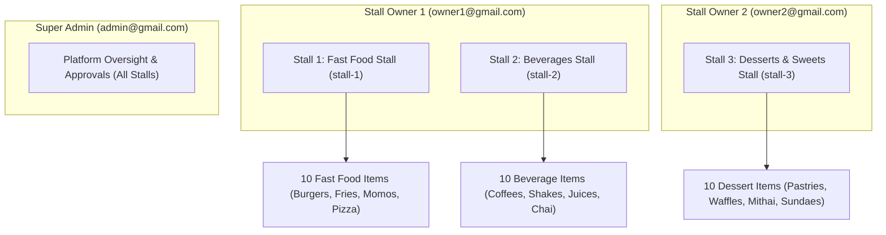
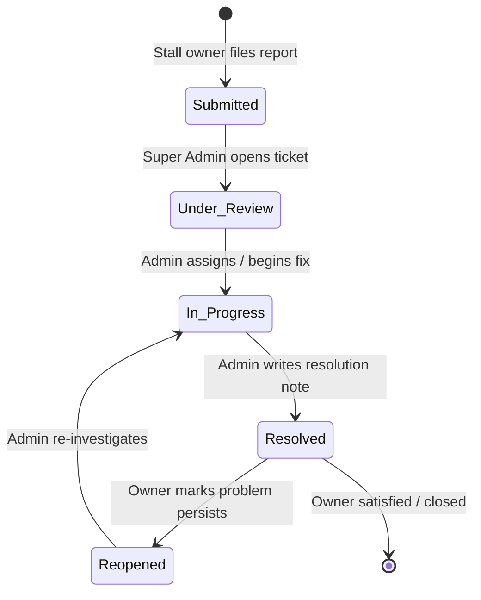

# FoodDesk — Comprehensive Frontend Implementation Plan
*Manage Smart. Serve Fast.*  
**"The Smarter Way to Manage Every Order."**

---

## 1. Executive Summary & Controlling Specification

This document is the **controlling specification** for the frontend development phase of **FoodDesk**.

### Core Architecture & Operating Principles
* **Frontend Only Prototype**: Built with **React 18 + Vite**, **Tailwind CSS**, **React Router v6**, **Lucide React**, **Recharts**, and **React Context API**.
* **Zero Backend Code During This Phase**: No Node.js Express server, no MongoDB database, no real payment gateway or SMS APIs.
* **Realistic Simulation Layer**: Local mock services backed by `localStorage` handle authentication, atomic order numbering, historical snapshots, P&L aggregation, status transitions, and support ticket management.
* **Owner-Assisted Walk-In Rule**: No customer-facing ordering, cart, or delivery checkout. All orders originate from the stall owner or counter staff via the POS.
* **Login as Default Entry Point**: When opening the application, unauthenticated users are directed to `/login`. Direct entry to any protected dashboard is strictly guarded. Public customer pages (`/menu/:stallSlug` and `/track/:stallSlug/:orderNumber`) remain freely accessible without login.

---

## 2. Demo Stalls & Centralized Seed Data Specification

The prototype is initialized with **3 distinct demo stalls** and **30 unique menu items**:



### 2.1. Stall 1: Fast Food Stall (`stall-1`)
* **Owner**: `owner_1` (`owner1@gmail.com`)
* **Category**: Fast Food & Snacks
* **Status**: `active` (Approved)
* **10 Menu Items**:
  1. *Veg Burger* — ₹70 (Cost: ₹35) | Fast Food | Available
  2. *Cheese Burger* — ₹95 (Cost: ₹50) | Fast Food | Available
  3. *Chicken Burger* — ₹130 (Cost: ₹70) | Fast Food | Available
  4. *Veg Sandwich* — ₹60 (Cost: ₹30) | Fast Food | Available
  5. *Grilled Sandwich* — ₹90 (Cost: ₹45) | Fast Food | Available
  6. *French Fries* — ₹70 (Cost: ₹30) | Fast Food | Available
  7. *Peri Peri Fries* — ₹85 (Cost: ₹38) | Fast Food | Available
  8. *Veg Momos (6 pcs)* — ₹80 (Cost: ₹35) | Momos | Available
  9. *Chicken Momos (6 pcs)* — ₹110 (Cost: ₹55) | Momos | Available
  10. *Pizza Slice (Farmhouse)* — ₹120 (Cost: ₹60) | Pizza | **Sold Out / Unavailable**

### 2.2. Stall 2: Beverages Stall (`stall-2`)
* **Owner**: `owner_1` (`owner1@gmail.com`) — *Same owner as Stall 1 to demonstrate multi-stall switching*
* **Category**: Shakes, Teas & Cold Beverages
* **Status**: `active` (Approved)
* **10 Menu Items**:
  1. *Cold Coffee* — ₹80 (Cost: ₹35) | Cold Beverages | Available
  2. *Hot Coffee* — ₹50 (Cost: ₹20) | Hot Beverages | Available
  3. *Chocolate Milkshake* — ₹110 (Cost: ₹50) | Shakes | Available
  4. *Vanilla Milkshake* — ₹95 (Cost: ₹42) | Shakes | Available
  5. *Oreo Shake* — ₹125 (Cost: ₹60) | Shakes | Available
  6. *Mango Shake* — ₹105 (Cost: ₹48) | Shakes | Available
  7. *Fresh Lime Soda* — ₹50 (Cost: ₹18) | Refreshers | Available
  8. *Lemon Iced Tea* — ₹65 (Cost: ₹25) | Refreshers | Available
  9. *Watermelon Juice* — ₹70 (Cost: ₹30) | Fresh Juices | Available
  10. *Masala Chai* — ₹25 (Cost: ₹10) | Hot Beverages | Available

### 2.3. Stall 3: Desserts & Sweets Stall (`stall-3`)
* **Owner**: `owner_2` (`owner2@gmail.com`) — *Isolated to Owner 2 only*
* **Category**: Bakery, Sweets & Ice Creams
* **Status**: `active` (Approved)
* **10 Menu Items**:
  1. *Chocolate Brownie* — ₹90 (Cost: ₹45) | Pastries | Available
  2. *Chocolate Pastry* — ₹75 (Cost: ₹35) | Pastries | Available
  3. *Black Forest Pastry* — ₹85 (Cost: ₹40) | Pastries | Available
  4. *Red Velvet Pastry* — ₹100 (Cost: ₹50) | Pastries | Available
  5. *Chocolate Waffle* — ₹130 (Cost: ₹65) | Waffles | Available
  6. *Classic Belgian Waffle* — ₹110 (Cost: ₹55) | Waffles | Available
  7. *Gulab Jamun (2 pcs)* — ₹50 (Cost: ₹22) | Traditional | Available
  8. *Rasmalai (2 pcs)* — ₹80 (Cost: ₹40) | Traditional | Available
  9. *Cheesecake Slice* — ₹150 (Cost: ₹75) | Gourmet | Available
  10. *Ice Cream Sundae* — ₹120 (Cost: ₹55) | Ice Creams | **Sold Out / Unavailable**

---

## 3. Authentication & Strict Access Control

### 3.1. Dual Login Modes & 3-Credential Stall Owner Validation

```
[Login Screen - Default Entry Point at /login]
         │
         ├── Mode A: Stall Owner Login (Default)
         │     ├── 1. Registered Email (e.g. owner1@gmail.com)
         │     ├── 2. Password (e.g. owner1)
         │     └── 3. Unique Stall ID (e.g. stall-1 or stall-2)
         │     └── Validation: All 3 credentials MUST match an authorized stall owned by that user.
         │     └── Failure: Clear non-revealing error ("Invalid credentials or unauthorized stall access").
         │
         └── Mode B: Super Admin Login (Toggle)
               ├── 1. Admin Email (admin@gmail.com)
               ├── 2. Admin Password (admin)
               └── No Stall ID required (Super Admin oversees the entire platform).
```

### 3.2. Demo Accounts & Authorization Matrix

| Role | Name | Email | Password | Required Stall ID | Accessible Dashboard |
| :--- | :--- | :--- | :--- | :--- | :--- |
| **Super Admin** | `admin` | `admin@gmail.com` | `admin` | *(None)* | `/admin/dashboard` (Platform Overview) |
| **Stall Owner 1** | `owner_1` | `owner1@gmail.com` | `owner1` | `stall-1` OR `stall-2` | `/dashboard` (Scoped to selected stall) |
| **Stall Owner 2** | `owner_2` | `owner2@gmail.com` | `owner2` | `stall-3` strictly | `/dashboard` (Scoped to `stall-3`) |

### 3.3. Strict Multi-Tenant Isolation & Stall Switcher Rules
1. **Multi-Stall Switcher**:
   - Only displayed for owners authorized for $> 1$ stall (Owner 1 sees a topbar dropdown to switch between `stall-1` Fast Food and `stall-2` Beverages).
   - Hidden for single-stall owners (Owner 2 sees a static badge for `stall-3` Desserts & Sweets).
   - Never displays stalls belonging to other owners.
2. **URL Manipulation Protection**:
   - If Owner 2 attempts to navigate to a URL referencing `stall-1` or `stall-2`, or if an owner modifies local storage or parameters, the frontend `StallGuard` intercepts the action, reverts the active stall to their authorized stall, and triggers a warning toast.
3. **Route Guards**:
   - Unauthenticated visitors hitting `/dashboard`, `/pos`, `/orders`, `/admin/*`, etc., are redirected to `/login`.
   - Stall Owners attempting to access `/admin/*` are blocked with an "Access Denied" screen and redirected back to `/dashboard`.
   - Super Admin has their own dedicated portal (`/admin/dashboard`).

---

## 4. Strict Dashboard & Navigation Separation

### 4.1. Completely Separate Dashboards
* **Super Admin Dashboard (`/admin/dashboard`)**: Platform-wide metrics (total stalls, active vs pending, platform GMV, system logs, stall approval pipeline, owner registry, and multi-stall issue management).
* **Fast Food Stall Dashboard (`stall-1`)**: Operates strictly on Fast Food orders, menu, inventory, expenses, and P&L.
* **Beverages Stall Dashboard (`stall-2`)**: Operates strictly on Beverages data.
* **Desserts & Sweets Stall Dashboard (`stall-3`)**: Operates strictly on Desserts data.

### 4.2. Completely Separate Navigation Bars (Never Mixed)

```
┌──────────────────────────────────────┐     ┌──────────────────────────────────────┐
│        STALL OWNER SIDEBAR           │     │         SUPER ADMIN SIDEBAR          │
├──────────────────────────────────────┤     ├──────────────────────────────────────┤
│ • Dashboard                          │     │ • Admin Dashboard                    │
│ • POS / New Order                    │     │ • Stall Approvals                    │
│ • Order History                      │     │ • Owner Management                   │
│ • Kitchen Display (KDS)              │     │ • Issue / Support Management         │
│ • Menu Management                    │     │ • Platform Settings                  │
│ • Expenses                           │     └──────────────────────────────────────┘
│ • Financial Analytics                │
│ • Inventory                          │
│ • Report an Issue                    │
│ • Stall Settings                     │
└──────────────────────────────────────┘
```
*Stall owner dashboards will never display Super Admin links, and Super Admin dashboard will not display counter POS links.*

---

## 5. Issue Reporting & Support Workflow Lifecycle

### 5.1. Stall Owner Issue Desk (`/support`)
Owners can submit technical, billing, POS, or operational issues to the Super Admin:
* **Submission Form**:
  - Issue Title (e.g., "Thermal printer alignment issue on Order #ORD-20261113-0004")
  - Category: `Website Bug`, `POS Error`, `Billing / Payment Discrepancy`, `Hardware / Printer`, `Other`
  - Priority: `Low`, `Medium`, `High`, `Critical`
  - Detailed Description
  - Automatically tags the ticket with `ownerId` and `stallId`.
* **Issue History & Status Tracking**:
  - Owners see only tickets submitted for their active stall.
  - View full conversation thread and Super Admin resolution notes.
  - **Reopen Feature**: If a resolved issue recurs or is unsatisfied, the owner can click **"Reopen Issue"** with follow-up comments.

### 5.2. Ticket State Machine


### 5.3. Super Admin Issue Management (`/admin/tickets`)
* Centralized inbox listing tickets from all stalls.
* Filters by Stall (`Fast Food`, `Beverages`, `Desserts`), Category, Priority, and Status.
* Inspect ticket details, view reporting stall and owner contact.
* Dispatch resolution replies and transition statuses.

---

## 6. Detailed Incremental Development Checklist

```markdown
### Incremental Development Status Board

- [x] **Module 1: Project Foundation & Layout Scaffold** (COMPLETED & VERIFIED)
  - [x] React 18 + Vite setup with Tailwind CSS, Lucide React, and `@` path alias
  - [x] Deep navy & primary orange branding system
  - [x] Native HTML5 Web Audio API synthesizer for zero-latency counter chimes
  - [x] Responsive layout shell, navbar, and mobile navigation drawer
  - [x] Post-review polish: Fixed hero button, explicit sample data labels, verified all 17 routes

- [ ] **Module 2: Seed Data, Storage Engine & 3-Credential Demo Authentication** (NEXT)
  - [ ] Implement `storageService` with automatic schema initialization in `localStorage`
  - [ ] Create centralized seed datasets for 3 stalls, 2 owners, 1 admin, 30 menu items, initial orders/expenses/tickets
  - [ ] Implement `mockAuthService`:
    - [ ] Mode A: Stall Owner login requiring Email + Password + Stall ID (all 3 must match)
    - [ ] Mode B: Super Admin login requiring Email + Password (no Stall ID)
    - [ ] Non-revealing error messages on mismatched credentials
  - [ ] Implement `AuthContext` with session persistence in `localStorage`
  - [ ] Make `/login` the default entry point (`/` redirects to `/login` when unauthenticated)
  - [ ] Build `AuthGuard` preventing unauthenticated access to dashboards
  - [ ] Build `RoleGuard` separating Stall Owner and Super Admin dashboards
  - [ ] Implement strict Sidebar navigation separation (Stall Owner vs Super Admin)

- [ ] **Module 3: Multi-Stall Switcher & Data Isolation Guards**
  - [ ] Implement `StallContext` with active stall selection
  - [ ] Build topbar Stall Switcher (enabled for Owner 1 between `stall-1` & `stall-2`; hidden for Owner 2)
  - [ ] Build `StallGuard` enforcing strict tenant isolation (Owner 2 cannot access `stall-1` or `stall-2`)
  - [ ] Verify stall switching instantly reloads stall-specific state across all modules

- [ ] **Module 4: POS Workstation & Atomic Order Numbering Engine**
  - [ ] Responsive POS interface (category pills, instant search, menu grid with photos)
  - [ ] Sold-out indicator (unavailable items cannot be added)
  - [ ] Interactive Cart Sidebar (quantity controls, remove item, subtotal, discount tool, grand total)
  - [ ] Atomic daily order numbering simulation (`ORD-YYYYMMDD-0001` per stall)
  - [ ] Pickup token generation and deep historical snapshot preservation

- [ ] **Module 5: Multi-Tier Payment Simulation & Digital Thermal Receipts**
  - [ ] Payment Selection Modal with clear `[DEMO PAYMENT]` indicator
  - [ ] Dynamic UPI QR simulation (with Simulate Success and Simulate Failure)
  - [ ] Static UPI QR simulation (with 12-digit mock UTR entry and verification audit)
  - [ ] Cash Payment simulation (with cash received and change-to-return calculator)
  - [ ] Digital Thermal Receipt view with printable styling and client-side PDF download (`jspdf`)

- [ ] **Module 6: Kitchen Display System (KDS)**
  - [ ] 4-column KDS kanban board (New, Preparing, Ready, Completed)
  - [ ] Large token badges, order numbers, items, quantities, and elapsed time timers
  - [ ] 1-click status transitions with simulated live updates across the application

- [ ] **Module 7: Order Management Hub**
  - [ ] Filterable order history table scoped to the active stall
  - [ ] Search by order number and customer mobile number
  - [ ] Filters for date ranges, payment status, and order status
  - [ ] Order Details Drawer showing full item snapshots, payment audits, and timeline
  - [ ] Simulated Order Cancellation and Refund actions

- [ ] **Module 8: Menu & Category Management (Historical Protection)**
  - [ ] Menu Management page with category filters and search
  - [ ] Add/Edit Food Item modal (name, category, selling price, cost price, description, image)
  - [ ] Availability toggle (instant sold-out flag)
  - [ ] Soft-delete / archive mechanism preserving historical orders

- [ ] **Module 9: Expense Management & Basic Inventory**
  - [ ] Expense Management module with category categorization (Raw Materials, Gas, Salaries, etc.)
  - [ ] Basic Inventory module with stock quantities, minimum thresholds, and low-stock alerts
  - [ ] Wastage logging

- [ ] **Module 10: Stall Owner Dashboard & Financial Analytics Engine**
  - [ ] Strict financial formulas (Gross Sales, Net Revenue, COGS, Gross Profit, Net Profit)
  - [ ] Dynamic KPI cards calculated from real orders and expenses
  - [ ] Interactive Recharts (Sales Trends area chart, Payment Method pie chart, Top 5 items)
  - [ ] Working date range filters (Today, Yesterday, Week, Month, Year, Custom)
  - [ ] CSV and printable financial report exports

- [ ] **Module 11: Super Admin Platform & Enhanced Issue Desk**
  - [ ] Super Admin Dashboard showing platform-wide stats across all stalls
  - [ ] Stall Management pipeline (view stall profiles, Approve, Reject with reason modal, Suspend, Reactivate)
  - [ ] Owner Management table
  - [ ] Issue / Support Management inbox (view tickets from all stalls, filter by stall/status, reply, resolve)
  - [ ] Stall Owner "Report an Issue" interface with 5 statuses (`Submitted`, `Under Review`, `In Progress`, `Resolved`, `Reopened`)
  - [ ] Reset Demo Data feature to restore factory seed state at any time

- [ ] **Module 12: Public Customer Experience (Strictly Read-Only)**
  - [ ] Public Digital Menu (`/menu/:stallSlug`) for walk-in counter browsing (no cart, no checkout)
  - [ ] Public Order Tracking Page (`/track/:stallSlug/:orderNumber`) with live preparation timeline
  - [ ] Verified accessible without requiring login

- [ ] **Module 13: End-to-End Verification, Responsive Polish & Final Audit**
  - [ ] Comprehensive verification of all 3 user accounts, all 3 stalls, and both login modes
  - [ ] Verify zero console errors, zero layout overflows, and complete `localStorage` persistence
  - [ ] Complete final acceptance checklist walkthrough
```

---

*This specification is finalized and serves as the controlling guideline.*
