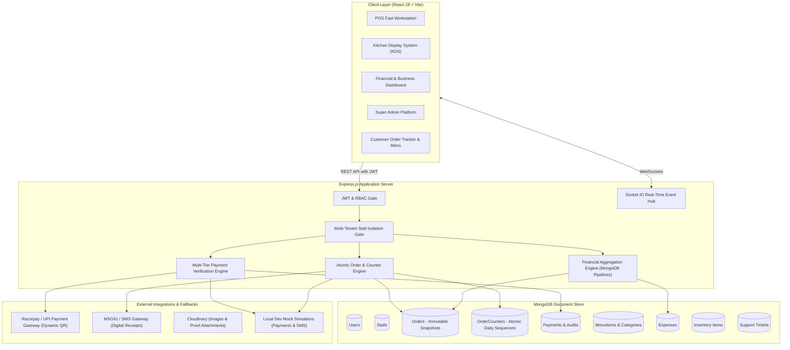
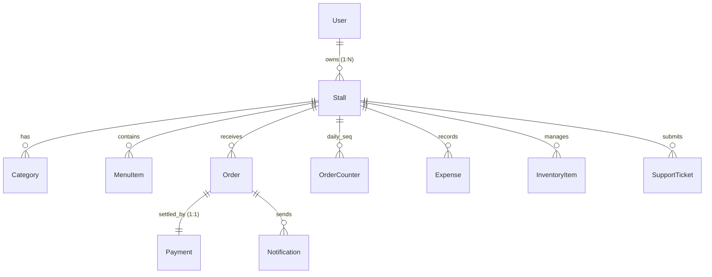
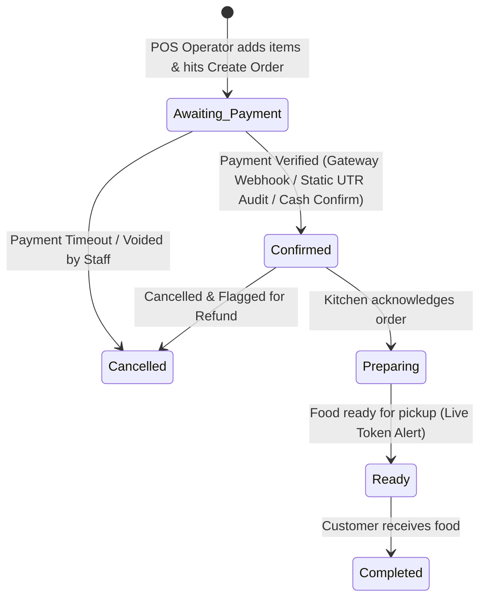
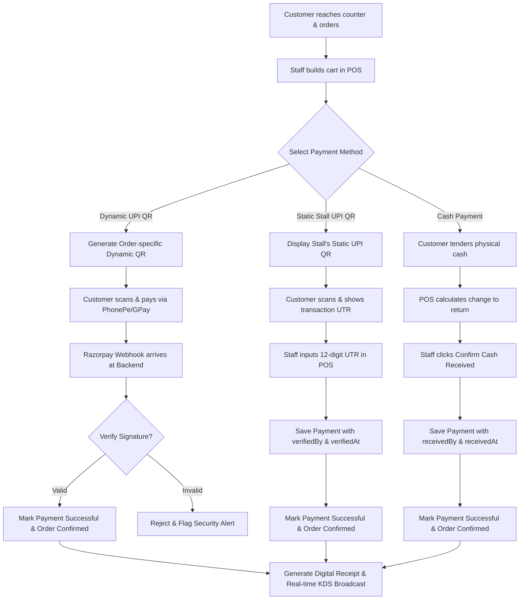

# FoodDesk — Comprehensive Implementation Plan & Technical Architecture
*Manage Smart. Serve Fast.*

---

## 1. System Overview & Core Principles

FoodDesk is a multi-tenant Point of Sale (POS), billing, payment tracking, and financial analytics platform engineered specifically for walk-in food stalls, kiosks, and quick-service food shops. It replaces paper notebooks and manual bookkeeping with a resilient, auditable digital workflow.

### Non-Negotiable Core Rules
1. **Owner-Assisted Walk-In Only**: Customers **never** place, customize, or submit orders via their own devices. All orders are entered into the POS by the stall owner or counter staff. Customers interact with the platform strictly to **pay (via QR/UPI/Cash)**, **receive digital receipts**, and **track order preparation status via live token display or tracking link**.
2. **Strict Multi-Tenant Isolation**: Every database collection containing operational data is scoped by `stallId`. Middleware enforces that an authenticated stall owner can only access stalls they explicitly own and that have been **approved and activated by the Super Admin**.
3. **Decoupled Verification vs. Approval**: Account verification (email/phone) and Stall Approval are distinct lifecycle states. A verified account cannot operate POS or view business reports until the Super Admin approves the stall profile. Multiple stalls can be created under one owner, each undergoing independent review.
4. **Historical Immutability**: All menu items ordered are stored as deep historical snapshots inside each order record (name, selling price, cost price, category, quantity). Editing prices or deleting/archiving menu items will **never** alter historical orders, receipts, or COGS calculations.
5. **Zero Floating-Point Financials**: All monetary amounts across the backend, database, and calculations are stored as **integer paise** (₹1 = 100 paise) to eliminate JavaScript floating-point rounding errors.
6. **Atomic Race-Condition-Free Daily Order Numbers**: Order numbers follow `ORD-YYYYMMDD-0001` format and reset to `0001` daily per stall. Sequence increments use atomic MongoDB counter updates with compound unique indexes to guarantee zero collisions even during simultaneous peak-hour orders.

---

## 2. High-Level System Architecture



---

## 3. Modular Directory Structure

```
FoodDesk/
├── backend/
│   ├── config/
│   │   ├── db.js                 # MongoDB connection & index sync
│   │   ├── socket.js             # Socket.IO initialization & room handlers
│   │   └── constants.js          # App constants (order statuses, roles, paise multipliers)
│   ├── controllers/
│   │   ├── authController.js     # Register, login, verify, password reset
│   │   ├── stallController.js    # Onboarding, profile CRUD, admin approvals
│   │   ├── menuController.js     # Categories, menu items (with soft-delete/archival)
│   │   ├── orderController.js    # POS order creation (atomic numbering), status transitions
│   │   ├── paymentController.js  # Gateway orders, webhooks, static UPI verify, cash confirm
│   │   ├── expenseController.js  # Expense tracking & category breakdown
│   │   ├── analyticsController.js# Aggregated P&L, sales trends, COGS, CSV/PDF reports
│   │   ├── inventoryController.js# Stock levels, adjustments, low-stock notifications
│   │   ├── adminController.js    # Super Admin platform metrics, stall approvals, audit logs
│   │   └── supportController.js  # Support tickets & resolution communication
│   ├── middleware/
│   │   ├── authMiddleware.js     # JWT token validation & user injection
│   │   ├── roleMiddleware.js     # Super Admin / Stall Owner permission enforcement
│   │   ├── tenantMiddleware.js   # Stall-ownership & Active status verification
│   │   ├── validateMiddleware.js # Express-validator request schema checks
│   │   └── errorMiddleware.js    # Centralized error handler & status mapper
│   ├── models/
│   │   ├── User.js               # Users (SuperAdmin, StallOwner, Customer)
│   │   ├── Stall.js              # Stall profile, status, UPI settings, operating hours
│   │   ├── Category.js           # Food categories per stall
│   │   ├── MenuItem.js           # Menu items with selling & cost prices
│   │   ├── Order.js              # Historical snapshot orders, token numbers, line items
│   │   ├── OrderCounter.js       # Atomic daily sequence tracker per stall
│   │   ├── Payment.js            # Transaction audit, gateway logs, manual verification
│   │   ├── Expense.js            # Operating expenses per stall
│   │   ├── InventoryItem.js      # Raw ingredient tracking & alerts
│   │   ├── Notification.js       # SMS/WhatsApp delivery audit & retry logs
│   │   ├── SupportTicket.js      # Support issues & communication trail
│   │   └── AuditLog.js           # Security and payment manual action logs
│   ├── routes/
│   │   ├── authRoutes.js
│   │   ├── stallRoutes.js
│   │   ├── menuRoutes.js
│   │   ├── orderRoutes.js
│   │   ├── paymentRoutes.js
│   │   ├── expenseRoutes.js
│   │   ├── analyticsRoutes.js
│   │   ├── inventoryRoutes.js
│   │   ├── adminRoutes.js
│   │   └── supportRoutes.js
│   ├── services/
│   │   ├── paymentService.js     # Razorpay API client + mock payment gateway
│   │   ├── smsService.js         # SMS gateway integration + mock logger
│   │   ├── receiptPdfService.js  # PDF receipt builder
│   │   └── counterService.js     # Atomic order sequence generator
│   ├── utils/
│   │   ├── dateUtils.js          # Asia/Kolkata boundary calculators
│   │   └── currencyUtils.js      # Paise <-> Rupee conversions & formatters
│   ├── seeds/
│   │   └── seedDatabase.js       # Comprehensive multi-stall seed data
│   ├── .env.example
│   ├── package.json
│   └── server.js                 # App entry point
│
├── frontend/
│   ├── public/
│   │   ├── favicon.svg
│   │   └── sounds/               # Audio alerts for new orders & payment confirmation
│   ├── src/
│   │   ├── api/
│   │   │   ├── axiosClient.js    # Axios interceptors with auto token injection
│   │   │   ├── authApi.js
│   │   │   ├── stallApi.js
│   │   │   ├── menuApi.js
│   │   │   ├── orderApi.js
│   │   │   ├── paymentApi.js
│   │   │   ├── expenseApi.js
│   │   │   ├── analyticsApi.js
│   │   │   ├── inventoryApi.js
│   │   │   └── adminApi.js
│   │   ├── components/
│   │   │   ├── common/           # Button, Modal, Card, Input, Badge, Table, SkeletonLoader
│   │   │   ├── layout/           # Navbar, Sidebar, StallSwitcher, Header, Footer
│   │   │   ├── pos/              # MenuGrid, ItemCard, CartSidebar, CustomerPhoneModal
│   │   │   ├── payment/          # DynamicQRModal, StaticQRVerifyModal, CashConfirmModal
│   │   │   ├── receipt/          # ReceiptPreviewModal, PrintableReceipt
│   │   │   ├── kds/              # KitchenOrderCard, TokenDisplayBoard
│   │   │   └── analytics/        # SalesChart, PaymentPieChart, ProfitLossCard, ExportButtons
│   │   ├── context/
│   │   │   ├── AuthContext.jsx   # Login user, tokens, roles
│   │   │   ├── StallContext.jsx  # Active selected stall profile & permissions
│   │   │   ├── CartContext.jsx   # POS active cart, subtotal, discount, customer mobile
│   │   │   └── SocketContext.jsx # Real-time event listeners & emitter
│   │   ├── pages/
│   │   │   ├── auth/             # Login, Register, ForgotPassword, VerifyAccount
│   │   │   ├── onboarding/       # CreateStallProfile, PendingApprovalNotice
│   │   │   ├── dashboard/        # Stall Dashboard (KPIs, recent orders, fast stats)
│   │   │   ├── pos/              # Fullscreen POS Workstation
│   │   │   ├── orders/           # Order List, Search, Status Management, Filter Drawer
│   │   │   ├── kds/              # Kitchen Display System view
│   │   │   ├── menu/             # Menu & Category Management
│   │   │   ├── expenses/         # Expense Tracker & Entry Form
│   │   │   ├── analytics/        # Financial & Sales Analytics Hub
│   │   │   ├── inventory/        # Stock Management & Wastage Logging
│   │   │   ├── support/          # Support Ticket Submission & History
│   │   │   ├── admin/            # Super Admin (Stalls Review, System Metrics, All Tickets)
│   │   │   └── public/           # Customer Public Order Tracker & Digital Menu
│   │   ├── routes/
│   │   │   ├── AppRoutes.jsx     # Route switch & lazy loaded pages
│   │   │   └── ProtectedRoute.jsx# Role & stall-approval guards
│   │   ├── utils/
│   │   │   ├── formatters.js     # Currency (₹), date/time (Kolkata), mobile masking
│   │   │   └── soundEffects.js   # Web Audio alerts
│   │   ├── App.jsx
│   │   ├── index.css
│   │   └── main.jsx
│   ├── index.html
│   ├── tailwind.config.js
│   ├── vite.config.js
│   └── package.json
└── README.md
```

---

## 4. Database Schema Specifications (MongoDB & Mongoose)



### 4.1. Key Collections Detail
* **Users**: Stores credentials, role (`super_admin`, `stall_owner`, `customer`), and verification flags.
* **Stalls**: Scoped by `ownerId`. Contains name, slug, address, operating hours, payment configuration (UPI ID, static QR image, gateway preferences), and approval status (`pending_approval`, `active`, `inactive`, `suspended`).
* **OrderCounters**: Compound unique index `{ stallId: 1, dateString: 1 }`. Stores atomic daily sequence `seq`.
* **Orders**: Stores `orderNumber` (`ORD-YYYYMMDD-0001`), `dailyTokenNumber`, `orderStatus`, `paymentStatus`, and an **immutable items array**:
  - `name`, `category`, `sellingPrice` (in paise), `costPrice` (in paise), `quantity`, `itemTotal`.
  - Financials: `subtotal`, `discountAmount`, `grandTotal`, `totalCostOfGoodsSold`.
  - Compound unique index: `{ stallId: 1, orderNumber: 1 }`.
* **Payments**: Linked 1:1 with Order. Records `amount` (in paise), `paymentMethod` (`upi_gateway`, `upi_static_qr`, `cash`), and strict audit verification:
  - Gateway: transaction IDs, signature, webhook payloads.
  - Static UPI QR: UTR / Reference number, `verifiedBy`, `verifiedAt`.
  - Cash: `receivedBy`, `receivedAt`.
* **MenuItems**: Selling price, cost price, category, availability flag, and `isArchived` flag (soft delete to preserve historical integrity).
* **Expenses**: Category (`raw_materials`, `gas`, `electricity`, `salaries`, `packaging`, `transportation`, `maintenance`, `other`), `amount` (in paise), `date`, and optional invoice attachment.
* **SupportTickets**: Issues submitted by stall owners to the Super Admin with message thread and resolution tracking.

---

## 5. Order Lifecycle & Atomic Numbering Strategy

### 5.1. Order & Payment State Machine



### 5.2. Atomic Zero-Collision Order Sequence
To prevent duplicate order numbers during rush hours, sequence generation is handled via an atomic `$inc` operation:
```javascript
// counterService.js
const kolkataDateStr = new Intl.DateTimeFormat('en-CA', {
  timeZone: 'Asia/Kolkata',
  year: 'numeric',
  month: '2-digit',
  day: '2-digit'
}).format(new Date()).replace(/-/g, ''); // "20261112"

const counter = await OrderCounter.findOneAndUpdate(
  { stallId, dateString: kolkataDateStr },
  { $inc: { seq: 1 } },
  { new: true, upsert: true }
);

const orderNumber = `ORD-${kolkataDateStr}-${String(counter.seq).padStart(4, '0')}`;
const dailyTokenNumber = counter.seq;
```

---

## 6. Financial Calculation Rules & Aggregations

All calculations strictly adhere to the PRD formulas and are executed inside MongoDB aggregation pipelines using integer paise:

$$\text{Gross Sales} = \sum (\text{Grand Total of Confirmed/Completed Orders before discounts})$$

$$\text{Net Revenue} = \text{Gross Sales} - \text{Discounts} - \text{Refunds}$$

$$\text{COGS} = \sum (\text{Historical Cost Price} \times \text{Quantity})$$

$$\text{Gross Profit} = \text{Net Revenue} - \text{COGS}$$

$$\text{Net Profit} = \text{Gross Profit} - \text{Other Recorded Business Expenses}$$

### Integrity Protections:
- Unpaid, pending, and cancelled orders are excluded from revenue.
- Confirmed cash payments are included in revenue; pending cash payments are excluded.
- Historical cost prices inside `order.items` remain untouched forever, even if the menu item's cost price is updated later.

---

## 7. Multi-Tier Payment Verification Workflow



---

## 8. Digital Receipts & Notifications

### Receipt Data Contract:
- Stall branding (Name, Logo, Address, Contact, UPI ID).
- Order Number & Daily Token Number (e.g., `#12`).
- Formatted Date & Time in Asia/Kolkata timezone.
- Masked Customer Mobile Number (`+91 98765*****`).
- Line items with snapshot unit price, quantity, and subtotal.
- Subtotal, Discounts, Net Amount Paid.
- Payment method & verification reference (UTR / Gateway ID).
- Dynamic QR code linking directly to public live tracking URL.

### Delivery Options:
1. **In-browser print / thermal receipt download** (58mm/80mm format via jsPDF).
2. **SMS Delivery via MSG91** (with automatic local mock logging when API key is not configured).
3. **WhatsApp Notification API** (optional template message with receipt link).

---

## 9. Phased Development Roadmap

### Phase 1: Environment & Foundation
- Setup Node.js runtime environment.
- Initialize backend project (Express, Mongoose, Socket.IO, CORS, Helmet).
- Configure MongoDB connection and schema definitions with compound unique indexes.
- Implement JWT authentication, bcrypt password hashing, and role-based middleware (`authMiddleware`, `roleMiddleware`, `tenantMiddleware`).

### Phase 2: POS Engine & Atomic Daily Order Counter
- Implement Category & MenuItem CRUD with soft-deletion and cost-price tracking.
- Build the atomic counter service (`ORD-YYYYMMDD-0001` per stall).
- Implement order creation with historical snapshot prices and line totals.
- Establish Socket.IO rooms (`room:stall_${stallId}`, `room:kds_${stallId}`) for live event broadcasting.

### Phase 3: Multi-Tier Payment Gateway & Auditing
- Implement Razorpay gateway integration for dynamic order-specific UPI QR generation.
- Implement secure webhook handler with HMAC signature validation.
- Build manual verification routes for static UPI QR payments (recording UTR, timestamp, user ID).
- Build cash payment confirmation route with change calculation and audit trail.
- Provide a clear, toggleable Local Mock Payment mode for zero-credential testing.

### Phase 4: Receipts, KDS, & Customer Public Tracking
- Implement digital receipt generation (web view + printable PDF receipt).
- Build the Kitchen Display System (KDS) with columns for New, Preparing, and Ready orders.
- Implement public order tracking page (`/track/:stallSlug/:orderNumber`) with live status refresh.
- Integrate SMS notification adapter with delivery retry queue and mock fallback.

### Phase 5: Financial Analytics & Aggregation Engine
- Build MongoDB aggregation pipelines for daily, weekly, monthly, and yearly P&L reports.
- Implement Gross Sales, Net Revenue, COGS, Gross Profit, and Net Profit calculations.
- Build Expense Management module (categories, attachments, timestamps).
- Add CSV and PDF export capability for financial reports.

### Phase 6: Frontend POS Workstation (React + Vite + Tailwind)
- Scaffold modern frontend with Tailwind CSS and consistent SaaS color palette.
- Implement Auth and Stall Onboarding flows (register, pending approval screen, stall switcher).
- Build high-speed POS workstation:
  - Sticky category tabs & instant search.
  - Responsive menu item grid with photos and availability status.
  - Interactive order cart with quantity adjustments, discount toggle, and customer mobile input.
  - Multi-tier payment modal (Dynamic QR, Static QR with UTR input, Cash change calculator).
- Build analytics dashboards with Recharts (sales trends, payment method breakdown, top-selling items).

### Phase 7: Super Admin Platform & Support Hub
- Build Super Admin dashboard: platform metrics, active stall counter, total processed revenue.
- Implement Stall Approval pipeline: review submitted profiles, Approve, Reject (with reason), or Suspend.
- Build Support Desk: stall owners create tickets, Super Admin replies, status tracking (`Open`, `In Progress`, `Resolved`).

### Phase 8: Seed Data, Testing & Verification
- Create comprehensive seed script with Super Admin, 2 independent Stall Owners, categories, menu items, orders, expenses, and inventory.
- Verify strict tenant isolation: verify Stall A cannot view Stall B's orders, payments, or analytics.
- Conduct end-to-end user journeys: Walk-in Order -> Payment Verification -> Digital Receipt -> KDS Status Update -> Customer Tracker -> Financial Report reconciliation.

---

## 10. Technical Questions & Design Decisions

### 1. Frontend State Management
* **Selected Architecture**: **React Context API with modular custom hooks** (`useAuth`, `useActiveStall`, `useCart`).
* *Rationale*: Provides zero-overhead, clean state separation without Redux boilerplate, perfectly optimized for POS cart and multi-stall switching.

### 2. Node.js Environment
* Node.js is not yet added to the standard system PATH.
* When you approve the start of build, we will install Node.js LTS via `winget` (or link an existing installation) to run the backend and Vite development servers.

### 3. Payment & SMS Credentials
* We will implement the full, production-ready Razorpay and MSG91/SMS service adapters.
* Simultaneous local Mock Mode will be included so the complete end-to-end flow works seamlessly without requiring immediate live gateway KYC or credentials.

---

*This document is ready for your review and verification. Please let me know if you would like any modifications before we proceed to Phase 1.*

